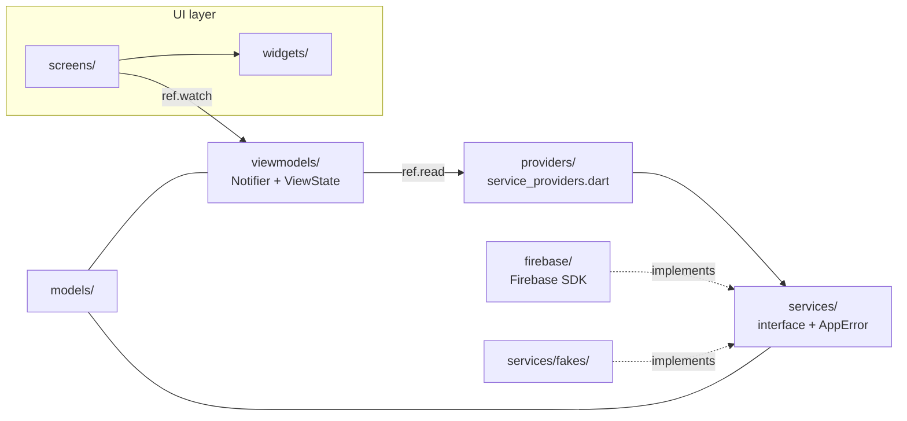
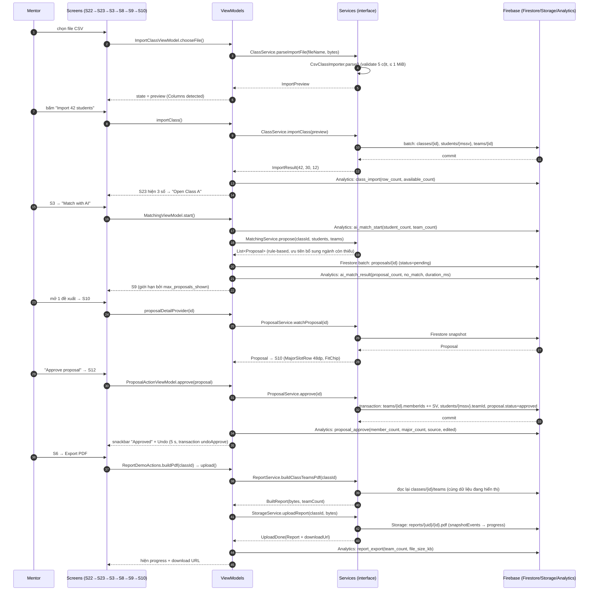

# Kiến trúc TeamUp EXE — MVVM + Riverpod + Firebase

> Tài liệu kiến trúc theo Lab 3 §5: cấu trúc thư mục, sơ đồ layer, một sơ đồ
> sequence cho một flow đầy đủ, và bảng ViewModel → Service.
> Các quyết định khung vẫn nằm ở [skeleton-decisions.md](skeleton-decisions.md) (D3–D6).

## 1. Mô hình

MVVM + Riverpod 3 (Notifier viết tay, không codegen).



Quy tắc bắt buộc (kiểm bằng `tool/check_layers.sh`, chạy trước mỗi PR):

| Quy tắc | Công cụ kiểm |
|---|---|
| `screens/` và `widgets/` **không** import Firebase SDK | `check "screens/widgets import Firebase"` |
| `viewmodels/` **không** import Firebase SDK | `check "viewmodels import Firebase"` |
| `viewmodels/` **không** import `screens/` hay `widgets/` | `check "viewmodels import screens/widgets"` |
| `screens/` **không** import `providers/` (chỉ qua ViewModel) | `check "screens/widgets import providers"` |
| `services/` và `models/` thuần Dart, không import UI | `check "services/models import Flutter UI"` |
| Màn không hard-code màu / cỡ chữ / padding | `check "screens hard-code …"` |

- **View** (`screens/`, `widgets/`): chỉ dựng UI từ `ViewState`, không gọi service
  trực tiếp. Nghiệp vụ (lọc, sắp xếp, tổng hợp, kiểm tra) **không** nằm trong
  `build()`.
- **ViewModel** (`viewmodels/`): mỗi màn một `Notifier`, giữ `ViewState<T>`
  (`Loading` / `Empty` / `Data<T>` / `Failure<T>` — `viewmodels/view_state.dart`).
  Chỉ import `providers/service_providers.dart` để lấy service.
- **Service** (`services/`): interface thuần Dart. Lỗi luôn là `AppError`.
- **Firebase** (`firebase/`): bản cài đặt thật. **Fake** (`services/fakes/`): chỉ
  nối trong `main_fake.dart` và test.

> `Ref` extension `InstrumentationRef` (`viewmodels/instrumentation.dart`) gom
> phần gọi Analytics/Crashlytics vào một chỗ để không lặp try/catch ở mọi
> ViewModel. Nó vẫn nằm đúng layer `viewmodels/`.

## 2. Cây thư mục

```text
lib/
├── main.dart            bản nộp: Firebase, Crashlytics, FCM nền
├── main_fake.dart       bản dev trên fake (không nộp)
├── app.dart             MaterialApp.router + theme
├── firebase_options.dart  sinh bởi flutterfire configure
├── models/              DTO thuần Dart: ClassRoom, Student, Team, Proposal, Report…
├── services/            interface + AppError + rule-based matching + csv importer
│   └── fakes/           bản giả lập cho test và main_fake.dart
├── firebase/            bản cài Firebase: auth, firestore, storage, fcm, analytics,
│                        crashlytics, remote config, pdf report service
├── providers/           service_providers.dart (nơi DUY NHẤT bind interface →
│                        implementation) + fake_overrides.dart
├── viewmodels/          Notifier theo từng miền: auth, classes, proposals,
│                        notifications, profile, config
├── screens/             theo flow: sign_in, my_classes, flow_a, flow_b, flow_c,
│                        profile, notifications, gallery
├── widgets/             thư viện component Lab 2 (AppButton, AppCard, MajorSlotRow,
│                        FitChip, TagChip, ErrorBanner, showConfirmDialog, StatusView…)
├── router/              routes.dart (hằng số route) + app_router.dart (go_router)
└── theme/               app_colors, app_typography, app_spacing, app_theme
firebase/                storage.rules, firestore.rules, indexes, remote-config-defaults.json
firebase.json  .firebaserc
tool/                    check_layers.sh, fixtures/ (CSV mẫu)
test/                    unit + widget test dùng fake service
e2e_test/                ARTEMIS pytest suite (Lab 3 §7)
docs/                    tài liệu Lab 3: design-traceability, architecture,
                         analytics-plan, test-plan, code-review
evidence/                ảnh console, DebugView, Crashlytics, ARTEMIS trace
report/  slides/         báo cáo PDF và slide PDF nộp
```

## 3. Điều hướng

`go_router` + `StatefulShellRoute.indexedStack`, 3 tab Classes / Proposals / Profile.
Hằng số route ở `lib/router/routes.dart` — màn điều hướng bằng helper
(`Routes.proposal(id)`), không dùng chuỗi thô, nên đổi tên route sẽ lỗi compile.
Redirect theo `sessionProvider`: chưa đăng nhập → `/sign-in`; đã đăng nhập →
`/classes`. Chạm thông báo FCM → `router.go(route)` **chỉ** khi route nằm trong
`Routes.isAllowedDeepLink()` (allow-list chống deep-link tới màn ngoài phạm vi).

## 4. ViewModel → Service

| Màn / Luồng | ViewModel | Service dùng | Nguồn dữ liệu thật |
|---|---|---|---|
| S1, S19 Sign in | `viewmodels/auth/sign_in_view_model.dart` → `SignInViewModel` | `AuthService`, `AnalyticsService`, `CrashService` | `FirebaseAuthService` (Google/email/phone) |
| (định tuyến) | `viewmodels/auth/session_view_model.dart` → `sessionProvider` | `AuthService`, `AnalyticsService`, `CrashService` | Firebase session + `users/{uid}` |
| S2 My classes | `viewmodels/classes/my_classes_view_model.dart` → `MyClassesViewModel` | `ClassService` | Firestore `classes` |
| S3, S23 Class detail | `viewmodels/classes/class_detail_view_model.dart` → `ClassDetailViewModel` | `ClassService`, `AnalyticsService` | Firestore `classes/{id}` |
| S4 No team | `viewmodels/classes/no_team_view_model.dart` → `NoTeamViewModel` | `ClassService` | Firestore `classes/{id}/students` |
| S5 Need members | `viewmodels/proposals/proposal_view_model.dart` → `proposalTeamsProvider` | `ProposalService`, `ClassService` | Firestore `classes/{id}/teams` |
| S7 Student detail | `viewmodels/classes/student_detail_view_model.dart` → `StudentDetailViewModel` | `ClassService`, `AnalyticsService` | Firestore `classes/{id}/students/{mssv}` |
| S8, S18 AI matching | `viewmodels/classes/matching_view_model.dart` → `MatchingViewModel` | `ClassService`, `MatchingService`, `ProposalService`, `AnalyticsService`, `CrashService` | Firestore + `RuleBasedMatchingService` |
| S9, S14 Proposals | `viewmodels/proposals/proposal_view_model.dart` → `visibleProposalsProvider`, `pendingProposalsProvider` | `ProposalService`, `ConfigService` | Firestore `collectionGroup('proposals')` + Remote Config |
| S10, S12, S13, S17, S20, S24, S25 Proposal detail | `viewmodels/proposals/proposal_view_model.dart` → `ProposalActionViewModel` | `ProposalService`, `AnalyticsService`, `CrashService` | Firestore transaction approve/undo/discard |
| S11 Add member | `viewmodels/proposals/proposal_view_model.dart` → `proposalStudentsProvider`, `ProposalActionViewModel` | `ClassService`, `ProposalService`, `AnalyticsService` | Firestore |
| S15 No match | `viewmodels/classes/matching_view_model.dart` (state `Empty`) | `MatchingService` | — |
| S16, S21 Add student | `viewmodels/proposals/proposal_view_model.dart` → `ProposalActionViewModel.createManual` | `ClassService`, `ProposalService`, `CrashService` | Firestore transaction |
| S22 Import class list | `viewmodels/classes/import_class_view_model.dart` → `ImportClassViewModel` | `ClassService`, `AnalyticsService`, `CrashService` | `CsvClassImporter` + Firestore batch |
| S23 Import result | `viewmodels/classes/import_class_view_model.dart` (`ImportClassState.result`) | `ClassService` | Firestore `classes/{id}` |
| S6 Profile | `viewmodels/profile/profile_view_model.dart` → `ProfileViewModel` | `AuthService`, `AnalyticsService`, `CrashService` | Firebase session |
| S6 demo: export PDF | `viewmodels/profile/report_demo_view_model.dart` → `ReportDemoActions` | `ReportService`, `StorageService`, `AnalyticsService`, `CrashService` | `pdf` package → Cloud Storage `reports/{uid}/…` |
| S6 demo: Remote Config | `viewmodels/config/app_config_view_model.dart`, `viewmodels/notifications/config_demo_view_model.dart` | `ConfigService` | Firebase Remote Config (realtime) |
| S6 demo: notification center | `viewmodels/notifications/inbox_view_model.dart`, `notification_taps_view_model.dart` | `NotificationService`, `NotificationStore` | Firestore `users/{uid}/notifications` + FCM |
| (toàn cục) | `viewmodels/instrumentation.dart` | `AnalyticsService`, `CrashService` | Firebase Analytics / Crashlytics |

## 5. Firebase

| Dịch vụ | Bản cài đặt | Trạng thái | Xử lý lỗi |
|---|---|---|---|
| Authentication (Google) | `firebase/firebase_auth_service.dart` | xong | `auth_error_mapper.dart` → `AppError`; hủy → `CancelledError` + thông báo. |
| Cloud Firestore | `firebase/firestore_class_service.dart`, `firestore_proposal_service.dart` | xong | `permission-denied` → `PermissionDeniedError`, `unavailable` → `NetworkError`, `deadline-exceeded` → `TimeoutAppError`. Duyệt nhóm dùng **transaction** (chống gán trùng SV). |
| Cloud Storage | `firebase/firebase_storage_service.dart` | xong | Đường dẫn theo user `reports/{uid}/{id}.pdf`; `storage.rules` chỉ cho `request.auth.uid == uid`; rủi ro thiếu `storage.rules` trong repo là điểm trừ. |
| Analytics | `firebase/firebase_analytics_service.dart` | xong | Gọi qua `trackAnalytics` (best effort), không chặn luồng. |
| Crashlytics | `firebase/firebase_crash_service.dart` + `main.dart` | xong | `FlutterError.onError` + `PlatformDispatcher.onError` cho fatal; `recordNonFatal` cho lỗi đã xử lý (import, AI timeout, upload). Custom key `role`, `class_id`. |
| Remote Config | `firebase/firebase_config_service.dart` | xong | Realtime `onConfigUpdated`; mặc định bundle `firebase/remote-config-defaults.json`; lỗi fetch → giữ giá trị cache/default. |
| FCM | `firebase/fcm_notification_service.dart`, `background_notification_handler.dart` | xong | Xử lý foreground/background/terminated; đăng ký token vào `users/{uid}/fcmTokens`; deep-link qua allow-list. |
| PDF generation | `firebase/pdf_report_service.dart` | xong | Sinh PDF từ **cùng** stream Firestore mà mentor đang xem → file phản ánh đúng màn hình. |

## 6. Sơ đồ sequence — Flow A đầy đủ (nhập lớp → AI ghép → duyệt → xuất PDF)



## 7. Quyết định thiết kế đáng ghi lại

| # | Quyết định | Lý do |
|---|---|---|
| D-a | `Notifier` viết tay thay vì `@riverpod` codegen | Không sinh code, review diff dễ, đủ cho 4 lớp; tránh phụ thuộc build_runner trong CI của trường. |
| D-b | `ViewState<T>` sealed thay vì `AsyncValue` | Bắt buộc rõ 4 trạng thái (loading/empty/data/error) như rubric Lab 3 §10 "explicit state model per screen"; `Empty` tách riêng khỏi `Data([])`. |
| D-c | Service interface thuần Dart + fake trong `services/fakes/` | ViewModel test được với fake, không cần Firebase. Bắt buộc rubric: "services are injected… a ViewModel can be tested with a fake service". |
| D-d | `RuleBasedMatchingService` thay vì mô hình ML | Lab 3 §3 nói "no ML model, as in Lab 2"; thuật toán quy tắc là giải pháp tốt, giải thích được và test được thuần Dart. |
| D-e | Approve/undo bằng Firestore **transaction** | Roster là dữ liệu dùng chung; transaction chống hai mentor duyệt trùng một sinh viên. |
| D-f | Đường dẫn Storage theo user `reports/{uid}/…` | Rubric Storage: "security rules allow each user to read and write only their own folder". |
| D-g | `RemoteConfigService` đọc realtime + default bundle | Rubric Remote Config: "changing the value in the console changes the app without a new build" → cần `onConfigUpdated`, không chỉ `fetch()` khi mở app. |
| D-h | `InstrumentationRef` extension thay vì try/catch lặp lại | Một chỗ duy nhất cho best-effort tracking → giảm rủi ro quên bọc try/catch, dễ review. |
