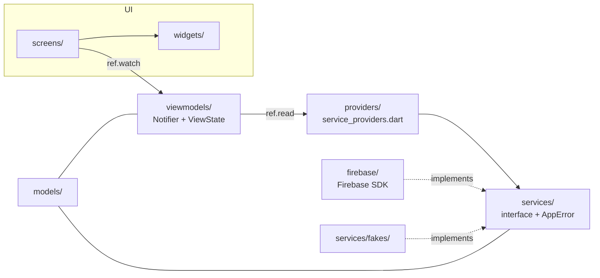

# Kiến trúc TeamUp EXE (bản đầu)

> Bản khung. Mỗi người điền phần của mình vào bảng ở mục 4 khi làm xong màn.

## 1. Mô hình

MVVM + Riverpod 3 (Notifier viết tay, không codegen). Lý do và các phương án đã cân nhắc nằm ở [skeleton-decisions.md](skeleton-decisions.md) (D3-D6).



- **View** (`screens/`, `widgets/`): chỉ dựng UI từ `ViewState`, không import Firebase, không gọi service trực tiếp.
- **ViewModel** (`viewmodels/`): mỗi màn một `Notifier`, giữ `ViewState<T>` (Loading / Empty / Data / Failure).
- **Service** (`services/`): interface thuần Dart. Lỗi luôn là `AppError`.
- **Firebase** (`firebase/`): bản cài đặt thật. **Fake** (`services/fakes/`): chỉ nối trong `main_fake.dart` và test.

`tool/check_layers.sh` kiểm các quy tắc import trên, chạy trong CI.

## 2. Cây thư mục

```text
lib/
├── main.dart            bản nộp: Firebase, Crashlytics, FCM nền
├── main_fake.dart       bản dev trên fake
├── app.dart             MaterialApp.router + theme
├── firebase_options.dart  sinh bởi flutterfire configure
├── models/  services/  services/fakes/  firebase/  providers/
├── viewmodels/  screens/  widgets/  router/  theme/
firebase/                rules, indexes, Remote Config template
firebase.json  .firebaserc
tool/check_layers.sh
test/                    unit test ViewModel (dùng fake)
```

## 3. Điều hướng

`go_router` + `StatefulShellRoute.indexedStack`, 3 tab Classes / Proposals / Profile. Bảng route ở [skeleton-decisions.md](skeleton-decisions.md) mục D7, hằng số ở `lib/router/routes.dart`. Redirect theo `sessionProvider`. Chạm thông báo FCM → `router.go(route)` nếu route nằm trong danh sách cho phép.

## 4. ViewModel → Service

| Màn | ViewModel | Service dùng | Người |
|---|---|---|---|
| S1/S19 | `SignInViewModel` | AuthService, AnalyticsService, CrashService | Ken |
| S2 | `MyClassesViewModel` (mẫu tham chiếu) | ClassService | Dan |
| S6 | `ProfileViewModel` | AuthService, AnalyticsService, CrashService | Ken / Cuong |
| S3, S4, S7, S8, S18, S22, S23 | | | Dan |
| S9-S14, S24, S25 | | | Cuong |
| S5, S15, S16, S17, S20, S21 | | | Khang |

## 5. Firebase

| Dịch vụ | Bản cài đặt | Trạng thái |
|---|---|---|
| Auth (Google) | `FirebaseAuthService` | xong |
| Analytics | `FirebaseAnalyticsService` | xong |
| Crashlytics | `FirebaseCrashService` + `main.dart` | xong |
| Remote Config | `FirebaseConfigService` (realtime) | xong |
| FCM | `FcmNotificationService` | cơ bản, còn TODO(Dan) |
| Firestore | `firestore_stubs.dart` | stub |
| Storage | `FirebaseStorageService` stub | stub |
