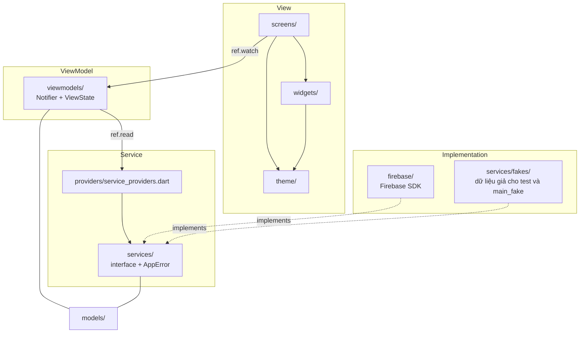
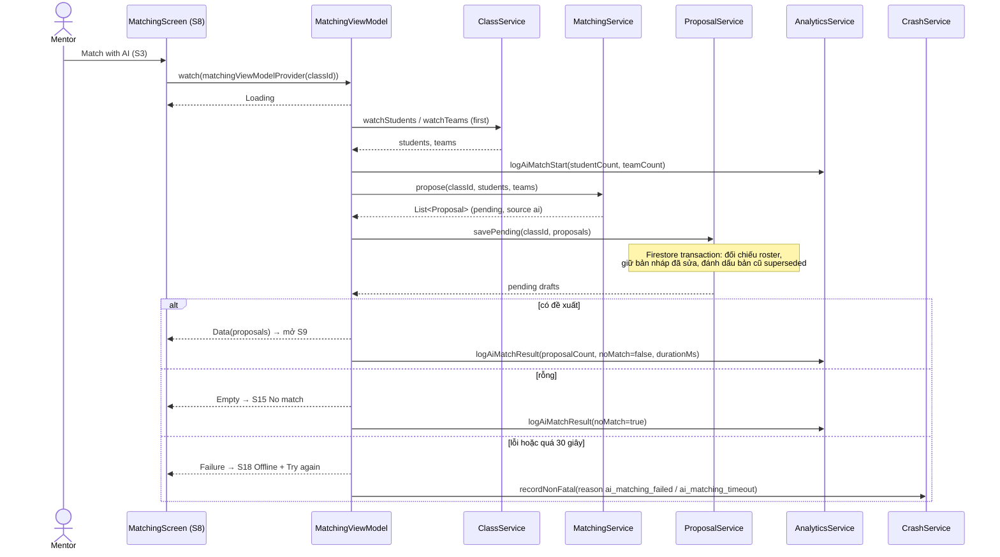

# Kiến trúc TeamUp EXE

MVVM + Riverpod 3 (`Notifier` viết tay, không sinh mã). Lý do và các phương án đã cân nhắc nằm ở [skeleton-decisions.md](skeleton-decisions.md) (D3–D6). Cập nhật 12/11/2026 cho khớp code.

## 1. Sơ đồ lớp

Phụ thuộc chỉ đi xuống. `tool/check_layers.sh` kiểm các quy tắc import và chạy trong CI.



| Quy tắc (Lab 3 mục 5) | Cách đảm bảo |
|---|---|
| Widget không gọi SDK | `screens/` và `widgets/` không import `firebase_*`, `cloud_firestore`; do `check_layers.sh` kiểm |
| Logic nằm ở ViewModel/service, không nằm trong `build()` | Lọc, xếp hạng, kiểm tra ở `viewmodels/` và `services/` (ví dụ `RuleBasedMatchingService`, `reconcileMatchingDrafts`) |
| Mỗi màn tải dữ liệu có state model | `ViewState<T>` = `Loading` / `Empty` / `Data` / `Failure`; `ViewStateBuilder` buộc xử lý đủ 4 nhánh |
| Service được inject | `lib/providers/service_providers.dart` là nơi duy nhất nối interface với bản cài đặt; test ghi đè bằng `fakeOverrides(...)` |

## 2. Cấu trúc thư mục

```text
lib/
├── main.dart              bản nộp: Firebase thật, Crashlytics, FCM nền
├── main_fake.dart         bản dev chạy trên fake, có trang /_gallery
├── app.dart               MaterialApp.router + theme
├── firebase_options.dart  cấu hình Firebase (Android + web) của prm-lab3-cc39e
├── models/                kiểu dữ liệu thuần Dart: ClassRoom, Student, Team, Proposal, Report, AppUser, AppNotification, ProjectTopic, MentorSlot, MeetingBooking, MeetingMinutes
├── services/              interface service + AppError; thuật toán thuần Dart (matching, CSV, đối chiếu bản nháp)
├── services/fakes/        bản giả của từng service, chỉ dùng cho test và main_fake
├── firebase/              bản cài đặt dùng Firebase SDK (Auth, Firestore, FCM, Analytics, Crashlytics, Remote Config, PDF)
├── providers/             Riverpod provider nối interface với bản cài đặt; fake_overrides cho test
├── viewmodels/            mỗi màn một Notifier giữ ViewState; telemetry.dart là helper Analytics/Crashlytics
├── screens/               màn hình, nhóm theo flow (flow_a…flow_f, onboarding, my_team, profile, notifications...)
├── widgets/               component dùng lại của Lab 2 (AppButton, StatusView, ConfirmDialog...)
├── router/                go_router + hằng số route, redirect theo trạng thái đăng nhập
└── theme/                 token: ColorScheme, TextTheme, spacing, radius
firebase/                  firestore.rules, indexes, Remote Config defaults/template, test rules
android/                   dự án Android (có google-services.json)
test/                      unit, ViewModel, widget test (dùng fake)
tool/check_layers.sh       kiểm tra quy tắc import giữa các lớp
e2e_test/                  bộ test ARTEMIS (pytest)
docs/                      tài liệu; evidence/ chứa ảnh bằng chứng
```

## 3. Điều hướng

`go_router` + `StatefulShellRoute.indexedStack` với 5 nhánh: `/classes`, `/proposals`, `/topics`, `/schedule`, `/profile`. Hằng số ở `lib/router/routes.dart`.

| Vai | Tab (`screens/app_shell.dart`) |
|---|---|
| Mentor | Classes, Proposals, Topics, Schedule, Profile |
| Trưởng nhóm / thành viên | My team (nhánh `/classes`), Topics, Schedule, Profile |

Redirect theo `sessionProvider`, theo thứ tự:
1. Chưa đăng nhập thì chỉ vào được `/sign-in`.
2. Đã đăng nhập nhưng chưa có vai (`role == null`) thì về `/onboarding`.
3. Route chỉ dành cho mentor (`Routes.isMentorOnly`: proposals, chi tiết lớp, import...) hoặc chỉ dành cho sinh viên (`Routes.isStudentOnly`: nộp đề tài, đặt lịch) bị đưa về `/classes`.

Chạm thông báo gọi `router.go(route)` nếu route khớp danh sách cho phép (`Routes.isAllowedDeepLink`).

## 4. Sequence: Flow A, ghép nhóm bằng AI (S3 → S8 → S9)



## 5. ViewModel → Service

Bảng này sinh từ các `ref.read/watch(...ServiceProvider)` trong `lib/viewmodels/`.

| ViewModel / provider | Màn | Service dùng |
|---|---|---|
| `SessionViewModel` (`sessionProvider`) | định tuyến theo đăng nhập | Auth |
| `SignInViewModel` | S1, S19 | Auth, Analytics, Crash |
| `MyClassesViewModel` | S2 | Class |
| `ImportClassViewModel` | S22 | Class, Analytics, Crash |
| `ClassDetailViewModel` | S3, S23 | Class, Analytics, Crash |
| `NoTeamViewModel` | S4 | Class |
| `StudentDetailViewModel` | S7 | Class, Analytics |
| `MatchingViewModel` | S8, S18, S15 | Class, Matching, Proposal, Analytics, Crash |
| `flow_a_config` (`aiMatchingEnabledProvider`) | S3, S4, S5 | Config |
| `pendingProposalsProvider`, `proposalDetailProvider` | S9, S10, S14 | Proposal, Analytics |
| `proposalStudentsProvider`, `proposalTeamsProvider` | S5, S11, S16 | Class |
| `ProposalActionViewModel` | S10 đến S13, S16, S17, S20, S24, S25 | Proposal, Analytics |
| `ProfileViewModel` | S6 | Auth, Notification, Analytics, Crash |
| `ReportDemoActions` | S6 (xuất + lưu PDF) | Report, Storage (Firestore), Class, Analytics, Crash |
| `config_demo_view_model` | S6 (Remote Config), S9 | Config, Class, Proposal |
| `inboxProvider`, `InboxActions`, `notificationTapsProvider` | trung tâm thông báo | Notification |
| `OnboardingViewModel` | onboarding sinh viên / mentor | Auth |
| `myTeamProvider` | My team (sinh viên) | Class |
| `mentorTopicsProvider`, `myTopicProvider`, `topicProvider`, `TopicActionViewModel` | D: danh sách, nộp, duyệt đề tài | Topic, Config |
| `slotsProvider`, `bookingsProvider`, `bookingProvider`, `ScheduleActionViewModel` | E: khung giờ, đặt lịch, xác nhận | Booking |
| `minutesProvider`, `ScheduleActionViewModel` | F: biên bản, ký, xuất PDF | Meeting |

## 6. Firebase

| Dịch vụ | Bản cài đặt | Ghi chú |
|---|---|---|
| Authentication | `FirebaseAuthService` | Google, email + mật khẩu, SĐT + OTP; lỗi map qua `AuthErrorMapper` |
| Cloud Firestore | `FirestoreClassService`, `FirestoreProposalService`, `FirestoreMentorProfileService`, `FirestoreNotificationStore`, `FirestoreTopicService`, `FirestoreBookingService`, `FirestoreMeetingService` | Rules ở `firebase/firestore.rules`, 30 test rules trên emulator (`firebase emulators:exec --only firestore "npm --prefix firebase/test test"`, cần JDK 21) |
| Lưu file (Firestore) | `FirestoreReportStorage`, `FirestoreTopicService` | Gói Spark không có Cloud Storage: bytes nằm trong 1 tài liệu Firestore (`reports/{id}/files/pdf`, `topics/{id}/files/outline`), ≤ 900 KB, chỉ chủ sở hữu / nhóm và mentor đọc (`firestore.rules`). PDF biên bản tạo lại trên máy, không lưu |
| Cloud Messaging | `FcmNotificationService`, `background_notification_handler.dart`, `activity_messages.dart` | Danh sách thông báo lưu ở `users/{uid}/notifications`. Gói Spark không có Cloud Functions, nên thông báo D/E/F do `activityMessages()` tạo ra: app theo dõi đề tài/lịch hẹn mà người dùng đọc được và biến mỗi thay đổi thành một tin cùng dạng push. Lần đọc đầu chỉ ghi inbox, không hiện popup; thay đổi do chính máy này gây ra bị bỏ qua. Chỉ chạy khi app đang mở hoặc chạy nền |
| Analytics | `FirebaseAnalyticsService` | Xem [analytics-plan.md](analytics-plan.md) |
| Crashlytics | `FirebaseCrashService` + `main.dart` | Thu thập tắt khi debug, bật bằng `--dart-define=CRASHLYTICS_DEBUG=true` |
| Remote Config | `FirebaseConfigService` (realtime) | `ai_matching_enabled`, `max_proposals_shown`, `max_topic_revisions`, `default_meeting_duration_minutes`; mặc định ở `firebase/remote-config-defaults.json` |

## 7. Mô hình dữ liệu Firestore

```text
users/{uid}                          hồ sơ: role mentor | leader | member; sinh viên có classId, teamId, studentId, mentorUid
  ├── notifications/{id}             thông báo đã nhận
  └── fcmTokens/{id}                 token FCM của thiết bị
classes/{classId}                    lớp (mentorUid)
  ├── students/{mssv}                sinh viên (ngành, teamId)
  ├── teams/{teamId}                 nhóm (memberIds, majors, rosterChangeProposalId)
  ├── proposals/{id}                 đề xuất: status pending | approved | discarded | superseded; source ai | manual
  └── matching/state                 tài liệu khóa để các lần matching đồng thời chạy lại giao dịch
reports/{id}                         metadata PDF
  └── files/pdf                      bytes PDF (≤ 900 KB)
topics/{classId}_{teamId}            D: đề tài; pending | approved | rejected | revision_requested
  └── files/outline                  bytes outline PDF/DOCX (≤ 900 KB)
mentors/{uid}/slots/{id}             E: khung giờ; available | booked (bookingId)
bookings/{id}                        E/F: lịch hẹn; requested | confirmed | cancelled | completed; meetUrl
minutes/{bookingId}                  F: biên bản, actionItems, mentorRating, isSignedByMentor
```

Đặt lịch và huỷ lịch ghi slot và booking trong cùng một giao dịch; rules ở mỗi bên kiểm bên kia bằng `getAfter`, nên không đặt trùng một khung giờ được.
