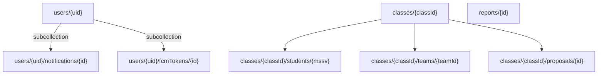
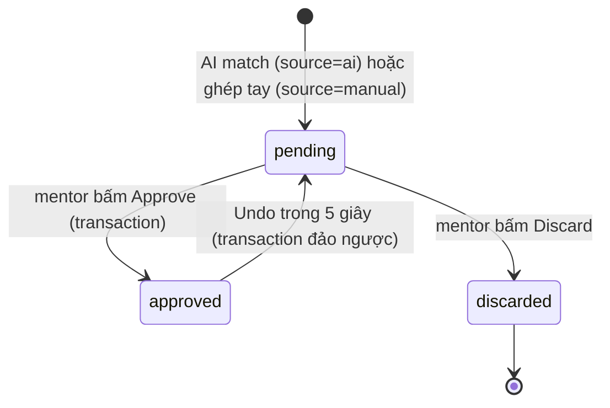

# Data model — TeamUp EXE

Tài liệu này là **hợp đồng tích hợp** giữa app Flutter và Firebase. Mọi trường ở đây
đều được kiểm tra lại ở `firebase/firestore.rules` (`validUser`, `validClass`,
`validStudent`, `validTeam`, `validProposal`, `validReport`, `validNotification`,
`validFcmToken`) và ở tầng Dart (`lib/models/*.dart` → `DataValidation`).

> Quy ước: `id` = khoá tài liệu Firestore. `uid` = Firebase Auth UID của mentor.
> Mọi ID đều phải khớp `^[A-Za-z0-9][A-Za-z0-9_-]{0,63}$` (`safeId` trong rules).

---

## 1. Cây collection



* **Sub-collection dưới `classes/{classId}`** (phương án A trong `docs/skeleton-decisions.md`):
  rules chỉ cần đọc `mentorUid` ở document lớp để kiểm quyền sở hữu.
* **`proposals`** được truy vấn bằng `collectionGroup('proposals')` nên rules có thêm
  một khối `match /{path=**}/proposals/{id}` chỉ cho phép đọc khi
  `mentorUid == request.auth.uid`.
* **`reports`** nằm ở collection gốc vì nó tham chiếu cả `classId` lẫn `ownerUid`
  và được đọc bằng `ownerUid` chứ không theo lớp.
* **Số liệu (số SV, số chưa có nhóm, số nhóm thiếu người) không được lưu** —
  luôn tính từ stream `students` và `teams` (xem `docs/design-traceability.md` D11).

---

## 2. `users/{uid}` — mentor

| Trường | Kiểu | Bắt buộc | Ràng buộc | Nguồn |
|---|---|---|---|---|
| `displayName` | string | ✔ | 1..120 ký tự | `AuthService` khi đăng nhập lần đầu |
| `role` | string | ✔ | đúng `'mentor'` | cố định ở Lab 3 |
| `lastSignInAt` | timestamp | ✔ | `== request.time` | `SessionViewModel` |

`email`, `photoUrl`, `phoneNumber` **không lưu trong Firestore** — chỉ giữ trong
`AuthUser` của Firebase Auth và hiển thị ở S6. Đây là ranh giới PII: những giá
trị này không bao giờ đi vào Analytics hay Crashlytics.

### `users/{uid}/notifications/{id}`

| Trường | Kiểu | Bắt buộc | Ràng buộc |
|---|---|---|---|
| `title` | string | ✔ | 1..200 |
| `body` | string | ✔ | ≤ 4000 |
| `receivedAt` | timestamp | ✔ | `≤ request.time` |
| `read` | bool | ✔ | chỉ `read` được đổi sau khi tạo |
| `route` | string \| null | ✖ | khớp `^/.*`; chỉ mở route trong allow-list `Routes.isAllowedDeepLink()` |

### `users/{uid}/fcmTokens/{id}`

| Trường | Kiểu | Bắt buộc | Ràng buộc |
|---|---|---|---|
| `token` | string | ✔ | ≤ 2048 |
| `platform` | string | ✔ | đúng `'android'` |
| `updatedAt` | timestamp | ✔ | `== request.time` |

`id` là token FCM mã hoá base64url (≤ 1500 ký tự) — dùng làm khoá tài liệu để
tránh sinh bản ghi trùng.

---

## 3. `classes/{classId}` — lớp đã import

| Trường | Kiểu | Bắt buộc | Ràng buộc | Ghi chú |
|---|---|---|---|---|
| `name` | string | ✔ | 1..120 | tên lớp hiển thị ở S2/S3 |
| `mentorUid` | string | ✔ | 1..128, **immutable** | chủ sở hữu → quyền truy cập |
| `createdAt` | timestamp | ✔ | **immutable**, `== request.time` khi tạo | |

Không có trường đếm. Xem `lib/models/class_room.dart` — `studentCount`,
`withoutTeamCount`, `teamsNeedingMembers` là **giá trị tính ở client**, không
được ghi xuống Firestore (D11).

---

## 4. `classes/{classId}/students/{mssv}` — sinh viên

Khoá tài liệu là **MSSV** (mã sinh viên), không phải UID — sinh viên không dùng
app, họ chỉ là dữ liệu.

| Trường | Kiểu | Bắt buộc | Ràng buộc | Ghi chú |
|---|---|---|---|---|
| `fullName` | string | ✔ | 1..120 | cột "Full name" của file import |
| `major` | string | ✔ | `SE` \| `AI` \| `MKT` \| `GD` | cột "Major" |
| `teamId` | string \| null | ✔ | `null` = chưa có nhóm (R2) | con trỏ tới `teams/{teamId}` |
| `semester` | string | ✖ | ≤ 32 | ví dụ "S5" |

`classId` **không** lưu trong document — nó nằm trên đường dẫn.

**Quy tắc liên kết (enforced by rules):**

* Tạo SV có `teamId != null` → phải tồn tại `teams/{teamId}` có chứa `mssv` trong
  `memberIds` (đọc bằng `getAfter` để batch import vẫn hợp lệ).
* Sửa `teamId` → `major` không được đổi; chỉ `teamId` được nằm trong
  `diff().affectedKeys()`; SV chỉ rời nhóm khi nhóm cũ không còn giữ `mssv`.
* Xoá SV → chỉ khi `teamId == null` (tránh orphan).

---

## 5. `classes/{classId}/teams/{teamId}` — nhóm

| Trường | Kiểu | Bắt buộc | Ràng buộc | Ghi chú |
|---|---|---|---|---|
| `name` | string | ✔ | 1..120 | tên nhóm hiển thị ở S9/S10 |
| `memberIds` | string[] | ✔ | 0..6 phần tử, **không trùng lặp**, mỗi phần tử `safeId` | MSSV, thứ tự khớp `majors` |
| `majors` | string[] | ✔ | 0..6 phần tử, chỉ trong `SE/AI/MKT/GD` | **song song** với `memberIds` |
| `rosterChangeProposalId` | string \| null | ✖ | `safeId` | đánh dấu roster đang được sửa theo đề xuất nào |

* `memberIds.length == majors.length` là bắt buộc — vị trí `i` của hai mảng là
  cùng một người.
* `major` của một SV nằm ở `students/{mssv}.major`; `majors` trong team là bản
  sao để đọc danh sách nhóm không cần join. Rules kiểm tra chúng khớp khi tạo
  team và khi approve.
* **Roster không được sửa tự do.** Chỉ được đổi trong cùng transaction với
  chuyển trạng thái của `proposal` (`validRosterTransition`): `pending → approved`
  thì `memberIds` **phải bằng** `currentMemberIds + addStudentIds`, và ngược lại
  khi Undo. Đây là chốt chặn quan trọng nhất — nó làm cho quy tắc "0 nhóm vượt 6
  người" và "100% SV có nhóm" trở thành bất biến của hệ thống, không phải quy
  tắc UI.
* Xoá team → chỉ khi `memberIds` rỗng.

---

## 6. `classes/{classId}/proposals/{id}` — đề xuất nhóm

Đây là **đề xuất ghép nhóm** (S9/S10), không phải đề tài nhóm.

| Trường | Kiểu | Bắt buộc | Ràng buộc | Ghi chú |
|---|---|---|---|---|
| `classId` | string | ✔ | `safeId`, **immutable** | trùng với path |
| `mentorUid` | string | ✔ | `== request.auth.uid`, **immutable** | dùng để lọc `collectionGroup` |
| `teamId` | string | ✔ | `safeId`, **immutable** | nhóm đích |
| `teamName` | string | ✔ | 1..120 | |
| `currentMemberIds` | string[] | ✔ | ≤ 6, không trùng lặp | thành viên đã có trong nhóm |
| `currentMajors` | string[] | ✔ | ≤ 6, chỉ `SE/AI/MKT/GD` | song song với `currentMemberIds` |
| `addStudentIds` | string[] | ✔ | ≤ 6, không trùng lặp, **không giao** với `currentMemberIds` | SV đề xuất thêm |
| `addMajors` | string[] | ✔ | ≤ 6 | song song với `addStudentIds` |
| `fit` | string | ✔ | `strong` \| `good` | mức độ phù hợp |
| `reasons` | string[] | ✔ | ≤ 6 phần tử, mỗi phần tử ≤ 240 | dòng "Why" ở S10 |
| `status` | string | ✔ | `pending` \| `approved` \| `discarded` | |
| `source` | string | ✔ | `ai` \| `manual`, **immutable** | "Added by you" ở S20 |
| `approvedAt` | timestamp | ✖ | chỉ có khi `status == approved` | mốc thời gian cho Undo 5 s |

### 6.1. Máy trạng thái



* `pending → approved` chỉ khi `currentMemberIds.size + addStudentIds.size ∈ [5, 6]`
  (R1). Dưới 5 → bị chặn ở S25.
* `approved → pending` (Undo) chỉ trong **5 giây** kể từ `approvedAt`
  (`request.time - approvedAt <= 5s`). Sau đó không hoàn tác được.
* `source` không đổi được → một đề xuất AI không thể bị "đổi nhãn" thành ghép tay.

### 6.2. Ghi được phép

| Chuyển trạng thái | Trường được đổi | Điều kiện thêm |
|---|---|---|
| `pending → pending` | bất kỳ trường nào trong schema | `classId`, `mentorUid`, `teamId`, `source` giữ nguyên |
| `pending → approved` | `status`, `approvedAt` | `approvedAt == request.time`; roster team khớp `current + add`; mọi SV được thêm đã có `teamId` trỏ đúng (đọc `getAfter`) |
| `pending → discarded` | `status` | `classId`/`mentorUid`/`teamId`/`source` giữ nguyên |
| `approved → pending` | `status`, `approvedAt` | `approvedAt` bị xoá; trong 5 s; roster đảo ngược; SV bị thêm trở lại `teamId == null` |

---

## 7. `reports/{id}` — metadata báo cáo PDF

| Trường | Kiểu | Bắt buộc | Ràng buộc | Ghi chú |
|---|---|---|---|---|
| `ownerUid` | string | ✔ | 1..128, **immutable** | chủ sở hữu |
| `classId` | string | ✔ | `safeId`, **immutable** | mentor phải sở hữu lớp |
| `storagePath` | string | ✔ | ≤ 512; đúng 3 đoạn `reports/{uid}/{file}.pdf` | đường dẫn Cloud Storage |
| `downloadUrl` | string | ✔ | ≤ 2048; khớp `^https://.*` | URL tải về |
| `sizeKb` | int | ✔ | 1..10240 | dung lượng |
| `createdAt` | timestamp | ✔ | `== request.time` khi tạo | |

File PDF **không** nằm trong Firestore. Nó nằm ở Cloud Storage tại
`reports/{ownerUid}/{reportId}.pdf`; `firebase/storage.rules` chỉ cho
`request.auth.uid == ownerUid` đọc/ghi/xoá. `downloadUrl` là URL có thời hạn —
tài liệu này lưu URL tại thời điểm upload, nếu URL hết hạn thì app gọi lại
`getDownloadURL`.

---

## 8. Quy tắc nghiệp vụ được mã hoá trong schema

| Mã | Quy tắc | Nơi thực thi |
|---|---|---|
| R1 | Nhóm chỉ được duyệt khi có **5..6** thành viên | `Proposal.canApprove`, `validProposal`, S25 |
| R2 | SV có `teamId == null` = chưa có nhóm | `students/{mssv}.teamId` |
| R3 | Mỗi SV thuộc **tối đa 1** nhóm | `teamId` là con trỏ đơn; `memberIds` không trùng lặp |
| R4 | Nhóm không vượt **6** thành viên | `ids()` giới hạn 6; `memberIds + addStudentIds <= 6` |
| R5 | Một nhóm cần **≥ 3 ngành** | `TeamRules.targetMajors = 3`; kết quả được ghi vào `proposals.fit` (`strong` khi đạt, `good` khi chưa) và dùng để xếp hạng đề xuất. Rules không kiểm được (rules không đếm phần tử khác nhau trong một mảng) → đây là quy tắc **mềm**. |
| R6 | Chỉ mentor sở hữu lớp được đọc/ghi | `ownsClass()`, `mentorUid` |
| R7 | Không đề xuất nào của người khác lộ ra | `match /{path=**}/proposals/{id}` lọc theo `mentorUid` |

R5 là quy tắc **mềm**: nó được kiểm ở `RuleBasedMatchingService` và ở UI
(`MajorSlotRow`), vì rules không có cách đếm số phần tử khác nhau trong một
mảng.

---

## 9. Index cần thiết

`firebase/firestore.indexes.json` khai báo index composite cho các truy vấn
collection-group. Index chỉ cần cho trường **lọc trong Firestore**; việc sắp xếp
theo `teamName` được làm ở client (`sort` trong `watchAllPending()`), nên không
cần thêm `teamName` vào index.

| Collection | Trường | Truy vấn tương ứng |
|---|---|---|
| `proposals` (collection group) | `mentorUid` ASC, `status` ASC | `watchAllPending()` — `collectionGroup('proposals').where(mentorUid).where(status)` |
| `reports` (collection) | `ownerUid` ASC, `createdAt` DESC | danh sách báo cáo của mentor, mới nhất trước |

`watchPending(classId)` chỉ lọc `status` trong một sub-collection nên **không** cần
index composite.

Nếu thiếu index, Console sẽ báo lỗi khi truy vấn; app hiển thị thông báo lỗi
network thay vì dữ liệu.

---

## 10. Dữ liệu mẫu

`tool/fixtures/lab3-demo.csv` — file import đúng định dạng S22 (CSV, xem
sai lệch D2 trong `docs/design-traceability.md`):

```csv
MSSV,Full name,Class name,Group,Major
SE000001,Nguyễn An,EXE101 Demo,1,SE
```

Cột `Class name` cho biết lớp đang import (một lần import chỉ một lớp). Cột
`Group` là **tên nhóm sẵn có** trong danh sách gốc của mentor: cột này được
`CsvClassImporter.teams()` dùng để **tạo sẵn `teams/{group}`** và gán
`teamId` cho SV, nên SV đã có nhóm sẽ không bị AI ghép lại. Hai cột này không
được lưu vào Firestore — Firestore chỉ nhận `name` của lớp và các document
`students` / `teams` đã dẫn xuất.
