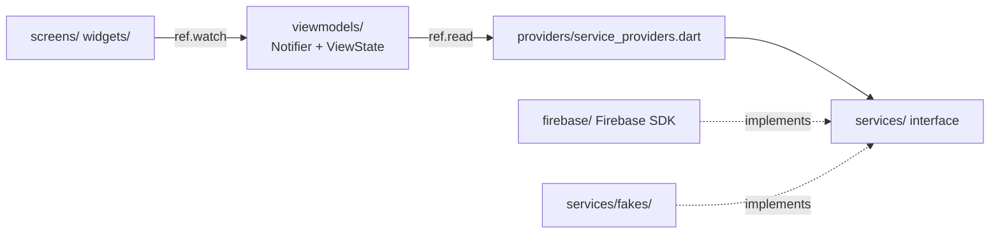
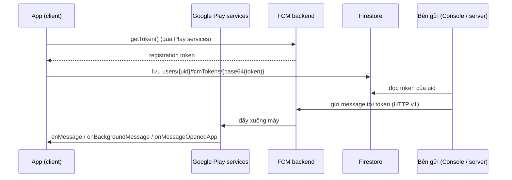

# TeamUp EXE: thuyết trình Lab 3 (nhóm 6)

Mỗi mục `##` là một slide. Phần **Nói** là ý chính khi trình bày, phần **Hỏi đáp** là câu giảng viên có thể hỏi. Mọi đường dẫn code đều có thật trong repo (cập nhật 13/11/2026).

---

## 1. Tổng quan

- App Flutter (Android) cho **mentor môn EXE** ghép nhóm 5-6 sinh viên đủ ngành (SE / AI / MKT / GD).
- Phạm vi: Flow A/B/C của Lab 2 (25 màn) + mở rộng D/E/F cho sinh viên (nộp đề tài, đặt lịch họp, biên bản).
- Firebase project `prm-lab3-cc39e`, **gói Spark (miễn phí)**: không có Cloud Storage, không có Cloud Functions.
- 6 dịch vụ: Authentication, Firestore, Cloud Messaging, Analytics, Crashlytics, Remote Config.

**Nói:** vì ở gói Spark nên có 2 chỗ thay thế: lưu file và gửi thông báo. Hai chỗ này giải thích ở slide 5 và 6.

---

## 2. Kiến trúc: MVVM + Riverpod



| Nguyên lý | Cách làm trong code |
|---|---|
| Widget không gọi SDK | `screens/` không import `firebase_*`; `tool/check_layers.sh` kiểm trong CI |
| Mỗi màn có trạng thái | `ViewState<T>` = Loading / Empty / Data / Failure; `ViewStateBuilder` bắt xử lý đủ 4 nhánh |
| Service được inject | `lib/providers/service_providers.dart` là chỗ duy nhất nối interface với bản Firebase |
| Test không cần Firebase | Test và `lib/main_fake.dart` ghi đè provider bằng bản fake |

**Hỏi đáp:**
- *Tại sao tách interface?* Để test ViewModel bằng fake (170 test Flutter chạy không cần mạng), và để đổi Firestore sang Storage/Cloudinary sau này mà không sửa màn hình.

---

## 3. Authentication

- 3 cách đăng nhập: Google (`signInWithGoogle`, `lib/firebase/firebase_auth_service.dart:145`), email + mật khẩu (`:166`), SĐT + OTP (`verifyPhoneNumber`, `:229`).
- Lỗi SDK map sang thông báo dễ hiểu qua `lib/firebase/auth_error_mapper.dart`.
- `authStateChanges()` quyết định route: chưa đăng nhập → `/sign-in`; chưa có vai → `/onboarding` (`lib/router/app_router.dart`).

**Hỏi đáp:**
- *Google Sign-In cần gì?* SHA-1 của keystore debug phải khai báo trong Firebase Console, sau đó tải lại `google-services.json`. Máy nào chưa thêm SHA-1 thì đăng nhập Google báo lỗi `DEVELOPER_ERROR`.
- *`google-services.json` có phải secret không?* Không. Nó chỉ định danh project; quyền truy cập dữ liệu do **Firestore rules** kiểm.

---

## 4. Firestore và Security Rules

```text
users/{uid}                  hồ sơ, role mentor | leader | member
  ├── notifications/{id}     inbox thông báo
  └── fcmTokens/{id}         token FCM của từng máy
classes/{classId}/students, teams, proposals
topics/{id}/files/outline    file outline (bytes)
reports/{id}/files/pdf       file PDF báo cáo (bytes)
mentors/{uid}/slots, bookings/{id}, minutes/{bookingId}
```

- Rules ở `firebase/firestore.rules`, **30 test** chạy trên emulator (`firebase/test/firestore.rules.test.mjs`).
- Đặt lịch ghi slot và booking trong **một transaction**; rules mỗi bên kiểm bên kia bằng `getAfter`, nên hai nhóm không đặt trùng một khung giờ.

**Hỏi đáp:**
- *Client tự ghi Firestore thì chặn gian lận thế nào?* Rules kiểm `request.auth.uid`, kiểu dữ liệu, trường được sửa (`affectedKeys().hasOnly([...])`). Ví dụ vai người dùng không đổi được sau khi tạo (`firestore.rules:339`).

---

## 5. Lưu file: thay Cloud Storage

Đề cho phép thay upload bằng Cloudinary hoặc AWS S3. Nhóm chọn **lưu bytes trong Firestore**:

| | Firestore bytes (nhóm dùng) | Cloudinary / S3 |
|---|---|---|
| Phân quyền theo `uid` | Có, cùng `firestore.rules` | Upload không ký (unsigned) thì ai có preset cũng upload được; muốn ký URL thì cần server giữ secret |
| Cần server | Không | Cần để ký request an toàn |
| Giới hạn | ≤ 900 KB/file (tài liệu Firestore tối đa 1 MiB) | Lớn hơn nhiều |

Code:
- `lib/firebase/firestore_report_storage.dart:47`: một `batch` ghi cả metadata `reports/{id}` và bytes `reports/{id}/files/pdf`, nên không bao giờ có metadata mà thiếu file.
- Outline đề tài: `lib/firebase/firestore_topic_service.dart` (`topics/{id}/files/outline`).
- Rules chặn file > 900 KB và sai kiểu; chỉ chủ sở hữu (báo cáo) hoặc nhóm + mentor (outline) đọc được.

**Hỏi đáp:**
- *Sao không dùng Cloudinary?* Không có server để giữ API secret, nên không giới hạn được ai được upload/đọc theo `uid`. Firestore giữ được quy tắc đó.
- *File lớn hơn thì sao?* Chia thành nhiều tài liệu (chunk) hoặc chuyển sang Storage/S3 khi có Blaze/server. Interface `StorageService` không đổi.

---

## 6. FCM (Cloud Messaging): nguyên lý



### FCM token là gì?
Chuỗi định danh **một bản cài app trên một máy** với FCM. Nó không định danh người dùng: một người có 2 máy thì có 2 token; đăng xuất trên máy thì token cũ phải bỏ.

### Cấp ở đâu?
**Máy chủ FCM của Google** cấp, qua Google Play services trên máy, khi app gọi `FirebaseMessaging.instance.getToken()` (`lib/firebase/fcm_notification_service.dart:109`). Token có thể đổi (cài lại app, xóa dữ liệu, Google xoay token) nên app nghe `onTokenRefresh` (`:340`).

### Client có lưu không?
Có, ở 2 chỗ:
1. SDK tự cache token trên máy.
2. App lưu lên **Firestore** để bên gửi biết gửi tới đâu: `users/{uid}/fcmTokens/{base64url(token)}` với `token`, `platform`, `updatedAt` (`lib/firebase/firestore_notification_store.dart:75-87`). ID tài liệu mã hóa base64 vì token có thể chứa `/`.

Chi tiết trong `_queueTokenSync` (`fcm_notification_service.dart:114`):
- chỉ lưu khi đã cấp quyền thông báo (Android 13+ phải xin `POST_NOTIFICATIONS`);
- token đổi thì xóa token cũ rồi ghi token mới;
- đăng xuất / đổi tài khoản thì `deleteToken()` (`:189`, `:407`) để máy không nhận push của tài khoản cũ;
- lần đăng nhập đầu, `users/{uid}` chưa có nên rules chặn ghi token; code thử lại 1s / 2s / 4s (`_saveTokenWithRetry`, `:156`, finding F2).

Rules: chỉ chính chủ đọc/ghi token của mình (`firebase/firestore.rules:349`).

---

## 7. FCM: gửi message thế nào, code server nằm đâu?

### Cách gửi message (nguyên lý)
Bên gửi cần **quyền của project** (service account), nên **không bao giờ gửi từ app**. Có 3 đường:
1. **Firebase Console** → Messaging → *Send test message* → dán token. Dùng để demo.
2. **Server** dùng Firebase Admin SDK hoặc REST `POST https://fcm.googleapis.com/v1/projects/prm-lab3-cc39e/messages:send` với OAuth token từ service account.
3. **Cloud Functions** trigger theo thay đổi Firestore (cần gói Blaze).

### Code server ở dự án này
**Không có server.** Gói Spark không chạy được Cloud Functions, và nhóm không giữ service account trong repo. Thay vào đó:
- Thông báo từ Console (demo FCM thật): gửi tới token, kèm **custom data** `uid=<uid người nhận>` và `route` (ví dụ `/proposals`). Thiếu `uid` thì app bỏ qua message (`fcm_notification_service.dart:240`) để máy không hiện thông báo của tài khoản cũ.
- Thông báo nghiệp vụ D/E (đề tài mới, kết quả duyệt, lịch hẹn): **app tự sinh**. `lib/firebase/activity_messages.dart:19` theo dõi `topics` và `bookings` mà người dùng được đọc, mỗi thay đổi tạo ra một `RemoteMessage` cùng định dạng push, rồi đưa vào cùng đường xử lý (`lib/providers/service_providers.dart:63-73`, `mergeMessages`).
  - Lần đọc đầu đánh dấu `silent`: chỉ ghi inbox, không bung popup.
  - Thay đổi do chính máy này ghi (`hasPendingWrites`) bị bỏ qua.
  - Giới hạn: chỉ chạy khi app đang mở hoặc còn chạy nền.

Nếu có server, đoạn gửi sẽ như sau (minh họa, **không có trong repo**):

```js
// Cloud Function (Blaze) — ví dụ khi mentor duyệt đề tài
const tokens = (await db.collection(`users/${uid}/fcmTokens`).get()).docs.map(d => d.get('token'));
await getMessaging().sendEachForMulticast({
  tokens,
  notification: { title: 'Your topic approved', body: title },
  data: { uid, id: `topic:${topicId}:approved`, route: '/topics' },
});
```

Định dạng `data` giống hệt message app đang tự sinh, nên chuyển sang server không phải sửa client.

---

## 8. FCM: client nhận và dùng thế nào

| Trạng thái app | API | Code |
|---|---|---|
| Đang mở (foreground) | `FirebaseMessaging.onMessage` | `_receive` → lưu inbox + hiện thông báo bằng `flutter_local_notifications` (`fcm_notification_service.dart:237`) |
| Chạy nền / đã tắt | `FirebaseMessaging.onBackgroundMessage` | hàm top-level `@pragma('vm:entry-point')` ở `lib/main.dart:18`, gọi `keepBackgroundNotification` (`lib/firebase/background_notification_handler.dart:13`) để lưu inbox |
| Người dùng chạm thông báo khi app nền | `onMessageOpenedApp` | `_receive(tapped: true)` → điều hướng theo `route` |
| Mở app từ thông báo khi app đã tắt | `getInitialMessage()` | `start()` (`:361`), xử lý sau khi biết user |

- Inbox lưu ở `users/{uid}/notifications` (`firestore_notification_store.dart:47`), dùng transaction nên nhận trùng không tạo 2 bản.
- `route` chỉ được mở nếu nằm trong danh sách cho phép (`NotificationRoutes.isAllowed`), tránh deep link lạ.

**Hỏi đáp:**
- *Vì sao foreground phải tự hiện thông báo?* Android không tự hiện notification khi app đang mở; app phải dùng local notification.
- *Background handler sao phải top-level?* Nó chạy trong isolate riêng, không có UI, nên phải gọi lại `Firebase.initializeApp` và không được điều hướng.

---

## 9. Crashlytics

Code:
- `lib/main.dart:30-36`: bắt lỗi Flutter (`FlutterError.onError = recordFlutterFatalError`) và lỗi async (`PlatformDispatcher.instance.onError`).
- `lib/firebase/firebase_crash_service.dart`: `setUserIdentifier(uid)`, custom key `role`, `class_id`, non-fatal (`recordError(fatal: false)`) khi import CSV lỗi hoặc AI matching quá 30 giây.
- **Nút crash:** Profile → card *Firebase demo* → **Test crash** (`lib/screens/profile/profile_screen.dart:96`) → `ProfileViewModel.testCrash` → `FirebaseCrashlytics.instance.crash()` (`firebase_crash_service.dart:27`).
- Bản debug tắt thu thập; muốn gửi khi debug thì chạy `--dart-define=CRASHLYTICS_DEBUG=true` (`main.dart:31`).

### Kịch bản demo trên máy thật
1. `flutter run --release` (hoặc debug kèm `--dart-define=CRASHLYTICS_DEBUG=true`).
2. Đăng nhập, mở Profile, nhấn **Test crash**: app tắt ngay.
3. **Mở lại app.** Crashlytics lưu báo cáo trên máy và chỉ gửi lên ở lần mở kế tiếp.
4. Chờ vài phút, Firebase Console → Crashlytics hiện issue kèm user ID, key `role`, `class_id`.

**Hỏi đáp:**
- *Sao crash xong chưa thấy ngay?* App chết trước khi kịp gửi; báo cáo được gửi khi mở lại, sau đó Console xử lý thêm vài phút.
- *Fatal và non-fatal khác gì?* Fatal là app chết. Non-fatal là lỗi đã bắt nhưng vẫn ghi lại để theo dõi, app chạy tiếp.

---

## 10. Ai xem kết quả Crashlytics: Dev và Admin

| Người xem | Ở đâu |
|---|---|
| Team Dev | Firebase Console → Crashlytics (stack trace, thiết bị, phiên bản) |
| Admin | **Trang web dành cho admin** (đề yêu cầu) |

> **Tình trạng: repo chưa có web admin.** Phần này cần làm hoặc trình bày hướng làm trước buổi chấm.

Điểm cần giải thích: Crashlytics **không có API để client đọc dữ liệu**. Dữ liệu chỉ ra ngoài Console qua BigQuery export (cần Blaze). Ở gói Spark, hướng khả thi:
1. Lần mở app sau crash, gọi `FirebaseCrashlytics.instance.didCrashOnPreviousExecution()`; nếu đúng thì ghi một bản tóm tắt vào Firestore `crashReports/{id}` (uid, role, thời điểm, phiên bản app). Non-fatal ghi luôn khi xảy ra.
2. Web admin (Flutter web hoặc HTML + Firebase JS SDK) đăng nhập tài khoản admin, đọc `crashReports`.
3. Rules: chỉ tài khoản có `role == 'admin'` được đọc; app chỉ được tạo, không được sửa/xóa.

Chi tiết stack trace vẫn xem ở Console; web admin hiển thị số lượng, thời điểm, người bị ảnh hưởng.

---

## 11. Remote Config

- 4 khóa: `ai_matching_enabled`, `max_proposals_shown`, `max_topic_revisions`, `default_meeting_duration_minutes`.
- Thứ tự giá trị (`lib/firebase/firebase_config_service.dart`): mặc định đóng trong app (`firebase/remote-config-defaults.json`) → giá trị đã kích hoạt lần trước (cache) → `fetchAndActivate()` → **realtime** (`onConfigUpdated`).
- `minimumFetchInterval`: 1 phút khi debug, 12 giờ khi release (`:54`), để không vượt giới hạn fetch.
- Mất mạng: giữ giá trị cache/mặc định, không đọc giá trị rỗng.

**Demo:** đổi `ai_matching_enabled = false` trên Console → nút *Match with AI* ở màn chi tiết lớp biến mất mà không cần mở lại app.

---

## 12. Analytics

- 10 sự kiện, mỗi sự kiện trả lời một câu hỏi sản phẩm (`docs/analytics-plan.md`). Ví dụ `ai_match_result` (`proposal_count`, `no_match`, `duration_ms`) trả lời "thuật toán có tìm được nhóm không, mất bao lâu".
- `setUserId(uid)` sau khi đăng nhập, không gửi email, tên, số điện thoại.
- Kiểm chứng: `test/telemetry/telemetry_wiring_test.dart`; xem trực tiếp bằng **DebugView**: `adb shell setprop debug.firebase.analytics.app com.group6.teamup_exe`.

---

## 13. Kiểm thử

| Loại | Số lượng | Lệnh |
|---|---|---|
| Unit / ViewModel / widget | 170 test | `flutter test` |
| Firestore rules | 30 test trên emulator | `firebase emulators:exec --only firestore "npm --prefix firebase/test test"` |
| Kiểm lớp kiến trúc | script | `bash tool/check_layers.sh` |
| E2E trên thiết bị | 14 ca ARTEMIS | `cd e2e_test && bash run_suite.sh` |
| AI code review | 10 finding, 3 fix | `docs/code-review.md` |

---

## 14. Checklist trước buổi chấm

- [ ] **Chạy trên máy thật** (đề bắt buộc), không dùng emulator. SHA-1 của máy build đã thêm vào Console.
- [ ] `firebase deploy --only firestore:rules,remoteconfig` (repo và Console phải khớp).
- [ ] Cấp quyền thông báo; copy FCM token sẵn để gửi test từ Console, nhớ thêm data `uid`.
- [ ] Bấm **Test crash** trước buổi chấm ít nhất 10 phút, mở lại app để Console có sẵn issue.
- [ ] Web admin xem kết quả Crashlytics (slide 10): **chưa có trong repo**.
- [ ] Bật DebugView để chiếu Analytics trực tiếp.
- [ ] Chuẩn bị 1 tài khoản mentor + 1 tài khoản trưởng nhóm để demo thông báo D/E giữa 2 máy.

---

## Phụ lục: trả lời nhanh

| Câu hỏi | Trả lời ngắn |
|---|---|
| FCM token là gì? | ID của một bản cài app trên một máy, do FCM cấp |
| Ở đâu cấp? | Server FCM của Google, qua Play services, khi gọi `getToken()` |
| Client có lưu không? | SDK cache trên máy; app lưu thêm vào `users/{uid}/fcmTokens` |
| Gửi bằng gì? | FCM HTTP v1 / Admin SDK với service account, hoặc Console |
| Code server ở đâu? | Không có (Spark). Demo gửi từ Console; thông báo D/E do `activity_messages.dart` sinh trên app |
| Client dùng ra sao? | `onMessage`, `onBackgroundMessage`, `onMessageOpenedApp`, `getInitialMessage`; lưu inbox, mở `route` |
| Sao crash chưa hiện? | Báo cáo gửi ở lần mở app kế tiếp, Console chậm vài phút |
| File lưu ở đâu? | Firestore bytes ≤ 900 KB, quyền do rules kiểm; Cloudinary/S3 cần server để ký request |
| Remote Config cập nhật khi nào? | Realtime listener; fetch tối thiểu 12 giờ ở release |
