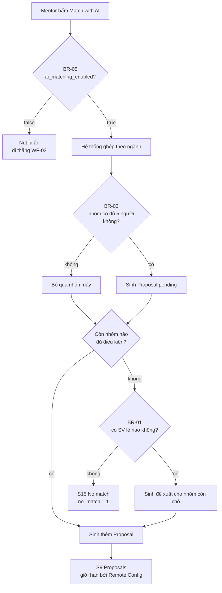
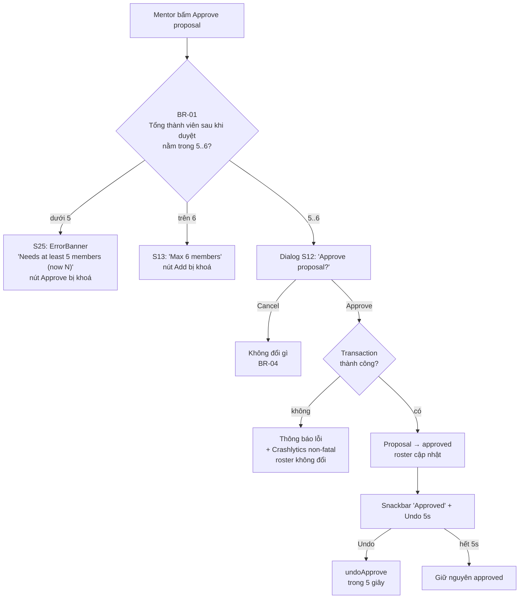
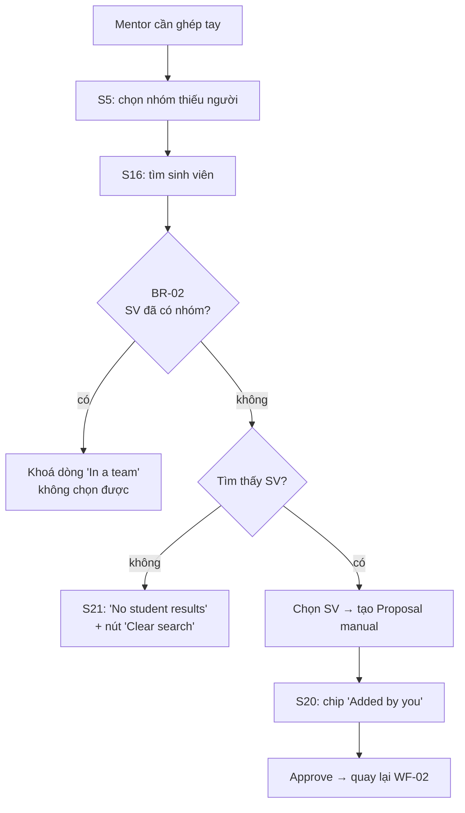
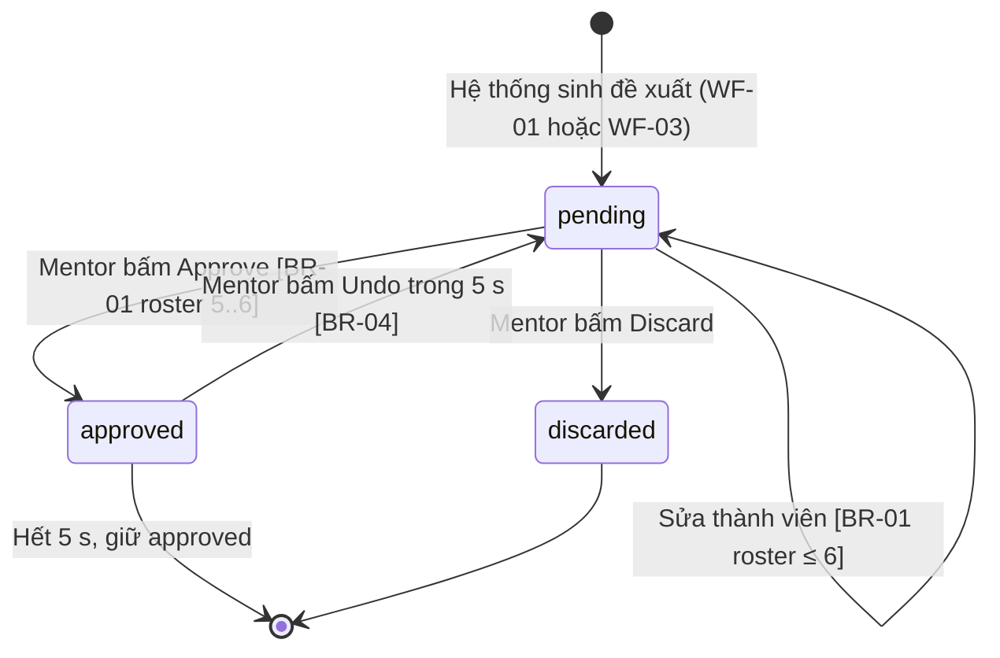
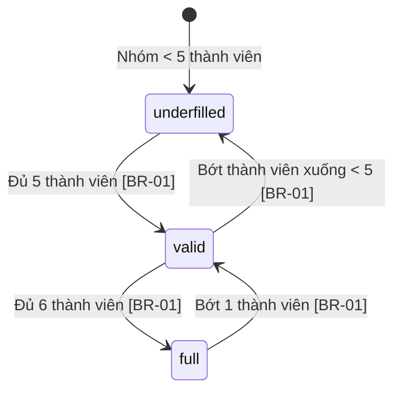

# Đặc tả workflow nghiệp vụ — TeamUp EXE

> Theo khung *Workflow là gì? Định nghĩa và đặc tả luồng nghiệp vụ* (W03–W14).
> Mỗi workflow lõi được đặc tả đủ **7 thành phần**: mã & tên, actor, trigger,
> precondition, bước & điểm quyết định, kết quả, exception — kèm truy vết
> `BR → UI → Service → TC`.
>
> Quy ước mã:
>
> | Mã | Loại | Ví dụ |
> |---|---|---|
> | `WF-0x` | Workflow lõi | `WF-01` |
> | `BR-0x` | Business rule | `BR-02` |
> | `UI-xx` | Màn hình (S của Lab 2) | `UI-10` |
> | `TC-xx` | Test case ARTEMIS | `TC-07` |
> | `FR-xx` | Tính năng | `FR-03` |

---

## 0. Kiểm tra nhận diện (W05) — vì sao đây là workflow, không phải màn hình

| Câu hỏi | WF-01 | WF-02 | WF-03 |
|---|---|---|---|
| 1. Có **trigger** rõ ràng? | ✔ Mentor bấm "Match with AI" | ✔ Mentor bấm "Approve proposal" | ✔ AI không ra đề xuất nào |
| 2. Kết thúc bằng **kết quả nghiệp vụ** có giá trị? | ✔ Nhóm có đề xuất ghép | ✔ Nhóm ở trạng thái `approved` với roster 5–6 | ✔ Nhóm được ghép tay và duyệt |
| 3. Có **thay đổi trạng thái / dữ liệu**? | ✔ `Proposal` `pending` sinh ra | ✔ `Proposal` `pending → approved`, `Team.memberIds` đổi | ✔ `Team.memberIds` + `Student.teamId` đổi |
| 4. Có **rẽ nhánh theo BR**? | ✔ BR-03 (đủ 5 thành viên không), BR-05 (AI bật/tắt) | ✔ BR-01 (5–6 người), BR-04 (Undo 5 s) | ✔ BR-02 (SV đã có nhóm) |
| 5. Diễn đạt được bằng **ngôn ngữ nghiệp vụ**? | ✔ "Ghép nhóm cho lớp" | ✔ "Duyệt một nhóm đề xuất" | ✔ "Ghép tay khi máy không ghép được" |

**5/5 ở cả ba** → đủ điều kiện là workflow lõi.

Quy mô (W08): mỗi WF có **3–7 bước**, mỗi WF gắn **một pain point** khác nhau,
tổng **3 WF lõi** → đúng khuyến nghị "2–4 WF lõi".

---

## 1. Danh sách workflow lõi và pain point (FR)

| Mã & tên | Actor | Pain point (từ `ux/persona.md` Lab 2) | FR liên quan |
|---|---|---|---|
| **WF-01 · Ghép nhóm cho một lớp** | Mentor, Hệ thống ghép | Mentor phải tự chia nhóm 5–6 người đa ngành cho cả lớp, mất hàng giờ và dễ thiếu ngành | FR-02 import danh sách, FR-03 ghép theo ngành, FR-04 duyệt đề xuất |
| **WF-02 · Duyệt một nhóm đề xuất** | Mentor, Hệ thống | Mentor không biết đề xuất nào hợp lý; phải kiểm tra giới hạn 6 người bằng mắt | FR-04 duyệt/bỏ, FR-05 thêm-bớt thành viên, FR-06 Undo |
| **WF-03 · Ghép tay khi máy không ghép được** | Mentor | Khi danh sách lẻ không đủ ngành, mentor không có cách nào đưa sinh viên vào nhóm đang thiếu người | FR-07 xem nhóm thiếu người, FR-08 ghép tay, FR-09 chặn SV đã có nhóm |

> Luồng phụ **nhập danh sách lớp (FR-02)** không tách thành WF riêng: nó là
> **precondition** của WF-01, vì không có dữ liệu thì không có gì để ghép. Theo
> W08, tách nó ra sẽ tạo một workflow 1 bước — quá nhỏ.

---

## 2. WF-01 · Ghép nhóm cho một lớp

| Trường | Nội dung |
|---|---|
| **Mã & tên** | `WF-01` · Ghép nhóm cho một lớp |
| **Actor** | Mentor (Cô Lan), Hệ thống ghép (`RuleBasedMatchingService`), Hệ thống đo lường (Analytics) |
| **Trigger** | Mentor bấm **"Match with AI"** ở S3 (`UI-03`) |
| **Precondition** | Lớp đã có danh sách sinh viên (FR-02 đã import, `BR-06`); `ai_matching_enabled = true` (BR-05) |
| **Kết quả (postcondition)** | ≥ 1 `Proposal` ở trạng thái `pending` cho lớp; mentor thấy danh sách ở S9 (`UI-09`); **chưa** có thay đổi nào lên roster thật (BR-04) |
| **Exception** | BR-03 thiếu người để đủ 5 → nhóm không được đề xuất; BR-05 AI bị tắt → nút "Match with AI" bị ẩn, đi thẳng tới WF-03; mất mạng/quá 30 s → S18 (`UI-18`) + Crashlytics non-fatal |

### Happy path

| # | Bước | Actor | Màn hình | Mã truy vết |
|---|---|---|---|---|
| 1 | Mentor mở lớp, thấy số SV chưa có nhóm và số nhóm thiếu người | Mentor | `UI-03` | FR-03 |
| 2 | Mentor bấm "Match with AI" | Mentor | `UI-03` | BR-05 |
| 3 | Hệ thống ghi `ai_match_start(student_count, team_count)` | Hệ thống | — | FR-08 |
| 4 | Hệ thống ghép: lấy SV **chưa có nhóm** và các nhóm **còn chỗ** | Hệ thống | `UI-08` | BR-01, BR-02 |
| 5 | Hệ thống ưu tiên **bổ sung ngành còn thiếu**, ưu tiên đủ 5 trước khi lấp chỗ thứ 6 | Hệ thống | `UI-08` | BR-03 |
| 6 | Hệ thống ghi `ai_match_result(proposal_count, no_match, duration_ms)` | Hệ thống | — | FR-08 |
| 7 | Mentor xem và chọn một đề xuất ở S9 → S10 | Mentor | `UI-09`, `UI-10` | FR-04 |

### Điểm quyết định

### Exception

| Mã | Tình huống | Hành vi hệ thống | Bằng chứng |
|---|---|---|---|
| BR-05 | `ai_matching_enabled = false` | Ẩn nút "Match with AI" ở S3/S4/S5; mentor dùng WF-03 | Ảnh Remote Config trước/sau |
| BR-03 | Nhóm thiếu người và pool không đủ để đủ 5 | Không sinh đề xuất cho nhóm đó; nếu không nhóm nào đủ → S15 "No match" | `ai_match_result.no_match = 1` |
| — | Mất mạng / AI chạy quá 30 s | S18 "Offline" + nút "Try again"; Crashlytics ghi 1 non-fatal | Ảnh Crashlytics |
| — | Lớp chưa import danh sách | S2 empty → nút "Import class list" | `TC-05` |

### Truy vết

`FR-02` · `FR-03` · `FR-08` → `UI-03`, `UI-08`, `UI-09`, `UI-15`, `UI-18` →
`MatchingViewModel` → `MatchingService` / `RuleBasedMatchingService` →
`ProposalService` → `TC-05`, `TC-06`, `TC-07`, `TC-08`, `TC-17`

---

## 3. WF-02 · Duyệt một nhóm đề xuất

| Trường | Nội dung |
|---|---|
| **Mã & tên** | `WF-02` · Duyệt một nhóm đề xuất |
| **Actor** | Mentor, Firestore (transaction), Hệ thống thông báo trong app |
| **Trigger** | Mentor bấm **"Approve proposal"** ở S10 (`UI-10`) và xác nhận ở dialog S12 (`UI-12`) |
| **Precondition** | `Proposal.status = pending`; `currentMemberIds + addStudentIds` **trong khoảng 5–6** (BR-01) |
| **Kết quả (postcondition)** | `Proposal.status = approved`; `Team.memberIds` = roster cũ + SV mới; `Student.teamId` được gán; **không** nhóm nào vượt 6; mentor thấy snackbar "Approved" + **Undo 5 s** (S14, `UI-14`) |
| **Exception** | Dưới 5 người → S25 (`UI-25`) khóa nút Approve; vượt 6 khi thêm → S13 (`UI-13`) "Max 6 members"; transaction thất bại → thông báo + Crashlytics non-fatal |

### Happy path

| # | Bước | Actor | Màn hình | Mã truy vết |
|---|---|---|---|---|
| 1 | Mentor mở đề xuất ở S10, xem `FitChip`, các ô ngành và lý do | Mentor | `UI-10` | FR-04 |
| 2 | (Tùy chọn) Mentor thêm/bớt thành viên ở S11 / S24 | Mentor | `UI-11`, `UI-24` | FR-05, BR-01 |
| 3 | Mentor bấm "Approve proposal" → dialog S12 | Mentor | `UI-12` | FR-04 |
| 4 | Firestore chạy **transaction**: ghi `Team.memberIds`, gán `Student.teamId`, đổi `Proposal.status` | Hệ thống | — | BR-01, BR-04 |
| 5 | Hệ thống ghi `proposal_approve(member_count, major_count, source, edited)` | Hệ thống | — | FR-08 |
| 6 | Mentor thấy snackbar "Approved" + **Undo** trong 5 s; bấm Undo → `undoApprove` | Mentor | `UI-14` | FR-06, BR-04 |
| 7 | Badge tab "Proposals" giảm 1; đề xuất biến mất khỏi danh sách pending | Hệ thống | `UI-09` | — |

### Điểm quyết định

### Exception

| Mã | Tình huống | Hành vi hệ thống | Bằng chứng |
|---|---|---|---|
| BR-01 | Roster < 5 (S25) | `ErrorBanner` "Needs at least 5 members (now N)", nút Approve khoá, "Add member" vẫn dùng được | `TC-11` |
| BR-01 | Roster > 6 (S13) | `ErrorBanner` "Max 6 members" **tại chỗ**, nút Add khoá | `TC-10` |
| BR-04 | Mentor bấm Cancel ở dialog | Không có thay đổi nào trên Firestore | `TC-14` |
| BR-04 | Mentor bấm Undo trong 5 s | Transaction hoàn tác: `Team.memberIds` về cũ, `Student.teamId` = null, `Proposal.status = pending` | `TC-08` + Firestore rules |
| — | Hai mentor duyệt cùng một SV | Transaction + `rosterChangeProposalId` chặn gán trùng | `firebase/test/firestore.rules.test.mjs` |

### Truy vết

`FR-04` · `FR-05` · `FR-06` → `UI-09`, `UI-10`, `UI-11`, `UI-12`, `UI-13`, `UI-14`, `UI-24`, `UI-25` →
`ProposalActionViewModel` → `ProposalService` / `FirestoreProposalService` →
`TC-08`, `TC-09`, `TC-10`, `TC-11`, `TC-14`

---

## 4. WF-03 · Ghép tay khi máy không ghép được

| Trường | Nội dung |
|---|---|
| **Mã & tên** | `WF-03` · Ghép tay khi máy không ghép được |
| **Actor** | Mentor, Firestore |
| **Trigger** | AI không ra đề xuất nào (S15, `UI-15`) **hoặc** mentor chọn "Add manually" từ S15 / từ S3 |
| **Precondition** | Lớp đã import; còn nhóm đang thiếu người (`Team.size < 5`, `BR-01`) |
| **Kết quả (postcondition)** | `Proposal` mới với `source = manual`; khi mentor duyệt → roster cập nhật như WF-02; chip "Added by you" ở S20 (`UI-20`) cho biết đây là ghép tay |
| **Exception** | SV đã có nhóm → dòng bị khoá "In a team" (BR-02); tìm không ra SV → S21 (`UI-21`) "No student results"; bỏ đề xuất → S17 (`UI-17`) |

### Happy path

| # | Bước | Actor | Màn hình | Mã truy vết |
|---|---|---|---|---|
| 1 | Mentor mở "Need members" (S5), thấy các nhóm đang thiếu và dòng "Needs … to reach 5" | Mentor | `UI-05` | FR-07 |
| 2 | Mentor chọn một nhóm → "Add student" (S16) | Mentor | `UI-16` | FR-08 |
| 3 | Mentor lọc theo ngành và chọn SV chưa có nhóm | Mentor | `UI-16` | BR-02 |
| 4 | Hệ thống tạo `Proposal` với `source = manual` | Hệ thống | `UI-20` | FR-08 |
| 5 | Mentor xem S20 (chip "Added by you"), chỉnh thêm nếu cần, rồi Approve (quay lại WF-02) | Mentor | `UI-20` | FR-04 |

### Điểm quyết định

### Exception

| Mã | Tình huống | Hành vi hệ thống | Bằng chứng |
|---|---|---|---|
| BR-02 | SV đã có nhóm | Dòng bị khoá, không tick được, nhãn "In a team" | `TC-13` |
| BR-01 | Nhóm đã đủ 5 người | Không hiện trong danh sách "Need members" | `TC-12` |
| — | Tìm không ra SV | S21 empty state + "Clear search" | `TC-13` |
| BR-04 | Mentor bấm "Discard proposal" | Dialog S17 nút đỏ; `Proposal.status = discarded`, AI không đề xuất lại | `TC-14` |

### Truy vết

`FR-07` · `FR-08` → `UI-05`, `UI-15`, `UI-16`, `UI-17`, `UI-20`, `UI-21` →
`ProposalActionViewModel.createManual` → `ProposalService` / `FirestoreProposalService` →
`TC-12`, `TC-13`, `TC-14`

---

## 5. State machine — đối tượng nghiệp vụ `Proposal`

| Bước của WF | Chuyển trạng thái | BR | Test case |
|---|---|---|---|
| WF-01 bước 6 | `[*] → pending` | BR-03 | `TC-07` |
| WF-02 bước 3 | `pending → pending` (Cancel) | BR-04 | `TC-14` |
| WF-02 bước 4 | `pending → approved` | BR-01 | `TC-08` |
| WF-02 bước 6 | `approved → pending` (Undo ≤ 5 s) | BR-04 | `TC-08` |
| WF-02 (nút bị khoá) | `pending → approved` **bị cấm** (roster < 5) | BR-01 | `TC-11` |
| WF-03 bước 4 | `[*] → pending` với `source = manual` | BR-02 | `TC-12` |
| WF-03 exception | `pending → discarded` | BR-04 | `TC-14` |

**Chuyển bị cấm có test riêng**: `pending → approved` khi roster = 4 bị chặn ở tầng
UI (`ErrorBanner` S25) **và** ở tầng Firestore rules
(`d.currentMemberIds.size() + d.addStudentIds.size() >= 5` khi `status == 'approved'`).

### State machine — `Team` (roster)

`underfilled` và `valid` là trạng thái **nghiệp vụ**; trạng thái **UI** tương ứng là
S5 (cần thêm người) và S9/S10 (đủ điều kiện duyệt). Không vẽ state machine riêng
cho từng màn hình — W06 cấm điều đó.

---

## 6. Business rule registry (truy vết chung)

| Mã | Nội dung | Nơi kiểm tra | Test |
|---|---|---|---|
| **BR-01** | Nhóm 5–6 thành viên. Dưới 5 → khóa Approve (S25); trên 6 → khóa Add (S13) | `Proposal.canApprove`, `TeamRules`, `firestore.rules` | `TC-10`, `TC-11` |
| **BR-02** | SV đã có nhóm không được thêm vào nhóm khác; dòng bị khoá | `ProposalStudentPicker` (`locked`), `firestore.rules` (`teamId`) | `TC-13` |
| **BR-03** | Ghép ưu tiên bổ sung ngành còn thiếu, đủ 5 trước khi lấp chỗ thứ 6 | `RuleBasedMatchingService` | `test/services/rule_based_matching_service_test.dart` |
| **BR-04** | Chưa Approve thì roster không đổi; Approve có Undo 5 s; Discard thì không đề xuất lại | `FirestoreProposalService` (transaction), `firestore.rules` (`duration.value(5, 's')`) | `TC-08`, `TC-14` |
| **BR-05** | `ai_matching_enabled` bật/tắt nút "Match with AI" | `RemoteConfigService` + `aiMatchingEnabledProvider` | Ảnh Remote Config |
| **BR-06** | Import tự lọc: SV đã có nhóm và nhóm đủ 6 không vào pool | `CsvClassImporter` + `ImportClassViewModel` | `TC-05`, `TC-06` |
| **BR-07** | Chỉ mentor sở hữu lớp được sửa dữ liệu lớp đó | `firestore.rules` (`ownsClass`), `storage.rules` (`request.auth.uid == uid`) | `firebase/test/firestore.rules.test.mjs` |

---

## 7. Ma trận truy vết Feature → Workflow → UI → Service → Test

| Feature | Workflow | Màn (UI) | Service | Test |
|---|---|---|---|---|
| FR-02 Import danh sách lớp | *(precondition của WF-01)* | `UI-22`, `UI-23` | `ClassService` | `TC-05`, `TC-06` |
| FR-03 Xem lớp / SV chưa có nhóm | WF-01 (bước 1) | `UI-03`, `UI-04`, `UI-07` | `ClassService` | `TC-12` |
| FR-04 Duyệt / bỏ đề xuất | WF-02 | `UI-09`→`UI-10`→`UI-12`→`UI-14` / `UI-17` | `ProposalService` | `TC-08`, `TC-14` |
| FR-05 Thêm / bớt thành viên | WF-02 (bước 2) | `UI-11`, `UI-13`, `UI-24`, `UI-25` | `ProposalService` | `TC-09`, `TC-10`, `TC-11` |
| FR-06 Undo sau khi duyệt | WF-02 (bước 6) | `UI-14` | `ProposalService` | `TC-08` |
| FR-07 Xem nhóm thiếu người | WF-03 (bước 1) | `UI-05` | `ClassService` | `TC-12` |
| FR-08 Ghép tay | WF-03 (bước 2–4) | `UI-15`, `UI-16`, `UI-20`, `UI-21` | `ProposalService` | `TC-13` |
| FR-09 Chặn SV đã có nhóm | WF-03 (BR-02) | `UI-16` | `ClassService` + rules | `TC-13` |
| FR-10 Xuất báo cáo PDF | *(sau WF-02)* | `UI-06` demo | `ReportService`, `StorageService` | `TC-15` |

Mỗi **nhánh rẽ** trong ba activity diagram ở §2–§4 đều có ít nhất một test case
tương ứng — đúng yêu cầu W13 ("mỗi nhánh tại hình thoi sinh ra một test case").

---

## 8. Kết luận tự kiểm (W14)

| Mục | Trạng thái |
|---|---|
| Mỗi WF đạt 5/5 câu kiểm tra nhanh | ✔ (bảng §0) |
| 2–4 WF lõi, mỗi WF gắn một pain point | ✔ 3 WF, 3 pain point khác nhau |
| Tên theo mẫu động từ + đối tượng nghiệp vụ | ✔ "Ghép nhóm…", "Duyệt một nhóm đề xuất", "Ghép tay…" — không chứa "màn hình" / "module" / "quản lý" |
| Đủ 7 thành phần, có ít nhất một exception | ✔ mỗi WF có 2–4 exception |
| Điểm quyết định ghi mã BR | ✔ BR-01…BR-07 |
| Postcondition khớp state machine | ✔ §5 |
| Mỗi nhánh rẽ có test case | ✔ §2–§4 + §7 |
| WF trong demo trùng WF đã thiết kế | ✔ kịch bản video và slide demo dùng đúng WF-01/02/03 |
