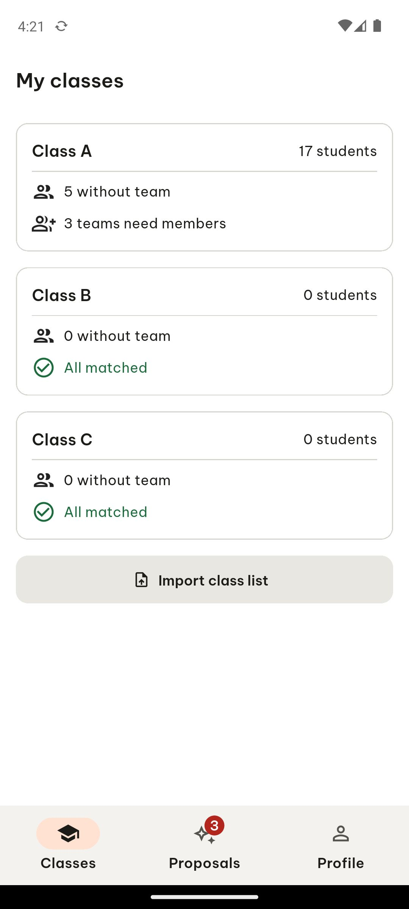

# ARTEMIS session 0797238d-da09-49d8-b3c4-49e5c9041348

- **Goal**: Open the TeamUp EXE app on the device. The sign-in screen is shown with a button labelled 'Continue with Google'. Tap that button, wait for the Google account picker, and choose the test Google account that is already configured on this device. Wait for the app to load. Report the title of the screen that is visible, the number of bottom-navigation tabs that are visible, and whether the word 'Classes' is visible.
- **Status**: failed
- **Steps**: 1

## Step 1

In Step 1, I launched the TeamUp EXE app, and the screen displayed the title "My classes" at the top along with three cards for "Class A", "Class B", and "Class C" containing respective student counts and team statuses, plus an "Import class list" button. At the bottom of the screen, three navigation tabs are visible labeled "Classes", "Proposals" with a red badge showing 3, and "Profile". The word "Classes" is clearly visible both in the top header and on the first bottom navigation tab.

```json
{
  "action": "manage_app",
  "coordinates": null,
  "coordinate_space": "normalized",
  "args": {
    "app_name": "TeamUp EXE",
    "action": "launch"
  }
}
```




