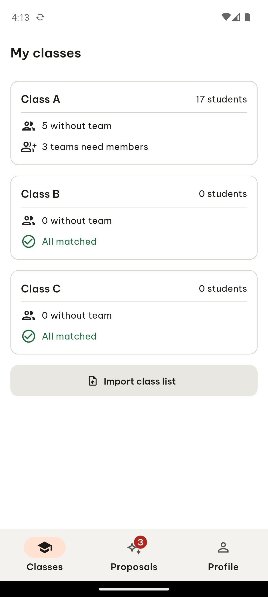

# ARTEMIS session 1312b157-16dc-451f-99f0-c54454324263

- **Goal**: The TeamUp EXE app is already open on the My classes screen. Read the screen and report the visible class names and the student count for each.
- **Status**: completed
- **Steps**: 1

## Step 1

```json
{
  "action": "report_task_status",
  "args": {
    "status": "completed",
    "explanation": "The visible class names and their student counts on the 'My classes' screen are:\n- Class A: 17 students\n- Class B: 0 students\n- Class C: 0 students"
  }
}
```


