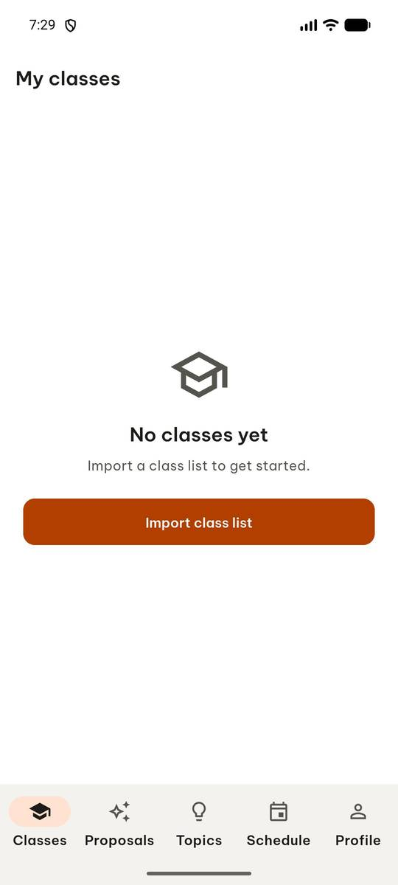
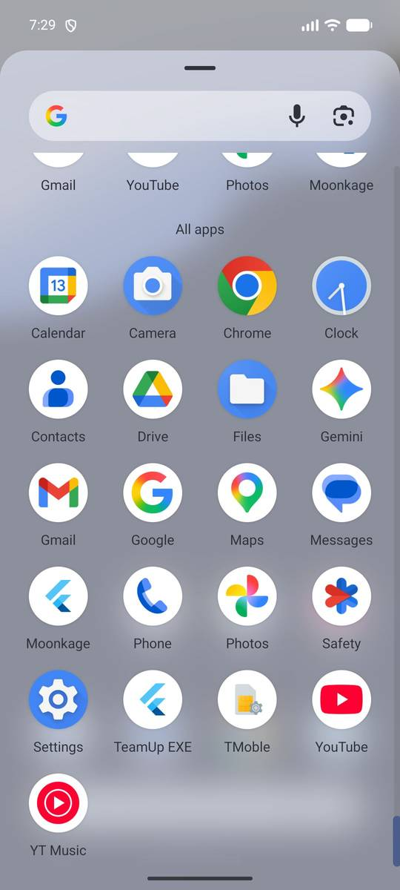
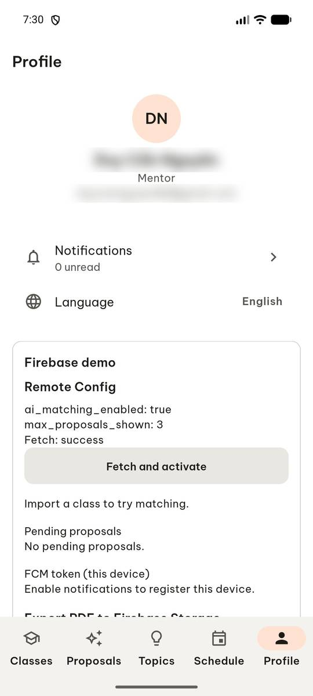
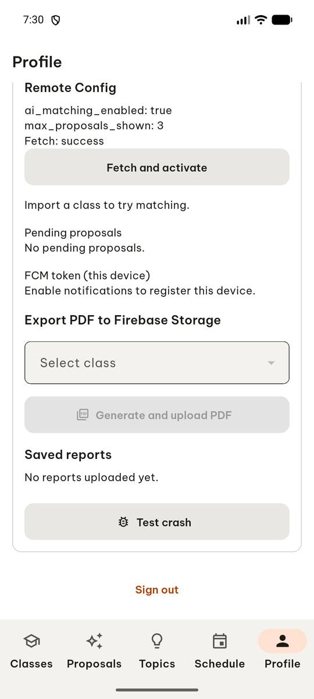
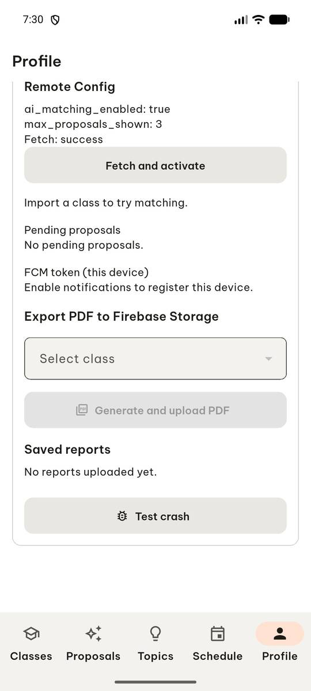
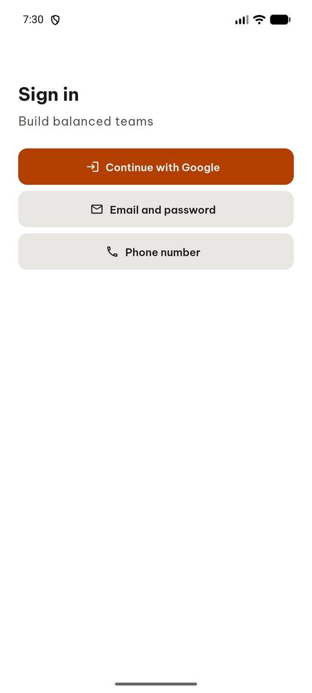
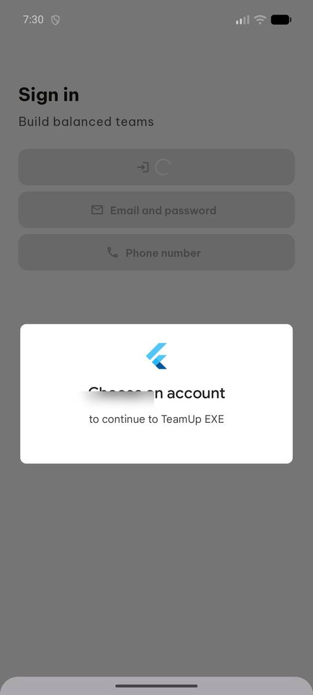
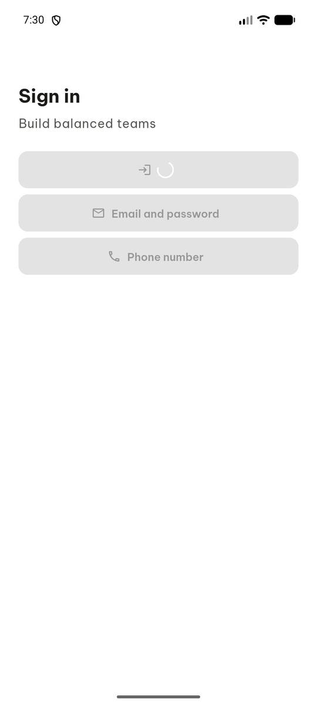
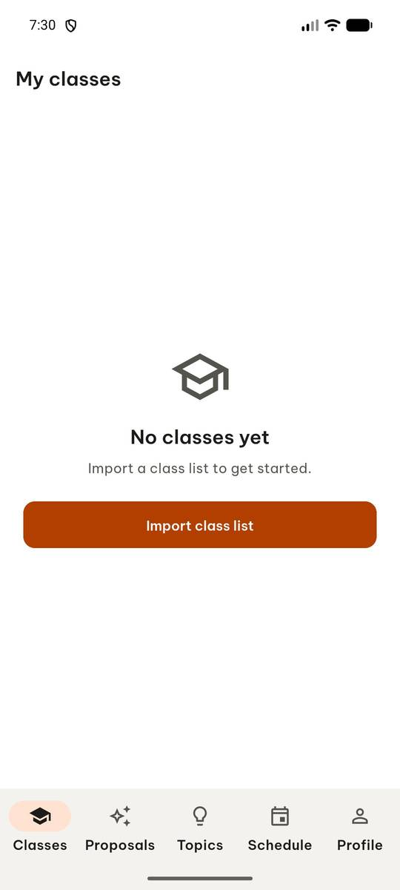

# test_tc01_google_sign_in_account_picker (run 1)

- Session: `978291ef-f733-43f6-bdd4-e6528878a607`
- Status: completed, 63.8s
- Output: `{"signed_in": true, "tabs": ["Classes", "Proposals", "Topics", "Schedule", "Profile"]}`

| Step | Screen before | Action |
|---|---|---|
| 1 |  | `manage_app` action=stop, app_name=com.group6.teamup_exe |
| 2 |  | `manage_app` action=launch, app_name=com.group6.teamup_exe |
| 3 |  | `wait_for_delay` time_in_ms=2000 |
| 4 |  | `click` target=9 |
| 5 |  | `swipe` direction=up |
| 6 |  | `click` target=7 |
| 7 |  | `click` target=7 |
| 8 |  | `click` target=3 |
| 9 |  | `click` target=3 |
| 10 |  | `wait_for_delay` time_in_ms=3000 |
| 11 |  | `report_task_status` completed: {"signed_in": true, "tabs": ["Classes", "Proposals", "Topics", "Schedule", "Profile"]} |

Final screen:

