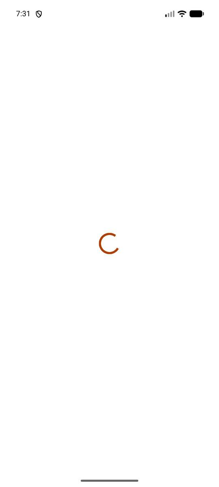
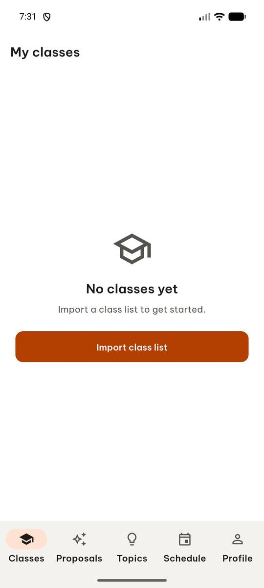
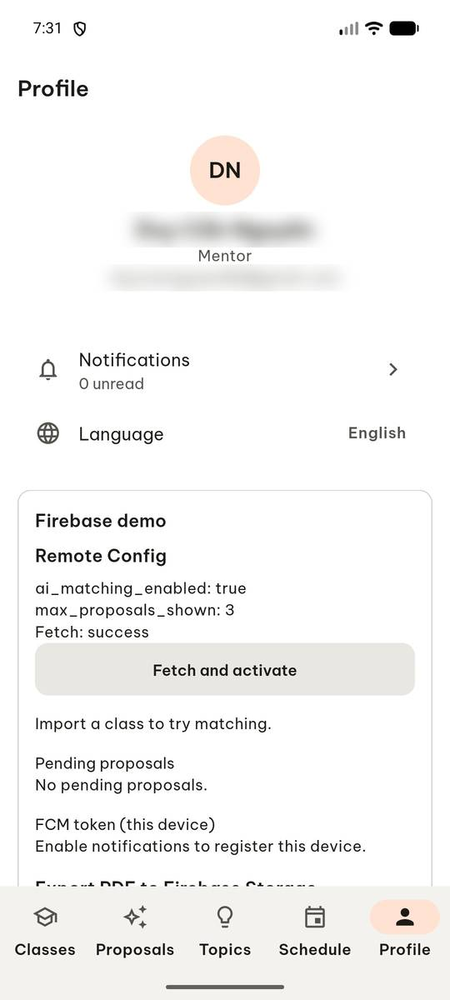
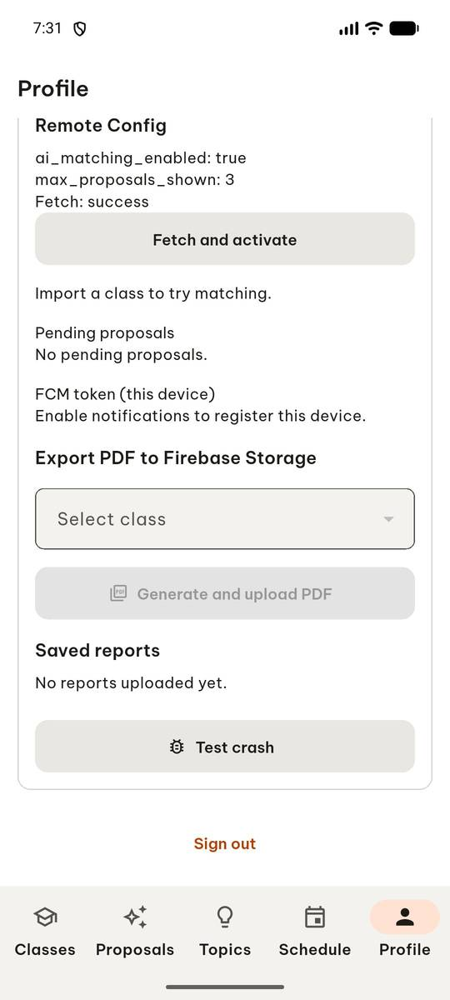
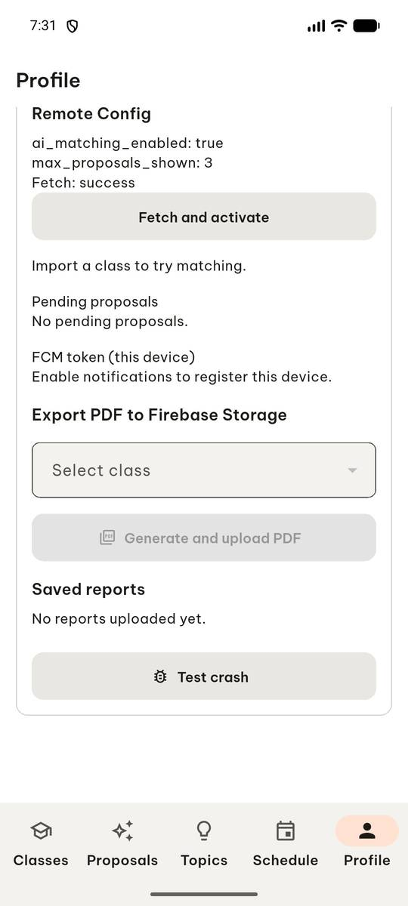
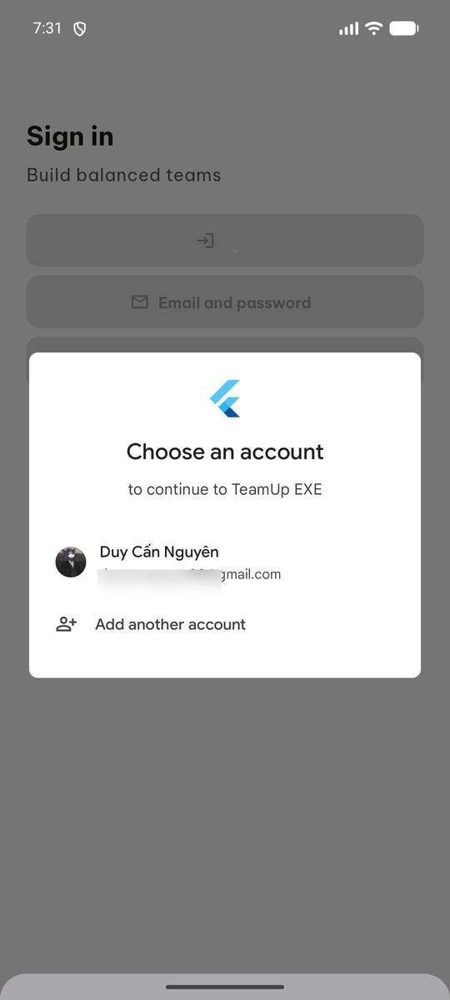
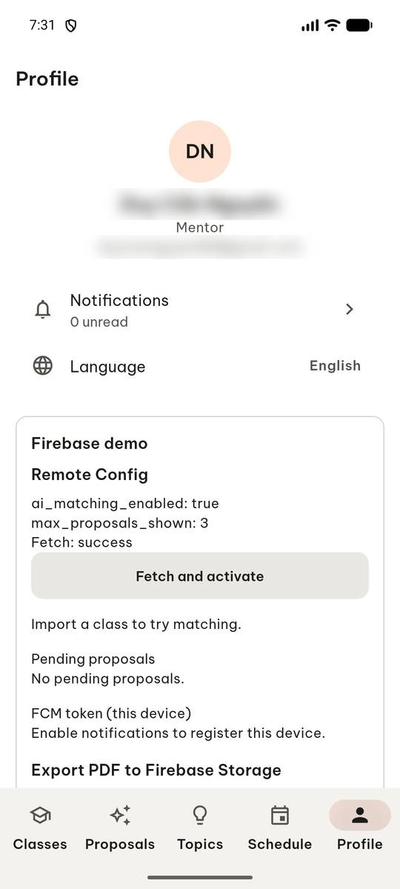
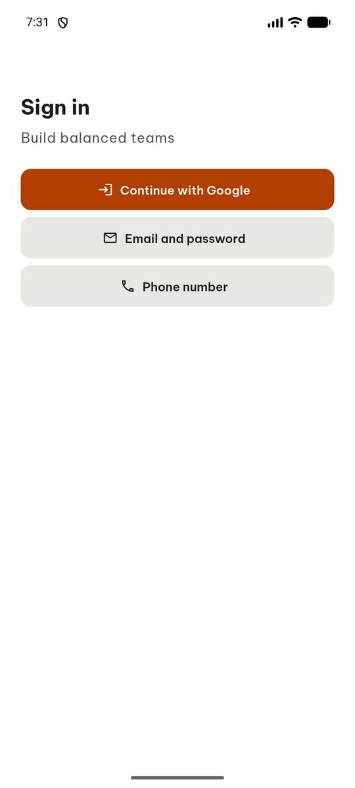
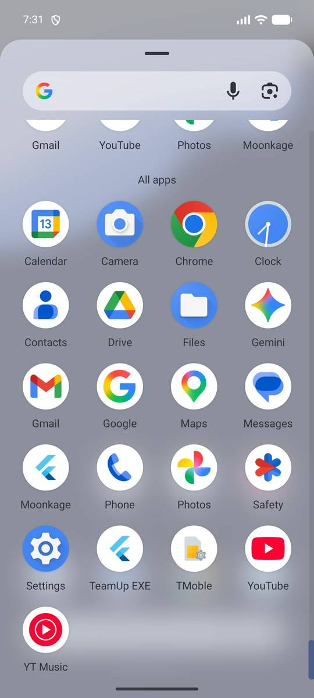

# test_tc02_sign_out_returns_to_sign_in (run 1)

- Session: `c99f2904-4134-4433-b72c-f1d526e819a5`
- Status: completed, 69.0s
- Output: `{"sign_in_visible": true, "classes_tab_visible": false, "relaunch_sign_in_visible": true}`

| Step | Screen before | Action |
|---|---|---|
| 1 |  | `manage_app` action=stop, app_name=com.group6.teamup_exe |
| 2 |  | `manage_app` action=launch, app_name=com.group6.teamup_exe |
| 3 |  | `wait_for_delay` time_in_ms=2000 |
| 4 |  | `click` target=9 |
| 5 |  | `swipe` direction=up |
| 6 |  | `click` target=7 |
| 7 |  | `click` target=7 |
| 8 |  | `click` target_description=Tap outside account chooser overlay to dismiss it, target=[500, 200] |
| 9 |  | `swipe` direction=up |
| 10 |  | `click` target=7 |
| 11 |  | `manage_app` action=stop, app_name=com.group6.teamup_exe |
| 12 |  | `manage_app` action=launch, app_name=com.group6.teamup_exe |
| 13 |  | `report_task_status` completed: {"sign_in_visible": true, "classes_tab_visible": false, "relaunch_sign_in_visible": true} |

Final screen:

