# test_tc03_invalid_email_shows_error (run 1)

- Session: `63cd2859-9f27-49ec-b764-7c8cc4eaff90`
- Status: completed, 84.4s
- Output: `{"error_text": "Enter a valid email", "reached_classes": false}`

| Step | Screen before | Action |
|---|---|---|
| 1 | 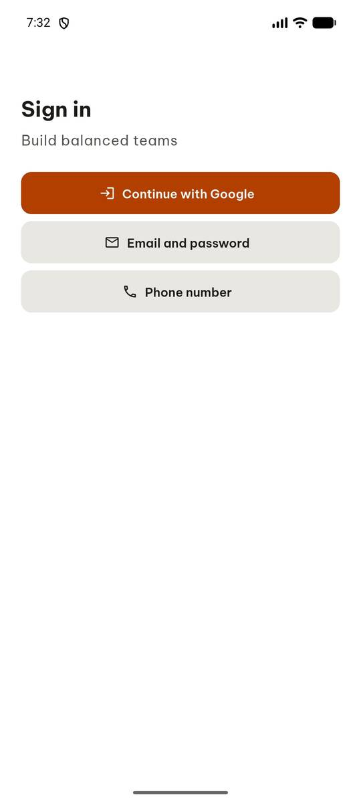 | `manage_app` app_name=com.group6.teamup_exe, action=stop |
| 2 |  | `manage_app` action=launch, app_name=com.group6.teamup_exe |
| 3 | 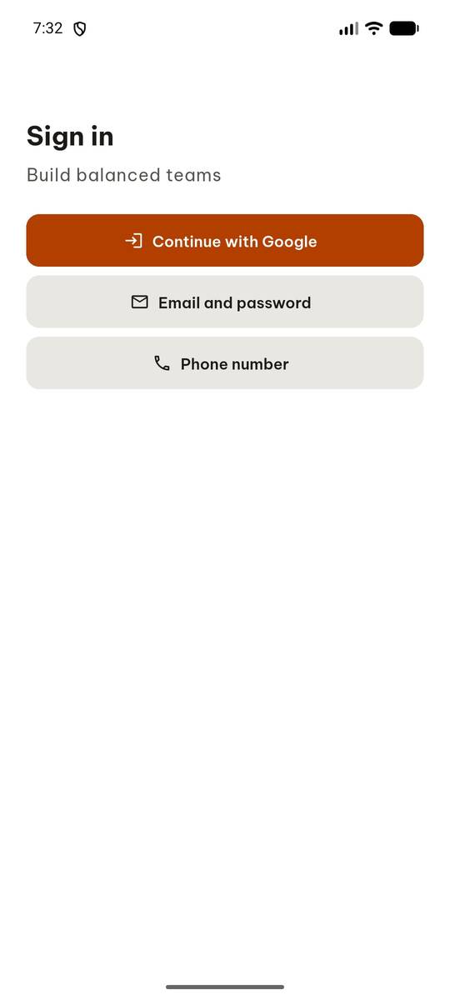 | `click` target=4 |
| 4 | 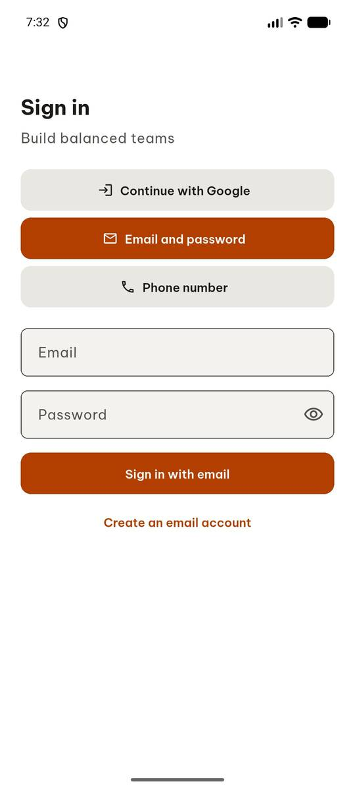 | `input_text` text=abc, clear_exist=True, target=6 |
| 5 |  | `input_text` text=abc, clear_exist=True, target=46 |
| 6 | 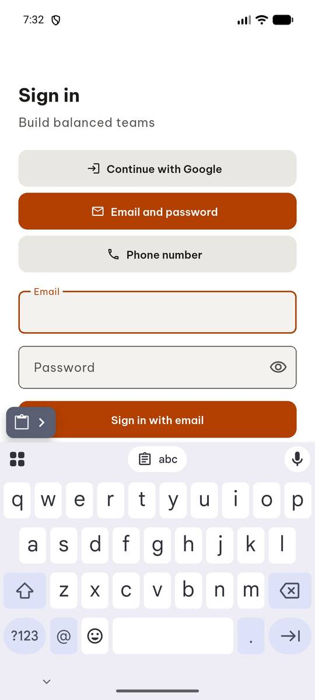 | `click_sequence` sequence=[[78, 785], [598, 850], [400, 850]], target_descriptions=['key a', 'key b', 'key c'] |
| 7 | 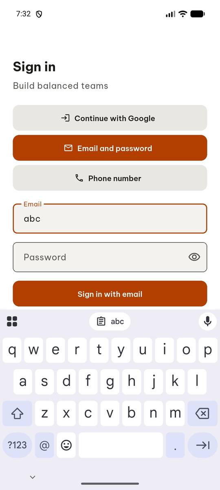 | `click` target_description=Password field, target=[500, 524] |
| 8 | 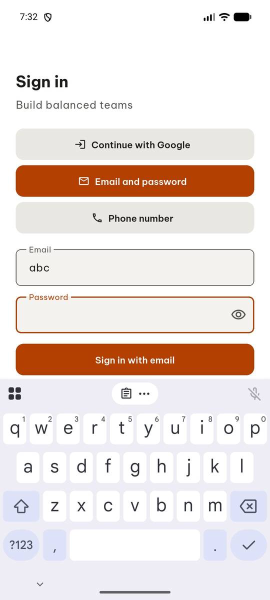 | `input_text` target=45, text=Passw0rd!, clear_exist=False |
| 9 | 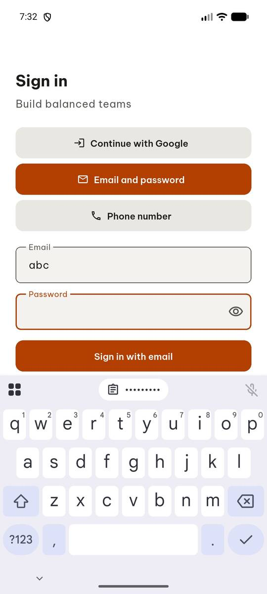 | `click_sequence` target_descriptions=['Shift key', 'Key P', 'Key a', 'Key s', 'Key s', 'Key w'], sequence=[[78, 850], [945, 720], [78, 785], [201, 785], [201, 785], [152, 720]] |
| 10 | 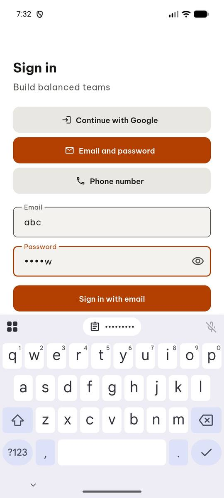 | `click` target=32 |
| 11 | 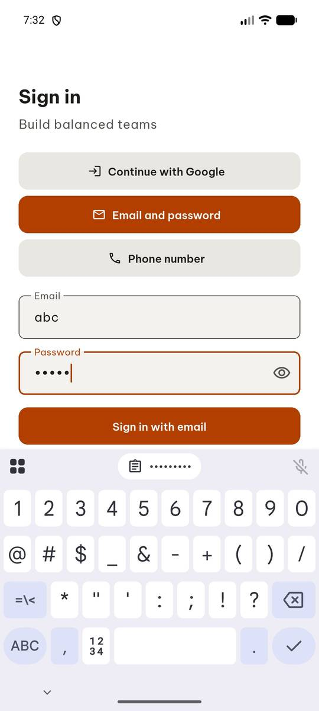 | `click_sequence` sequence=[[945, 720], [78, 915]], target_descriptions=['Key 0', 'Letter keyboard button'] |
| 12 |  | `click_sequence` target_descriptions=['Key r', 'Key d', 'Symbol keyboard button'], sequence=[[350, 720], [301, 785], [78, 915]] |
| 13 | 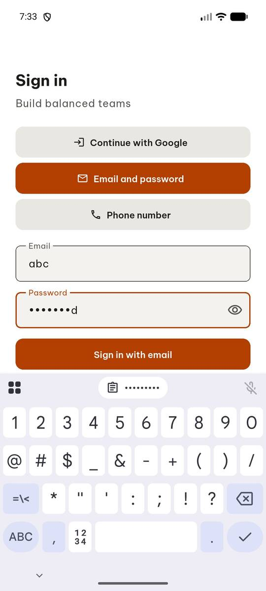 | `click_sequence` target_descriptions=['Exclamation mark key', 'Sign in with email button'], sequence=[[697, 850], [500, 598]] |
| 14 | 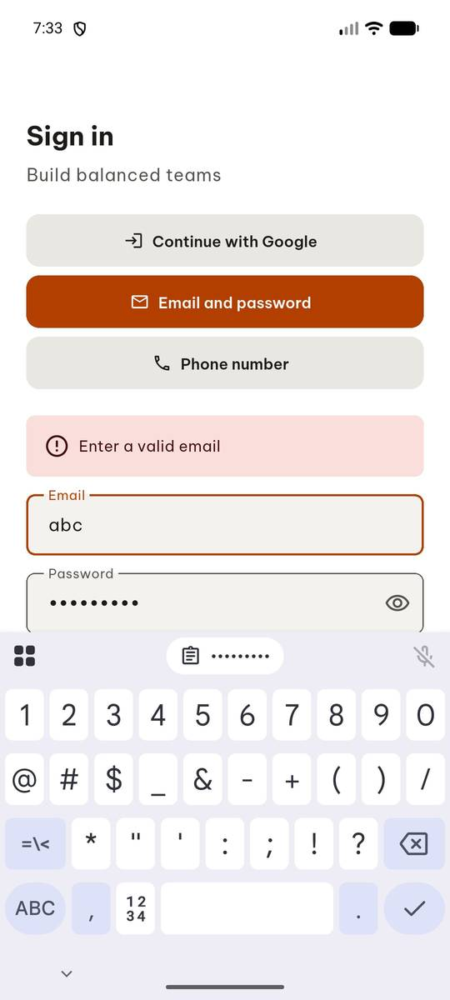 | `report_task_status` completed: {"error_text": "Enter a valid email", "reached_classes": false} |

Final screen:

