# test_tc05_match_with_ai_then_approve (run 1)

- Session: `763f3ec2-4de3-45d2-b044-050bead9fe5a`
- Status: completed, 102.9s
- Output: `{"group2_before": 1, "member_count": 6, "approved_message": "Team approved", "group2_after": 0}`

| Step | Screen before | Action |
|---|---|---|
| 1 | 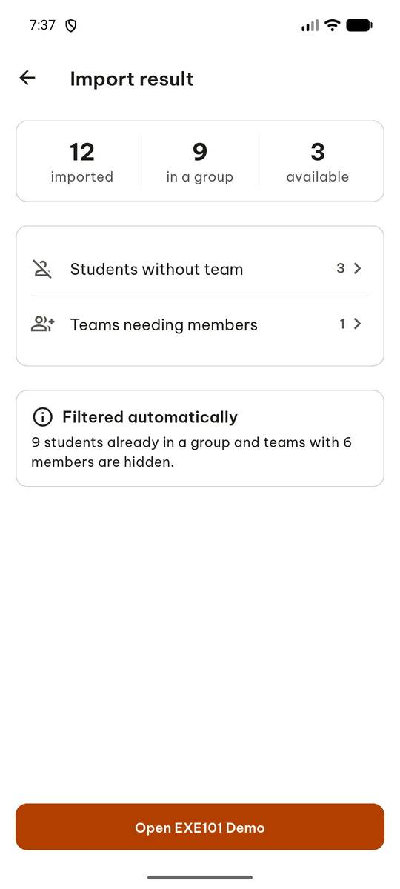 | `manage_app` action=stop, app_name=com.group6.teamup_exe |
| 2 |  | `manage_app` app_name=com.group6.teamup_exe, action=launch |
| 3 |  | `wait_for_delay` time_in_ms=3000 |
| 4 | 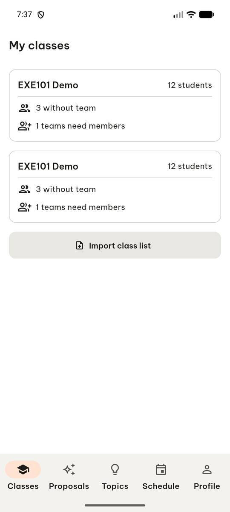 | `click` target=6 |
| 5 | 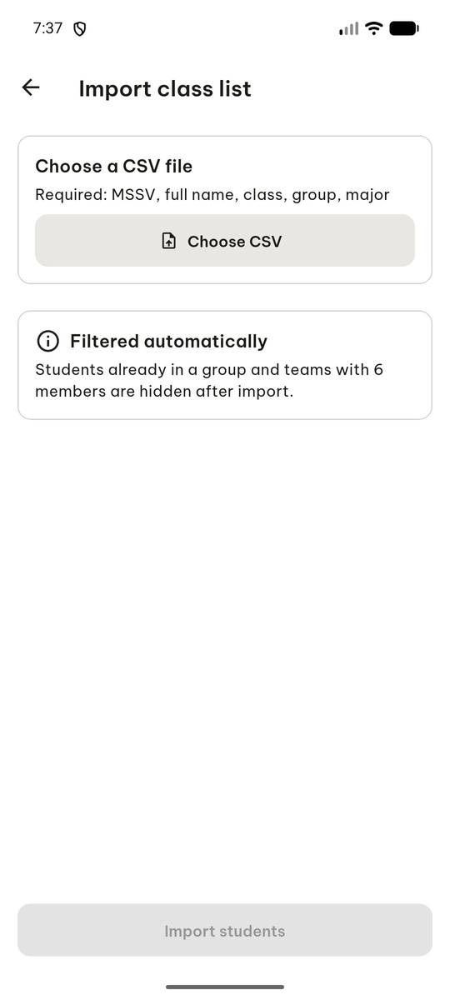 | `click` target=3 |
| 6 |  | `click` target_description=Choose CSV button, target=[500, 240] |
| 7 | 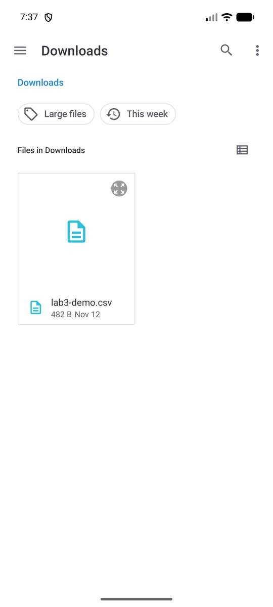 | `click` target=10 |
| 8 | 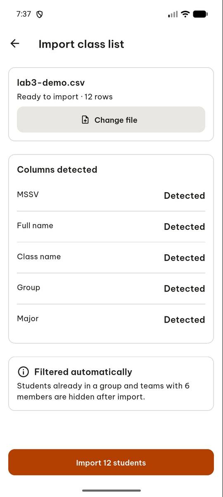 | `click` target=6 |
| 9 | 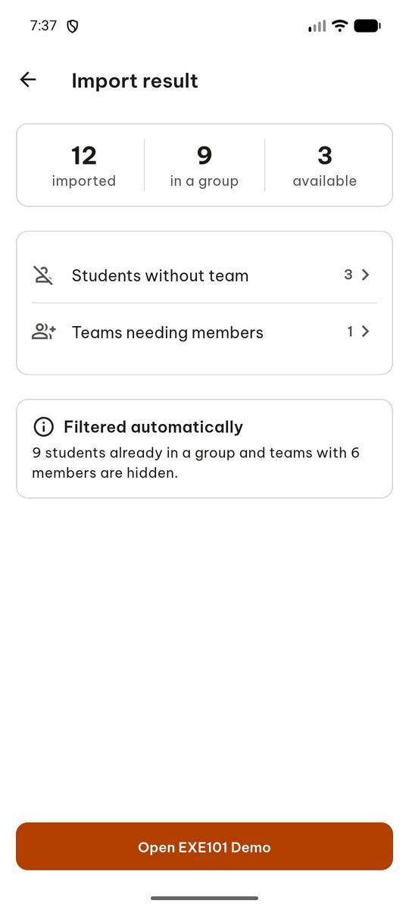 | `click` target=9 |
| 10 | 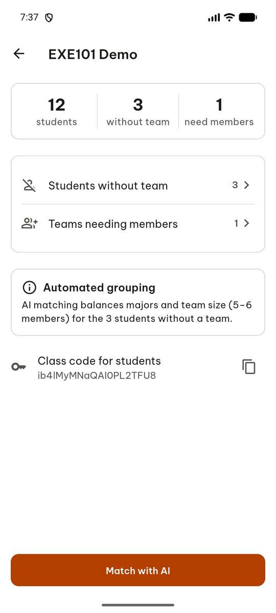 | `click` target=11 |
| 11 | 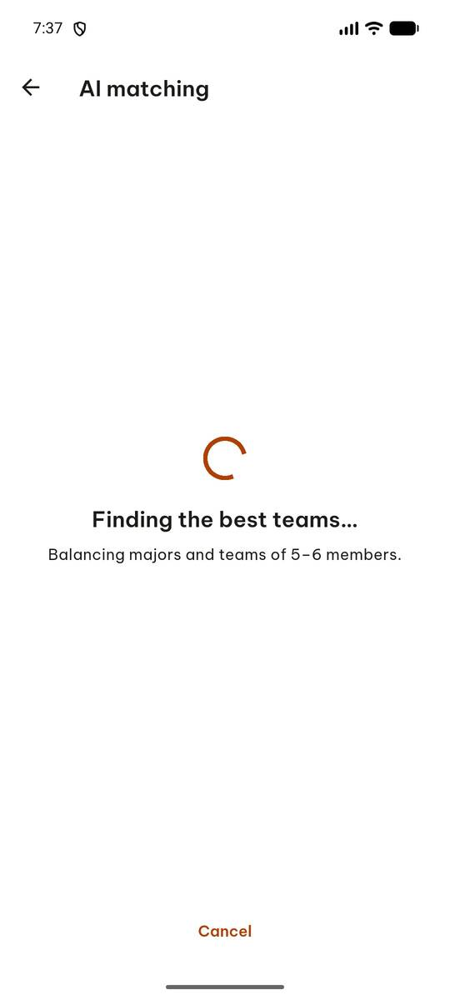 | `wait_for_delay` time_in_ms=10000 |
| 12 | 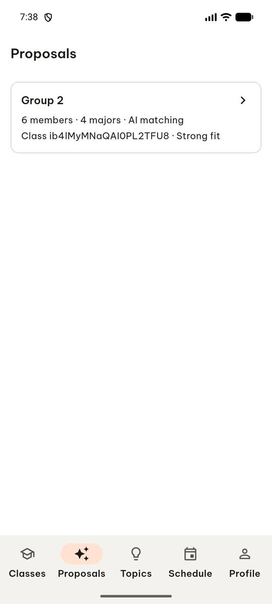 | `click` target=2 |
| 13 | 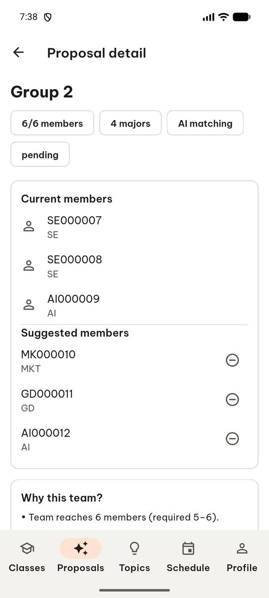 | `swipe` direction=up |
| 14 | 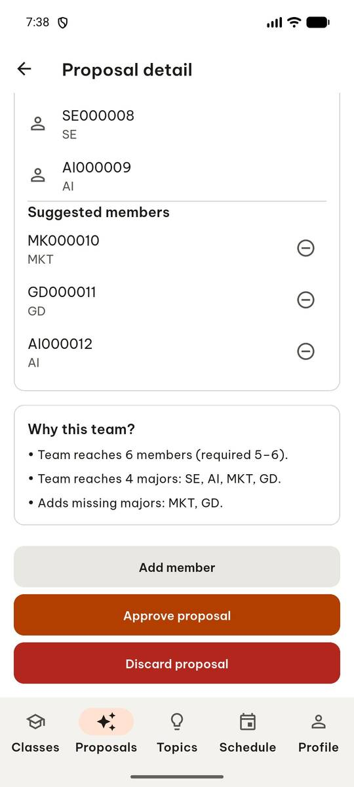 | `click` target=14 |
| 15 | 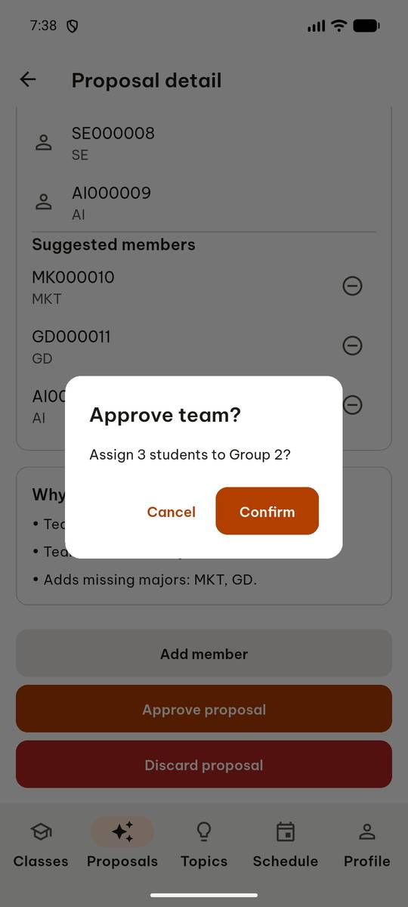 | `click` target=5 |
| 16 | 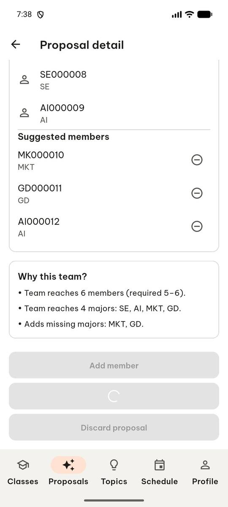 | `wait_for_delay` time_in_ms=2000 |
| 17 | 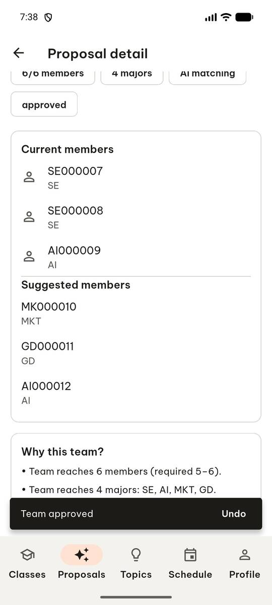 | `click` target=1 |
| 18 |  | `report_task_status` completed: {"group2_before": 1, "member_count": 6, "approved_message": "Team approved", "group2_after": 0} |

Final screen:

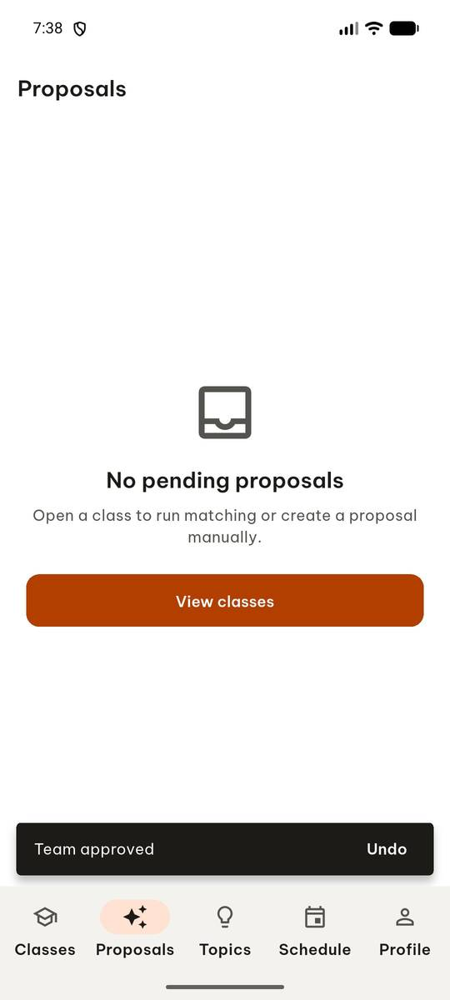
