# test_tc06_remove_members_blocks_approve_below_five (run 1)

- Session: `e5f0435a-b306-4318-8fb7-a24abae6379a`
- Status: completed, 104.0s
- Output: `{"banner_text": "Approval needs at least 5 and at most 6 members.", "approve_enabled": false}`

| Step | Screen before | Action |
|---|---|---|
| 1 | 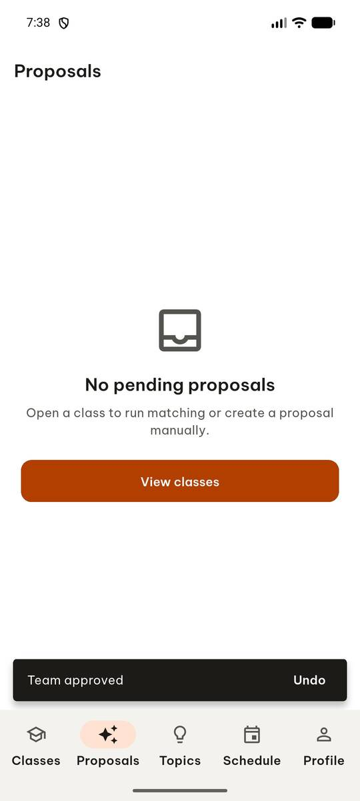 | `manage_app` app_name=com.group6.teamup_exe, action=stop |
| 2 |  | `manage_app` app_name=com.group6.teamup_exe, action=launch |
| 3 |  | `wait_for_delay` time_in_ms=2000 |
| 4 | 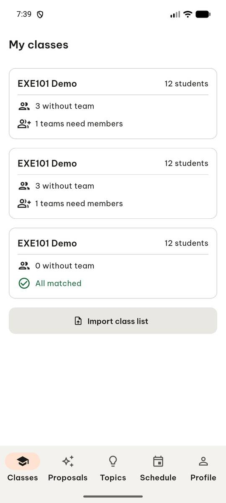 | `click` target=8 |
| 5 | 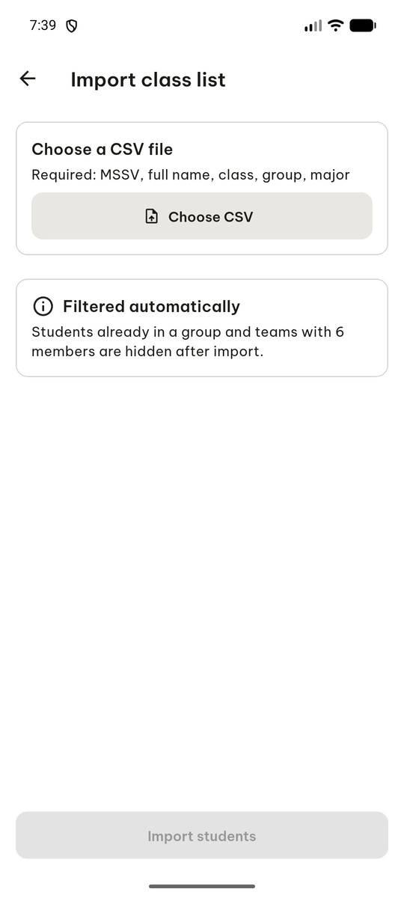 | `click` target=[500, 240], target_description=Choose CSV button |
| 6 | 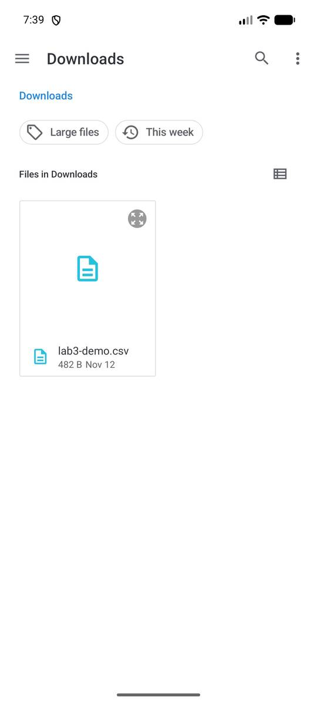 | `click` target=11 |
| 7 | 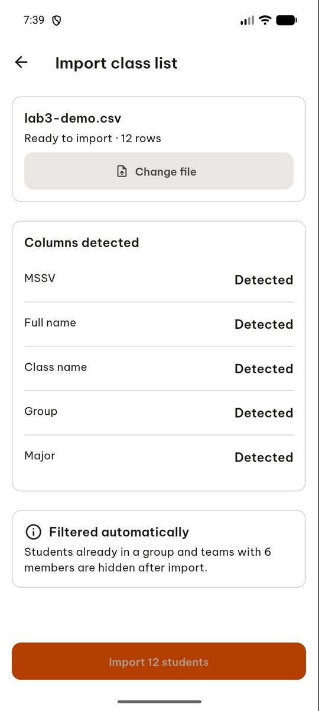 | `click` target=6 |
| 8 | 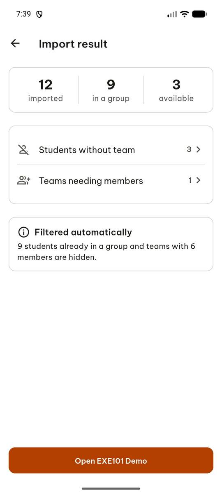 | `click` target=9 |
| 9 | 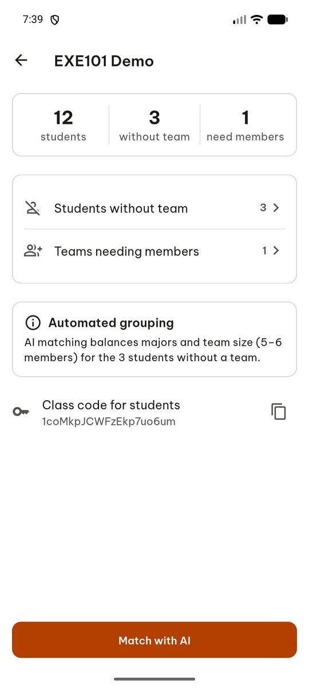 | `click` target=11 |
| 10 | 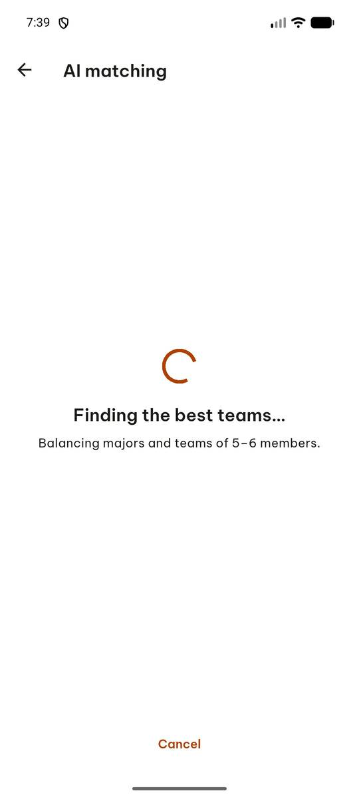 | `wait_for_delay` time_in_ms=5000 |
| 11 | 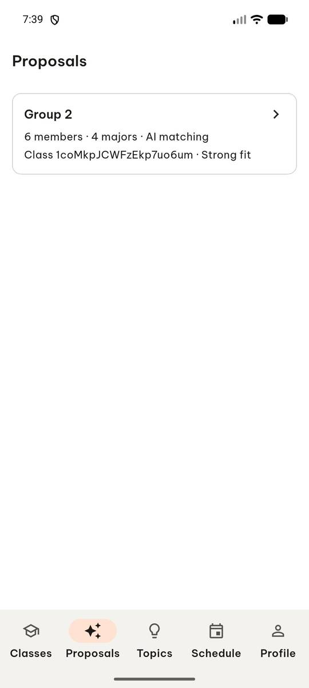 | `click` target=2 |
| 12 |  | `click` target=13 |
| 13 | 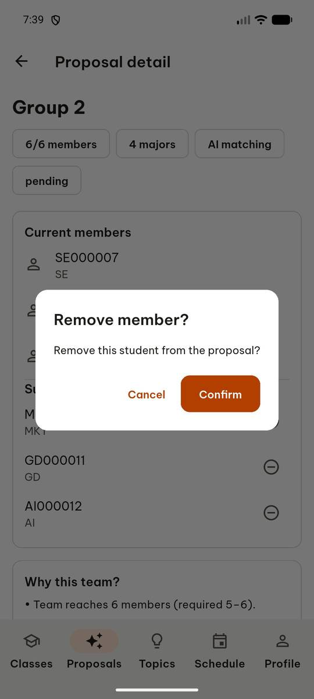 | `click` target=5 |
| 14 | 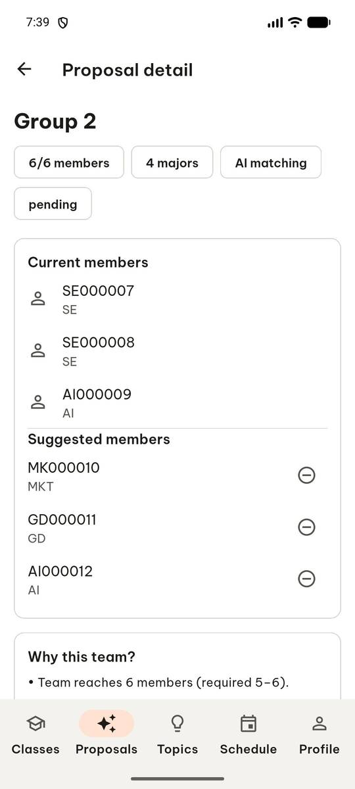 | `click` target=13 |
| 15 | 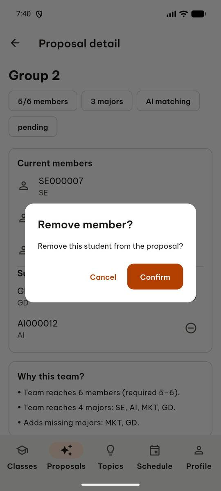 | `click` target=5 |
| 16 | 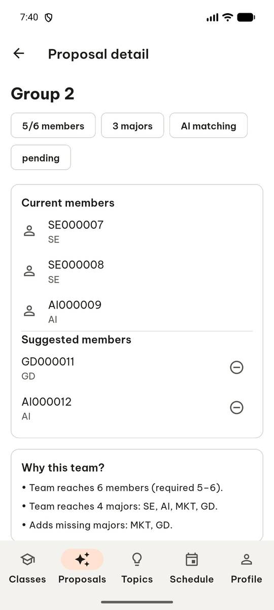 | `swipe` direction=up |
| 17 | 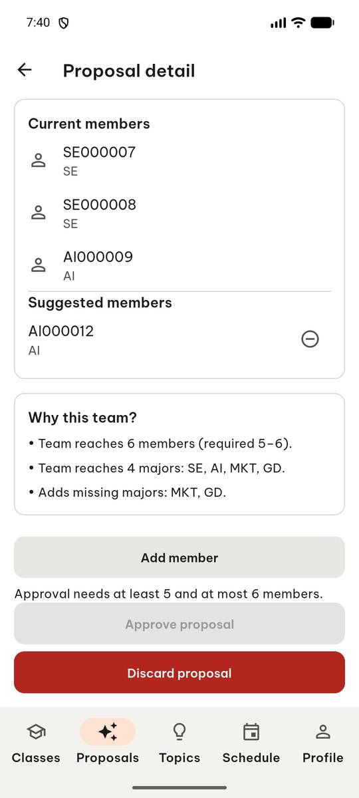 | `click` target=13 |
| 18 | 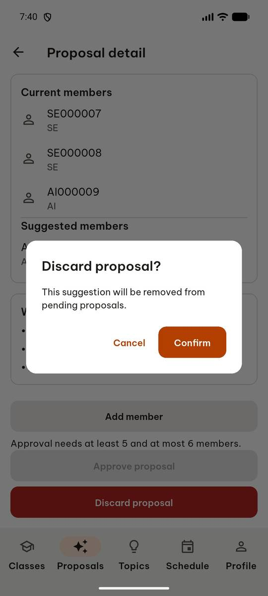 | `click` target=5 |
| 19 | 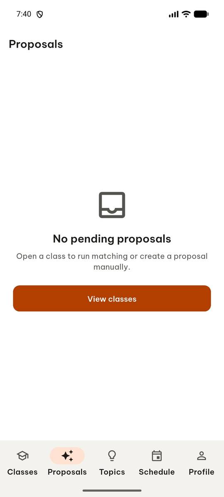 | `report_task_status` completed: {"banner_text": "Approval needs at least 5 and at most 6 members.", "approve_enabled": false} |

Final screen:

