# test_tc07_discard_then_manual_add_search_empty (run 1)

- Session: `fe3e1b34-8066-41c6-8ac5-ee3eaf70e49d`
- Status: completed, 126.9s
- Output: `{"group2_before": 1, "group2_after": 0, "empty_title": "No student results"}`

| Step | Screen before | Action |
|---|---|---|
| 1 | 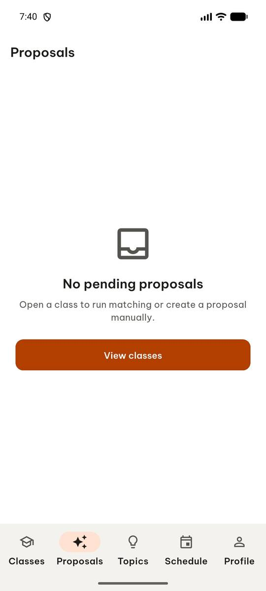 | `manage_app` app_name=com.group6.teamup_exe, action=stop |
| 2 |  | `manage_app` action=launch, app_name=com.group6.teamup_exe |
| 3 |  | `wait_for_delay` time_in_ms=3000 |
| 4 | 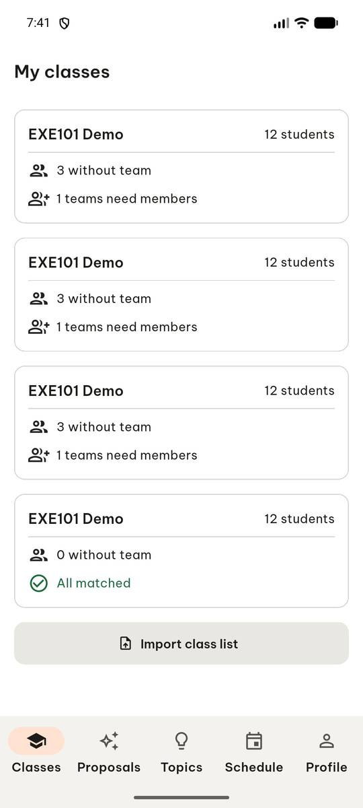 | `click` target=10 |
| 5 | 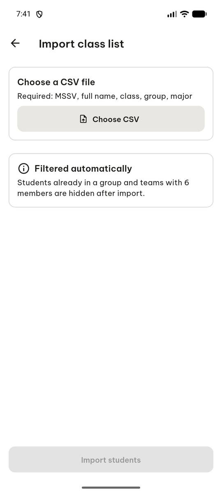 | `click` target=[500, 240], target_description=Choose CSV button |
| 6 |  | `click` target=11 |
| 7 | 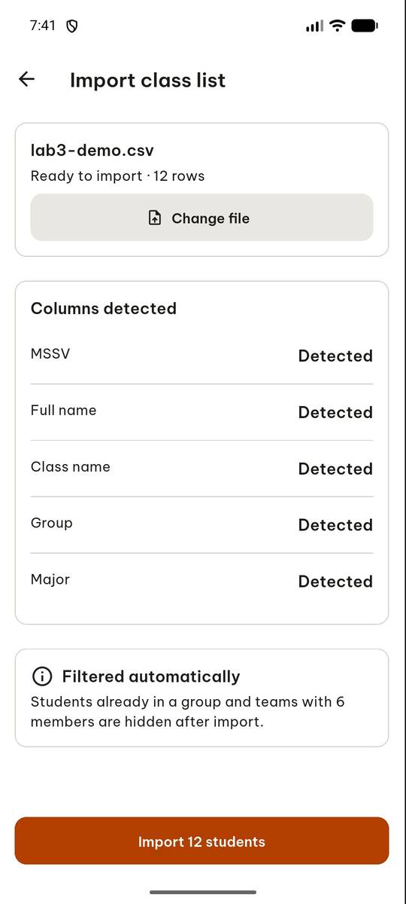 | `click` target=5 |
| 8 | 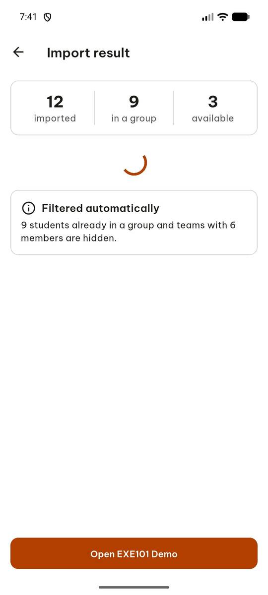 | `click` target=9 |
| 9 | 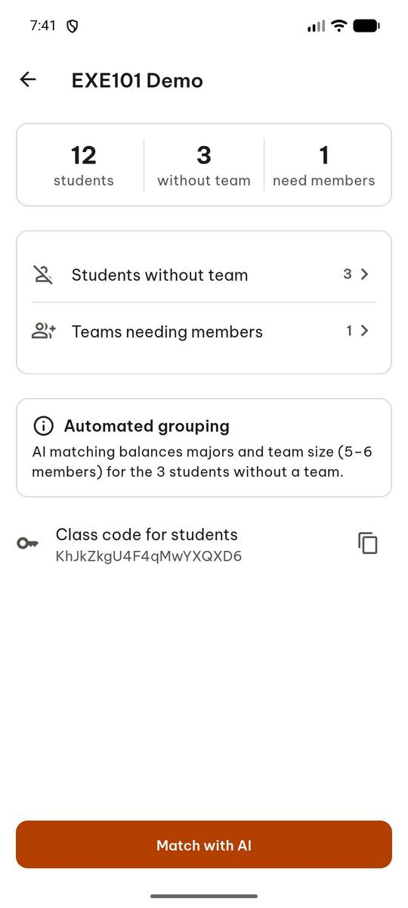 | `click` target=11 |
| 10 | 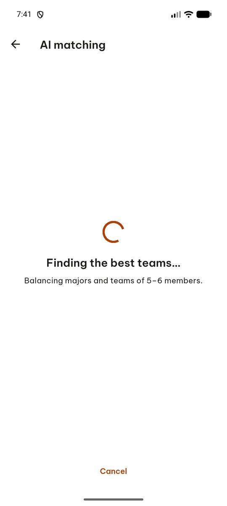 | `wait_for_delay` time_in_ms=5000 |
| 11 | 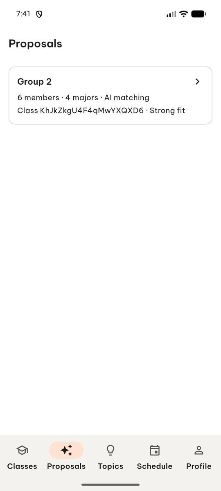 | `click` target=2 |
| 12 | 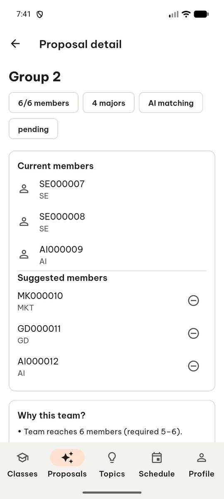 | `swipe` direction=up |
| 13 | 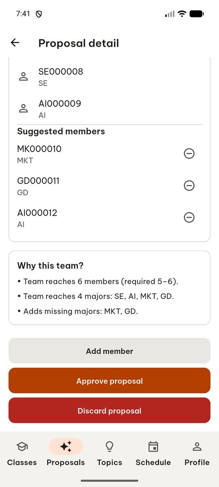 | `click` target=15 |
| 14 | 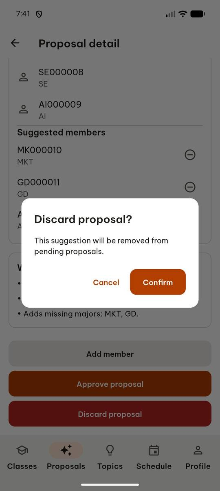 | `click` target=5 |
| 15 | 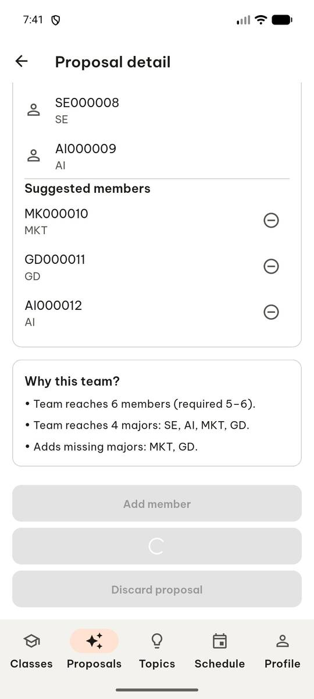 | `wait_for_delay` time_in_ms=2000 |
| 16 | 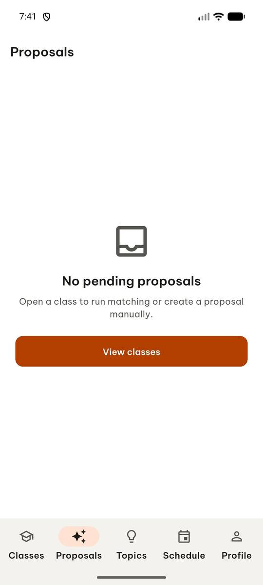 | `click` target=5 |
| 17 | 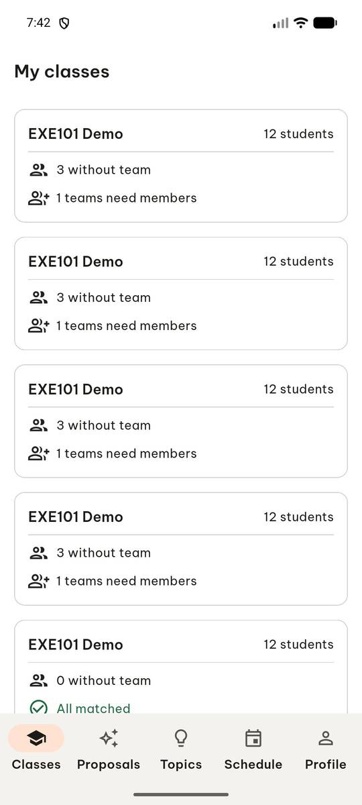 | `click` target=3 |
| 18 | 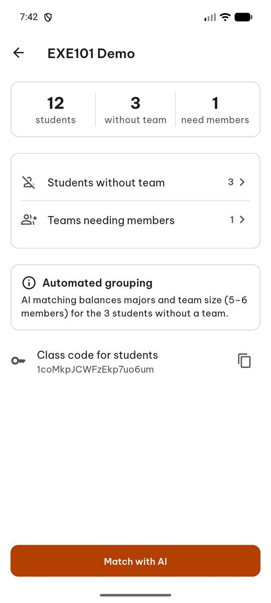 | `click` target=6 |
| 19 | 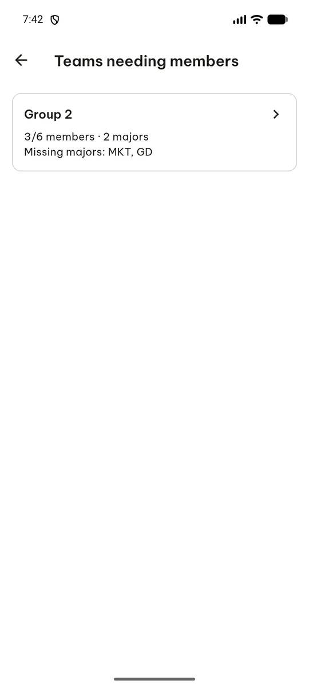 | `click` target=3 |
| 20 | 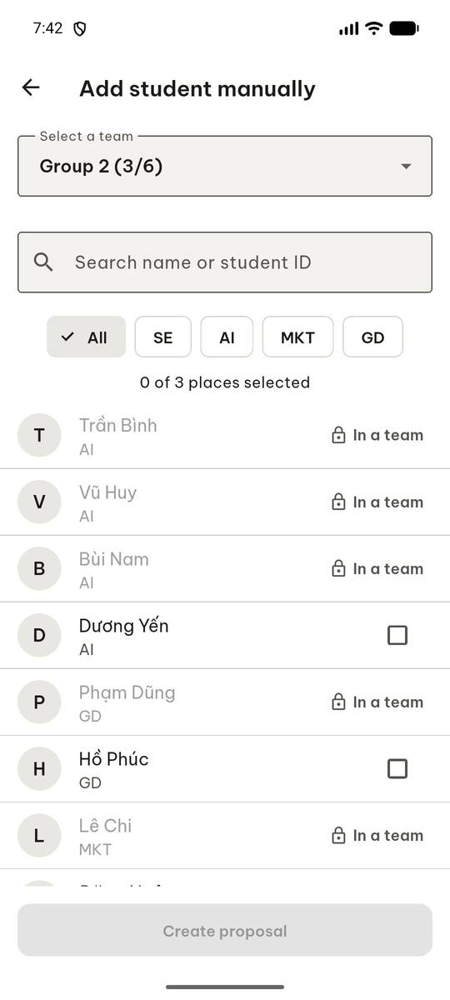 | `input_text` target=4, clear_exist=True, target_description=Search field, text=ZZZ |
| 21 | 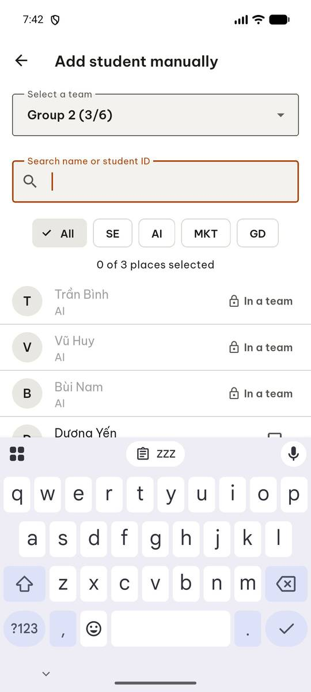 | `input_text` clear_exist=True, text=ZZZ, target=42, target_description=Search name or student ID |
| 22 | 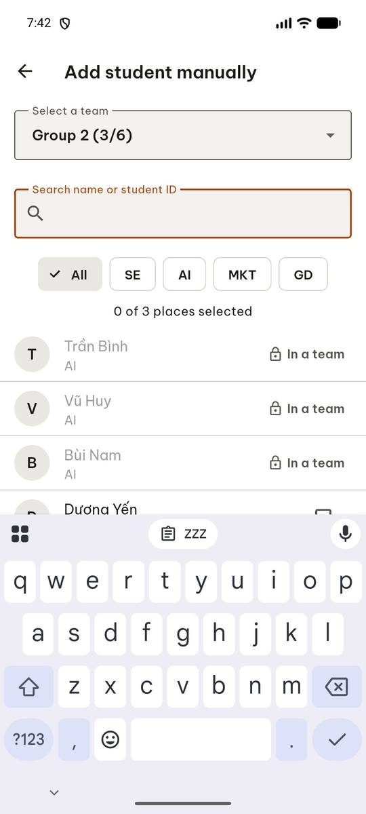 | `click` target=2 |
| 23 |  | `report_task_status` completed: {"group2_before": 1, "group2_after": 0, "empty_title": "No student results"} |

Final screen:

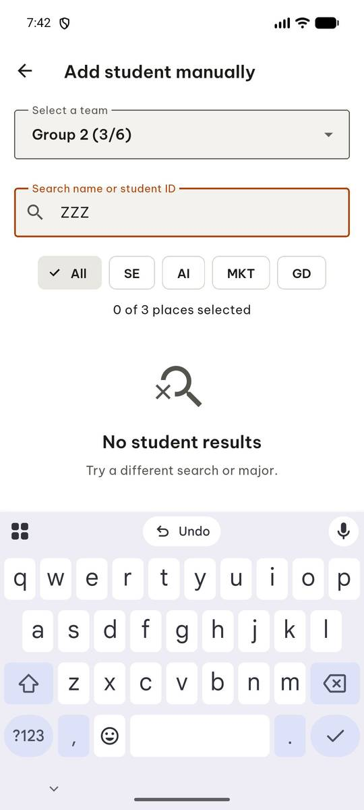
