# test_tc08_class_and_student_detail_values (run 1)

- Session: `392fb26f-43cf-4b70-b6be-dadf1d933245`
- Status: completed, 124.1s
- Output: `{"without_team": 3, "need_members": 1, "student_ids": ["AI000012", "GD000011", "MK000010"], "student_id": "AI000012", "group": "None", "major": "AI"}`

| Step | Screen before | Action |
|---|---|---|
| 1 | 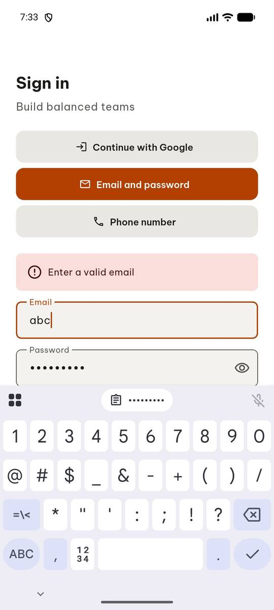 | `manage_app` app_name=com.group6.teamup_exe, action=stop |
| 2 |  | `manage_app` action=launch, app_name=com.group6.teamup_exe |
| 3 | 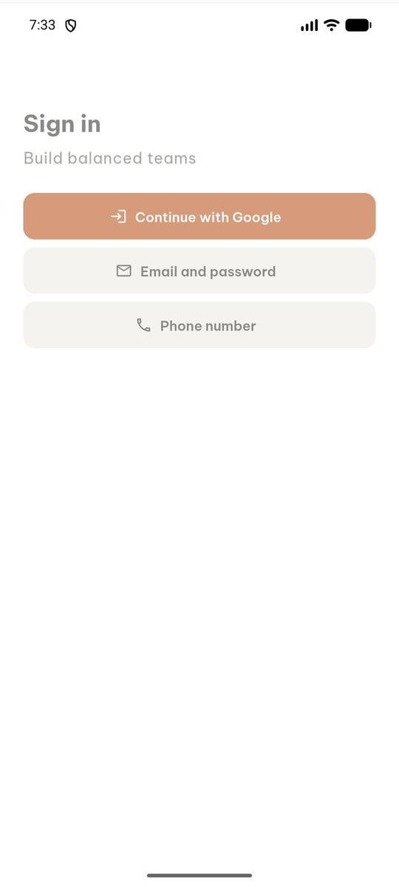 | `click` target=3 |
| 4 | 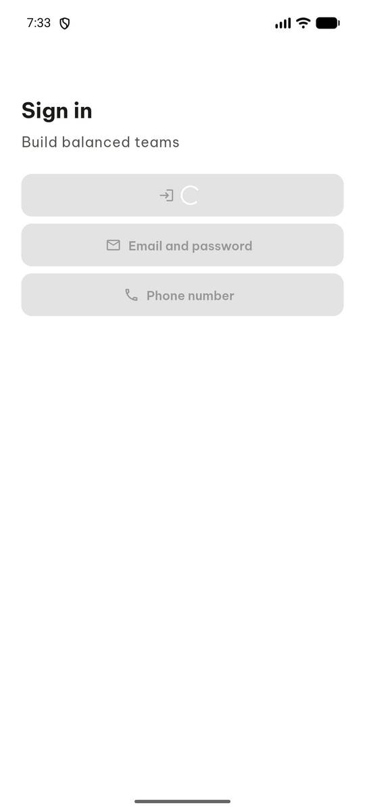 | `wait_for_delay` time_in_ms=3000 |
| 5 | 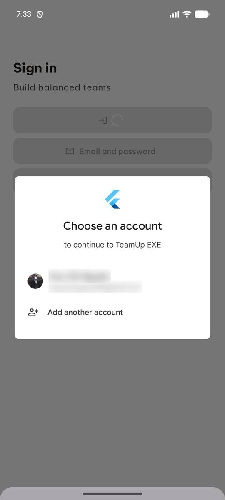 | `click` target=3 |
| 6 |  | `wait_for_delay` time_in_ms=4000 |
| 7 | 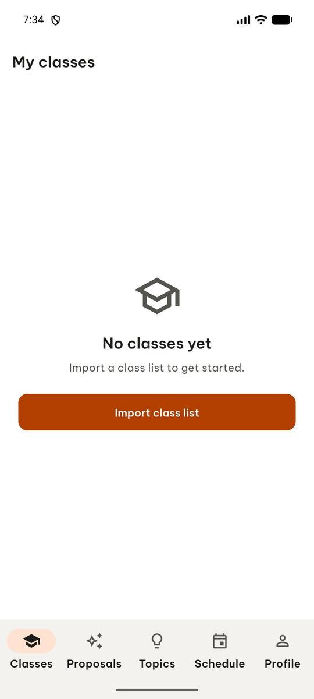 | `click` target=4 |
| 8 | 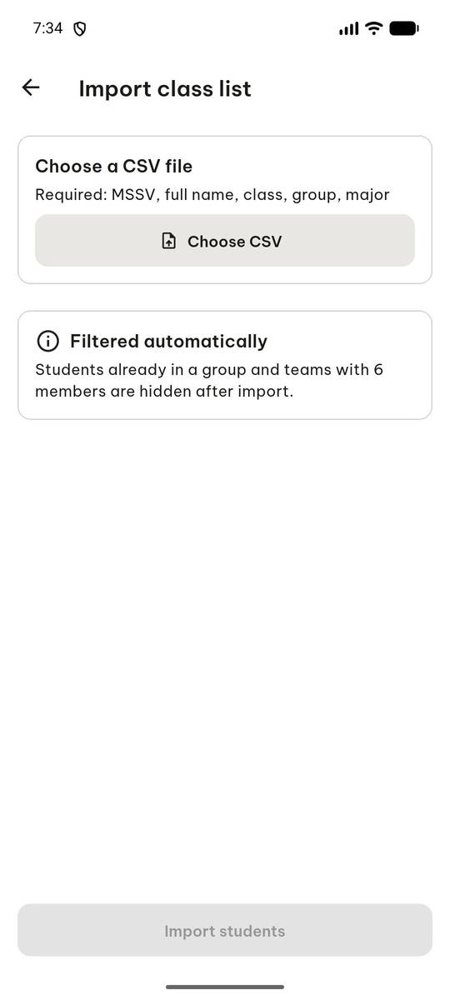 | `click` target=[500, 240], target_description=Choose CSV button |
| 9 |  | `wait_for_delay` time_in_ms=2000 |
| 10 | 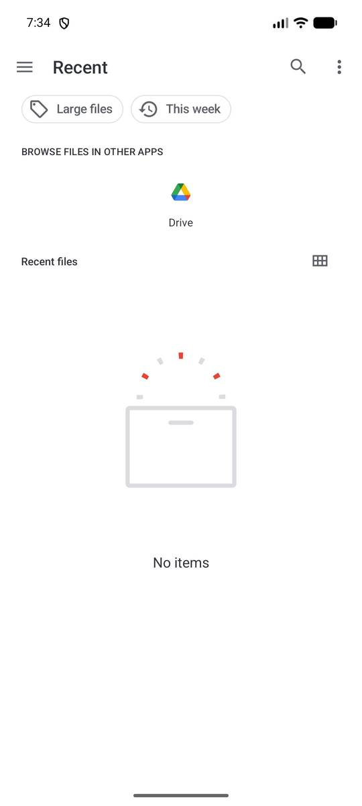 | `click` target=7 |
| 11 | 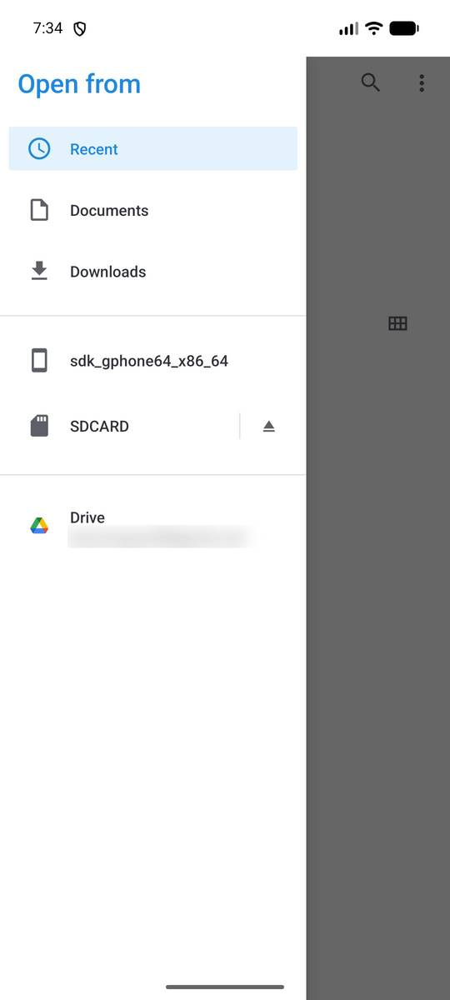 | `click` target=4 |
| 12 | 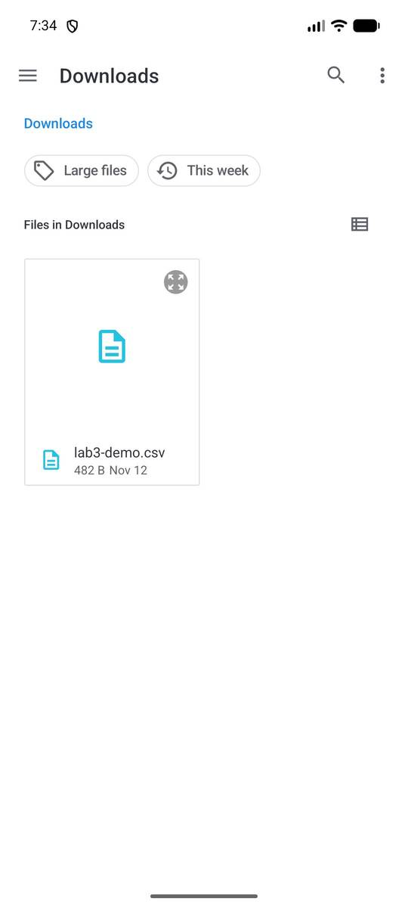 | `click` target=11 |
| 13 | 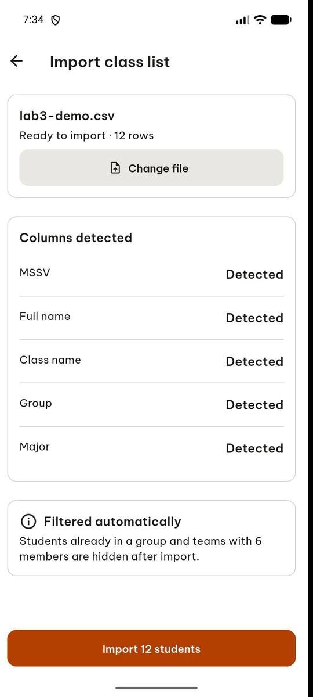 | `click` target=6 |
| 14 | 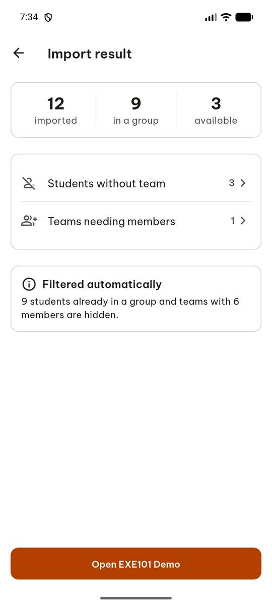 | `click` target=9 |
| 15 | 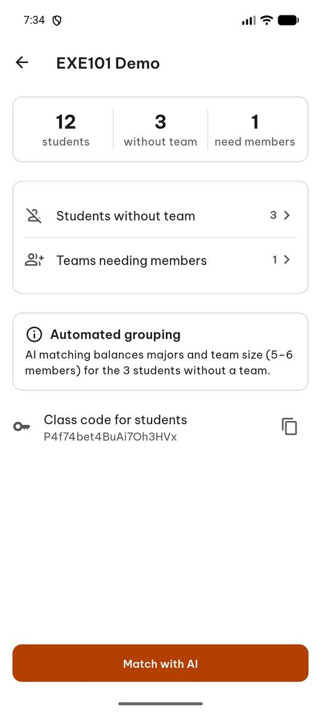 | `click` target=5 |
| 16 | 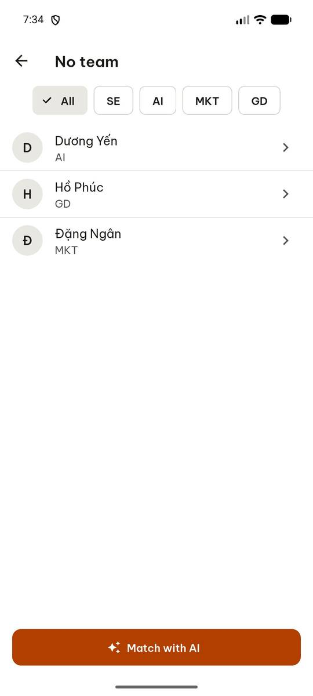 | `click` target=9 |
| 17 |  | `click` target=1 |
| 18 |  | `click` target=11 |
| 19 | 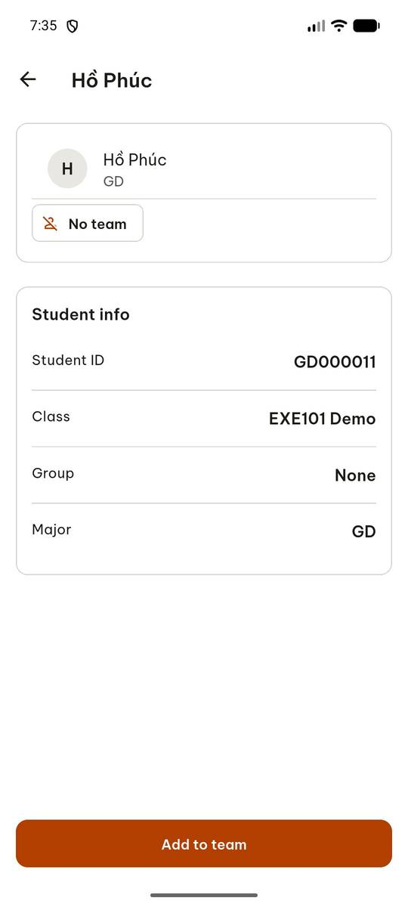 | `click` target=1 |
| 20 |  | `click` target=13 |
| 21 | 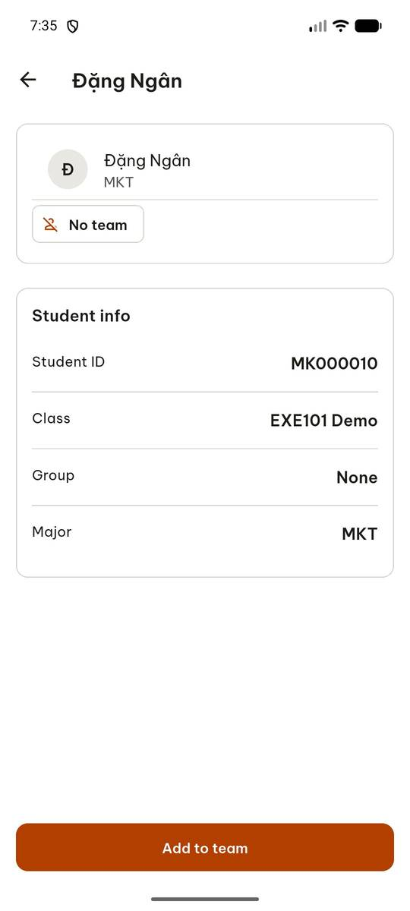 | `report_task_status` completed: {"without_team": 3, "need_members": 1, "student_ids": ["AI000012", "GD000011", "MK000010"], "student_id": "AI000012", "group": "None", "major": "AI"} |

Final screen:

