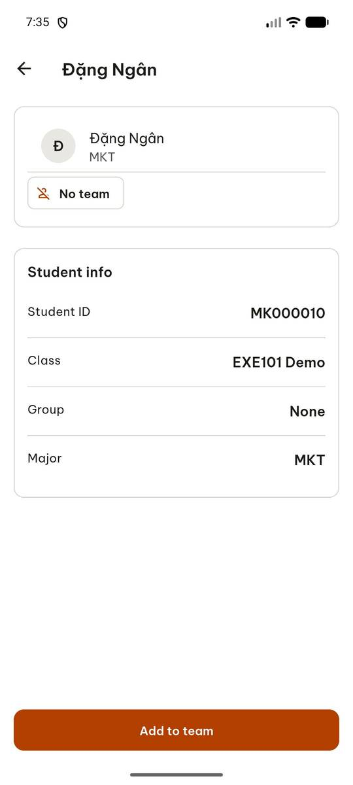
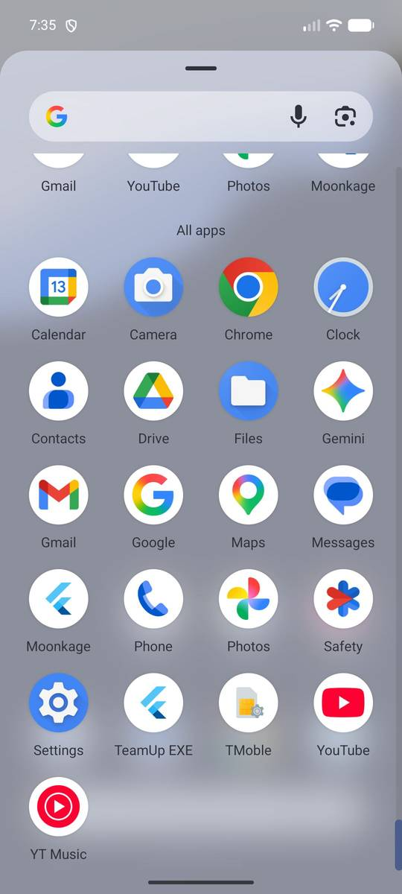
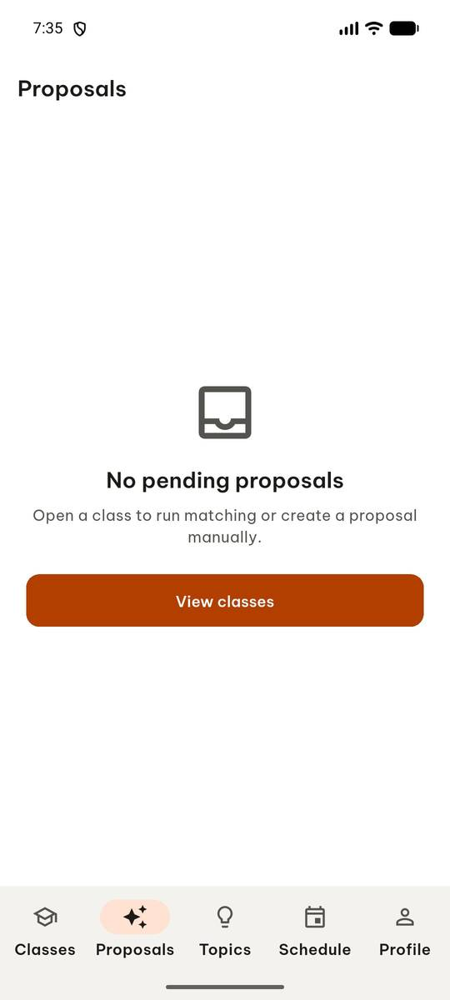
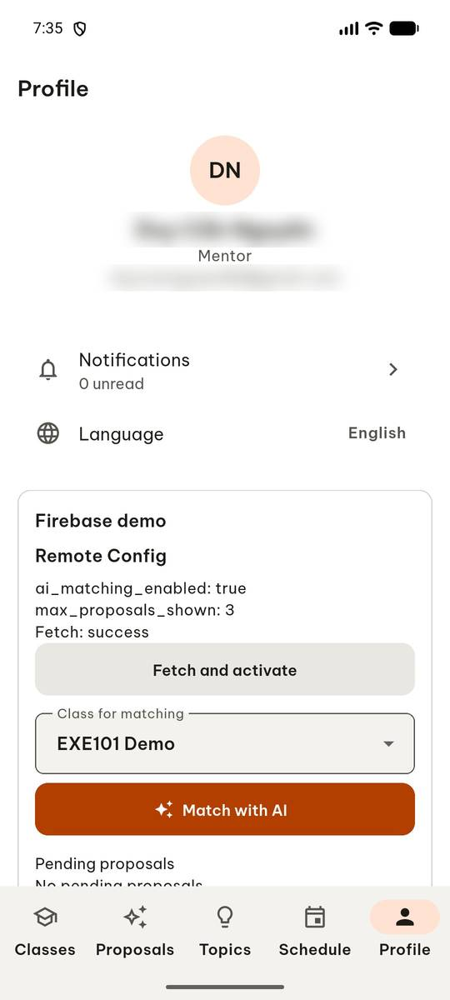
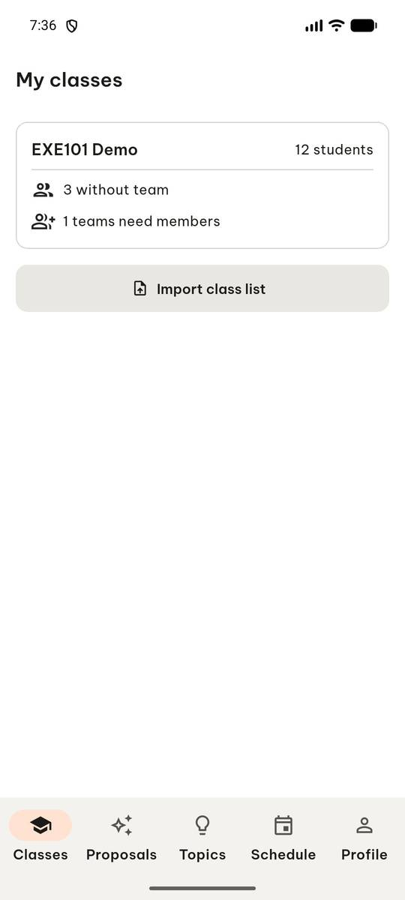
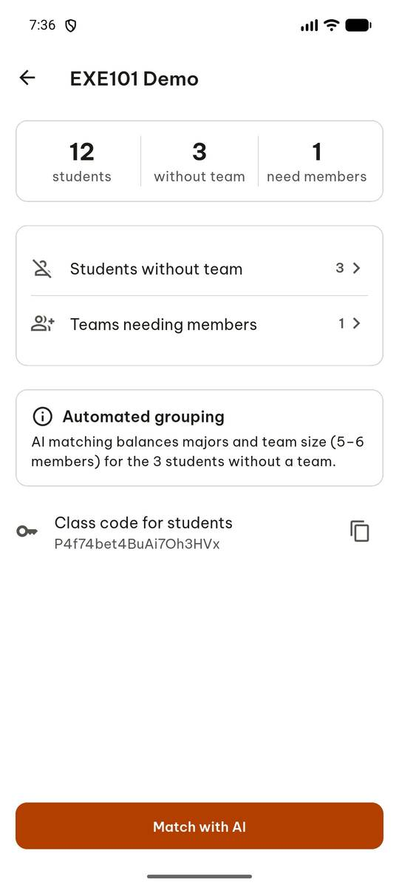

# test_tc09_tabs_and_back_navigation (run 1)

- Session: `f4c8df86-8cfb-4f84-b001-5818cba1d3d0`
- Status: completed, 49.7s
- Output: `{"proposals_title": "Proposals", "profile_title": "Profile", "classes_title": "My classes", "back_title": "My classes"}`

| Step | Screen before | Action |
|---|---|---|
| 1 |  | `manage_app` action=stop, app_name=com.group6.teamup_exe |
| 2 |  | `manage_app` app_name=com.group6.teamup_exe, action=launch |
| 3 |  | `wait_for_delay` time_in_ms=2000 |
| 4 |  | `click` target=6 |
| 5 |  | `click` target=9 |
| 6 |  | `click` target=12 |
| 7 |  | `click` target=3 |
| 8 |  | `press_key` key=BACK |
| 9 |  | `report_task_status` completed: {"proposals_title": "Proposals", "profile_title": "Profile", "classes_title": "My classes", "back_title": "My classes"} |

Final screen:

