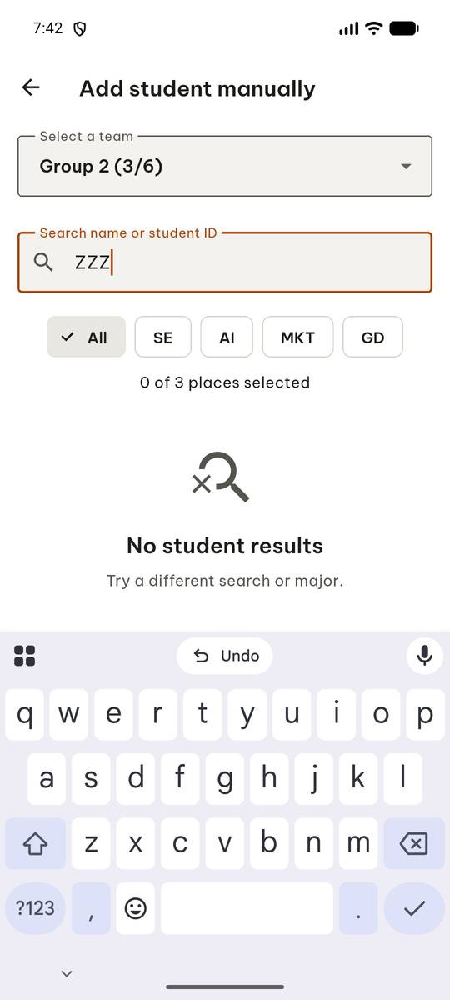
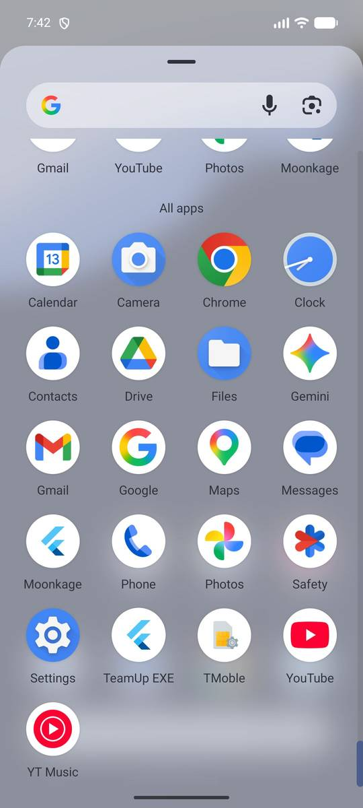
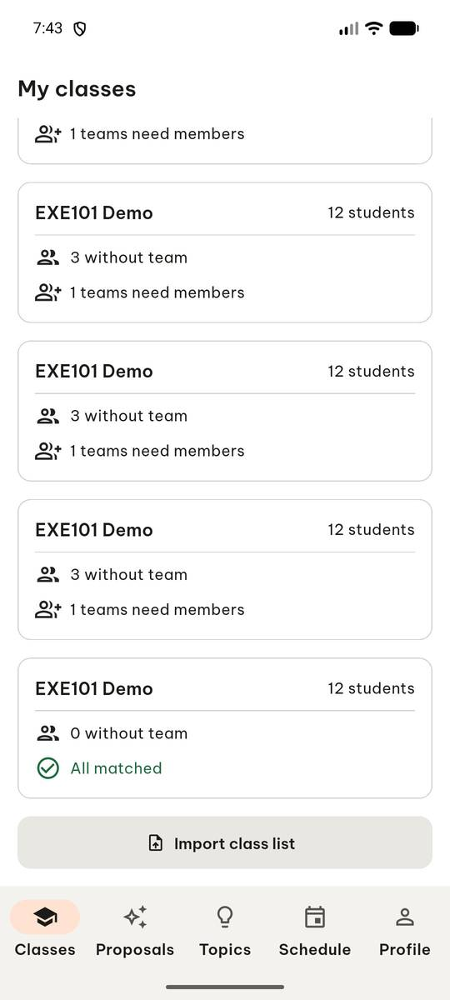
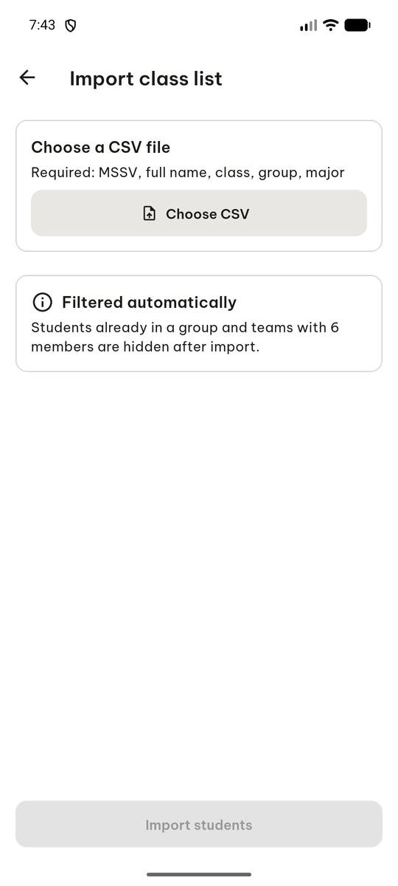
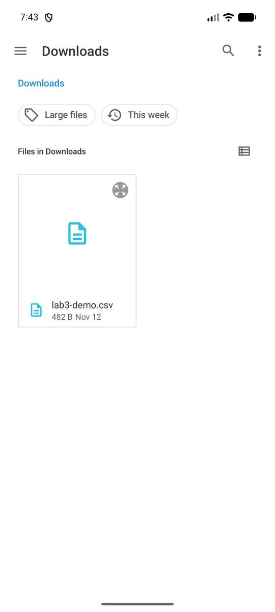
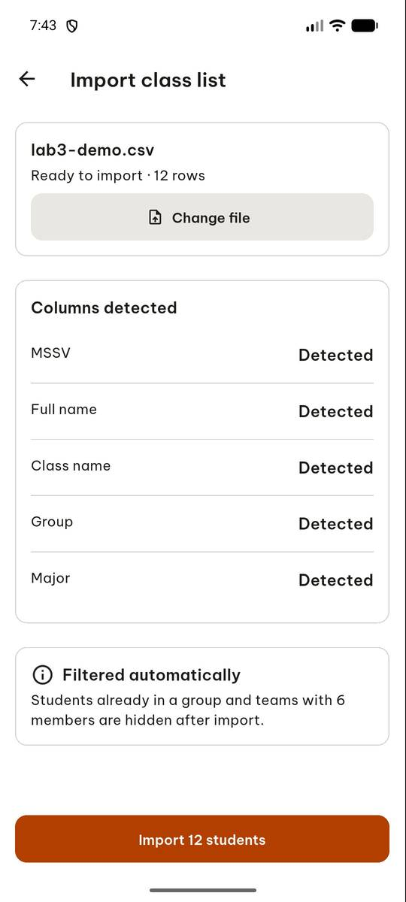
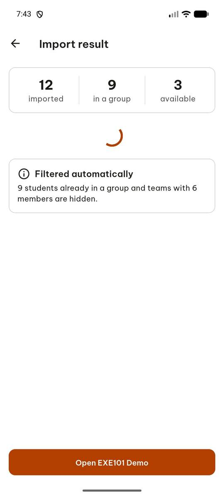
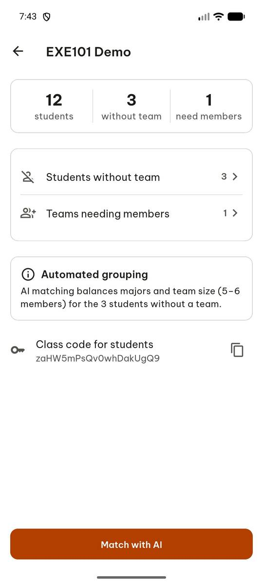
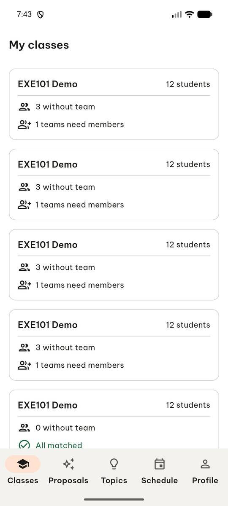
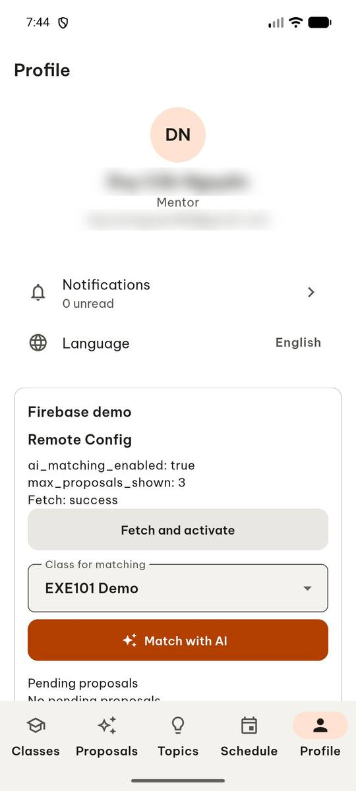

# test_tc10_remote_config_values_change_the_app (run 1)

- Session: `28bb6923-08af-4168-a09d-fe9409904600`
- Status: completed, 92.2s
- Output: `{"match_button_visible": true, "ai_matching_enabled": true, "max_proposals_shown": 3}`

| Step | Screen before | Action |
|---|---|---|
| 1 |  | `manage_app` app_name=com.group6.teamup_exe, action=stop |
| 2 |  | `manage_app` action=launch, app_name=com.group6.teamup_exe |
| 3 |  | `wait_for_delay` time_in_ms=3000 |
| 4 |  | `swipe` direction=up |
| 5 |  | `click` target=12 |
| 6 |  | `click` target_description=Choose CSV button, target=[500, 240] |
| 7 |  | `click` target=11 |
| 8 |  | `click` target=6 |
| 9 |  | `click` target=6 |
| 10 |  | `click` target=1 |
| 11 |  | `click` target=16 |
| 12 |  | `report_task_status` completed: {"match_button_visible": true, "ai_matching_enabled": true, "max_proposals_shown": 3} |

Final screen:

