# test_tc11_export_pdf_and_upload (run 1)

- Session: `f8d4337d-7af1-4647-b967-2f764b4b8633`
- Status: completed, 95.2s
- Output: `{"saw_progress": true, "status_text": "Uploaded 13 KB. Opening the PDF share dialog.", "saved_reports_visible": true}`

| Step | Screen before | Action |
|---|---|---|
| 1 | 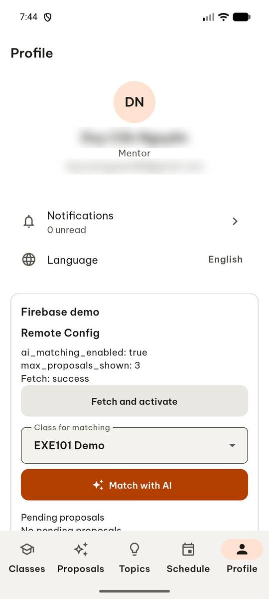 | `manage_app` action=stop, app_name=com.group6.teamup_exe |
| 2 |  | `manage_app` action=launch, app_name=com.group6.teamup_exe |
| 3 |  | `wait_for_delay` time_in_ms=2000 |
| 4 | 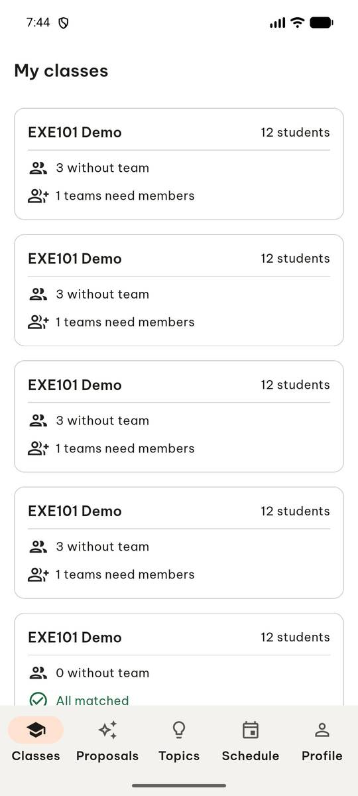 | `swipe` direction=up |
| 5 | 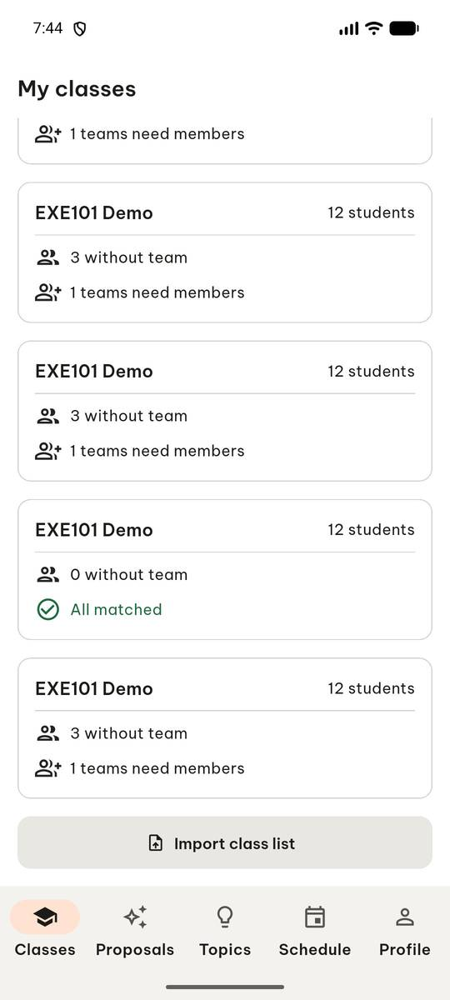 | `click` target=12 |
| 6 | 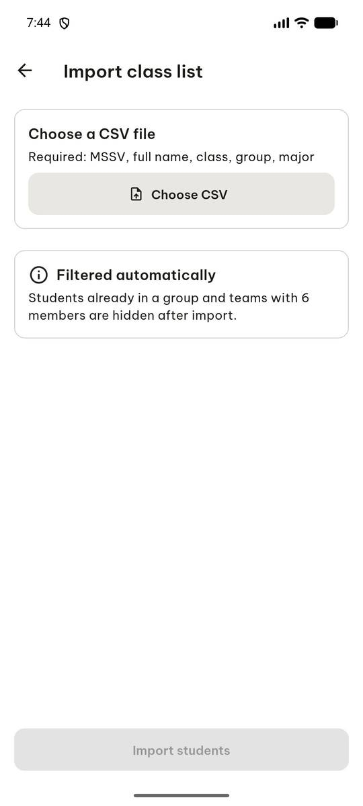 | `click` target=[500, 240], target_description=Choose CSV button |
| 7 | 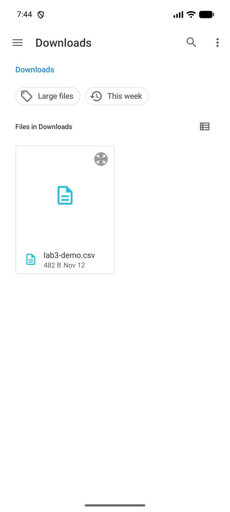 | `click` target=11 |
| 8 | 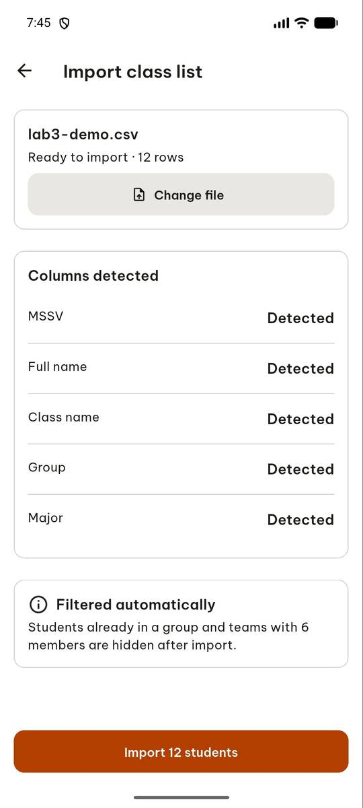 | `click` target=5 |
| 9 | 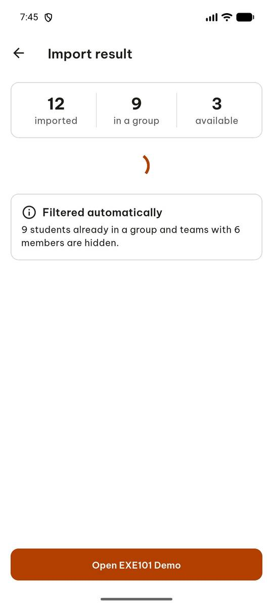 | `click` target=6 |
| 10 | 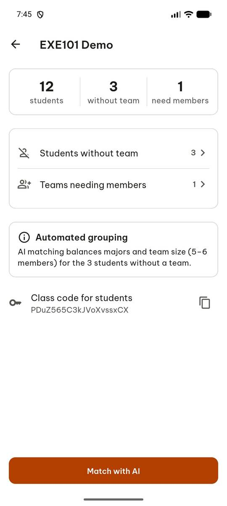 | `click` target=1 |
| 11 | 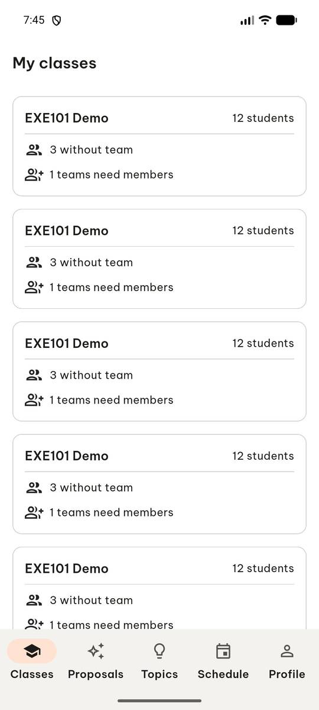 | `click` target=16 |
| 12 |  | `swipe` direction=up |
| 13 | 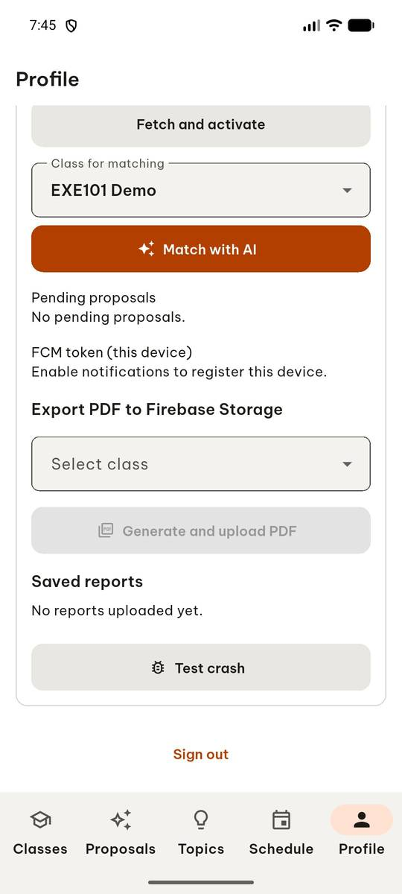 | `click` target=7 |
| 14 | 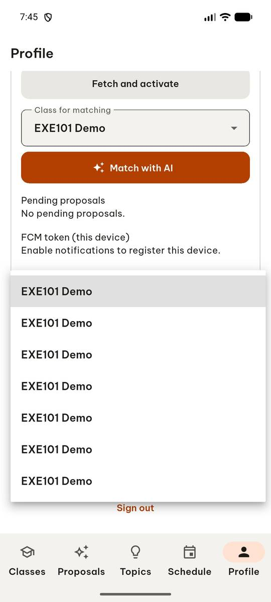 | `click` target=1 |
| 15 | 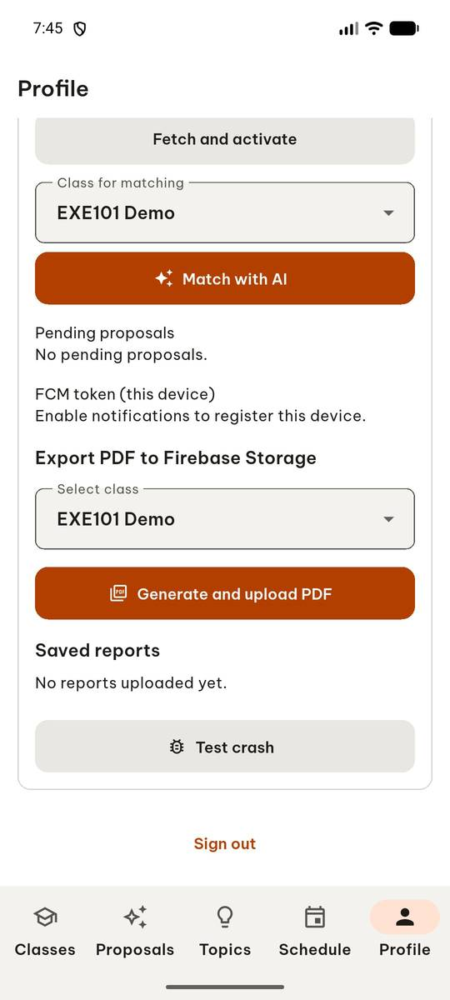 | `click` target=8 |
| 16 | 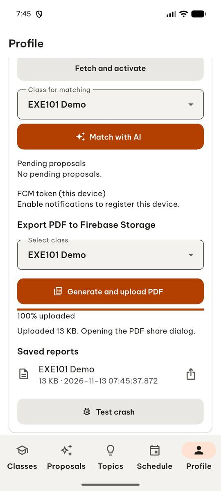 | `report_task_status` completed: {"saw_progress": true, "status_text": "Uploaded 13 KB. Opening the PDF share dialog.", "saved_reports_visible": true} |

Final screen:

