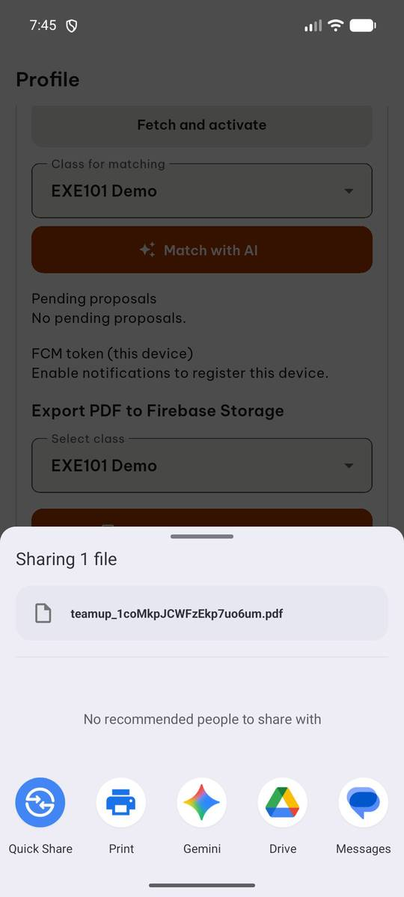
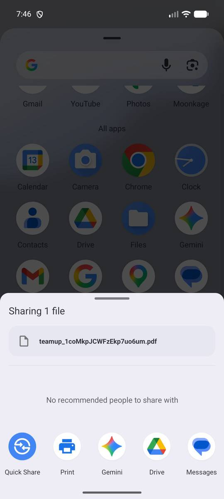
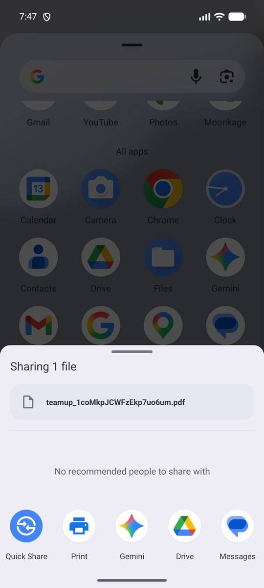
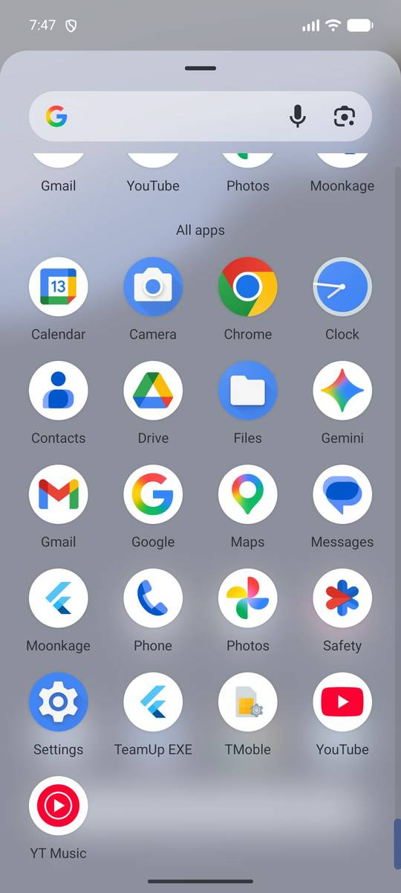
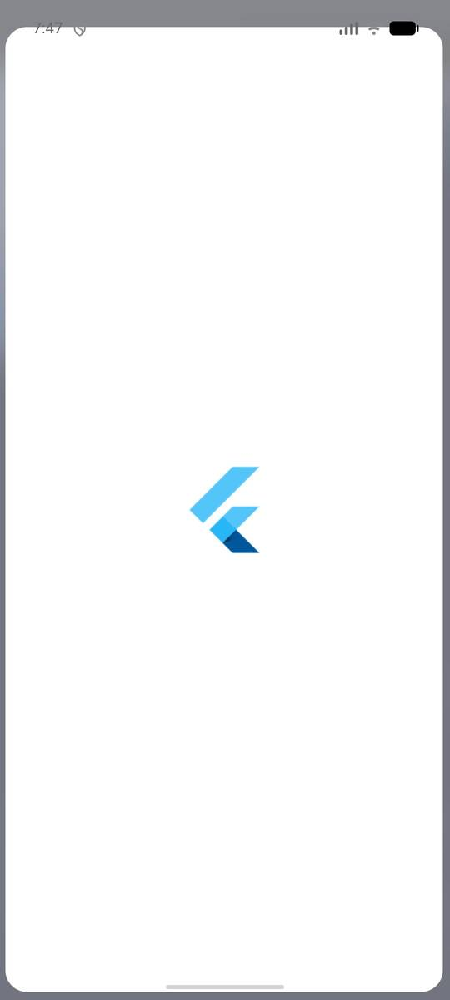
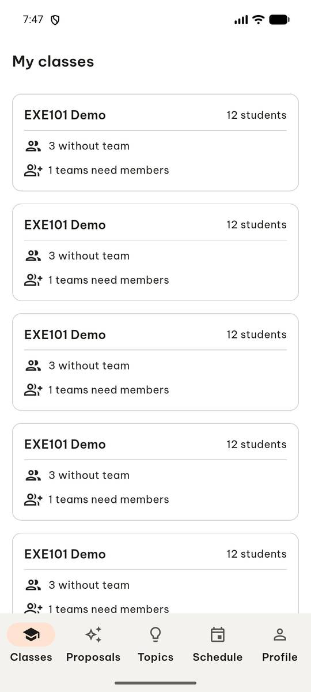
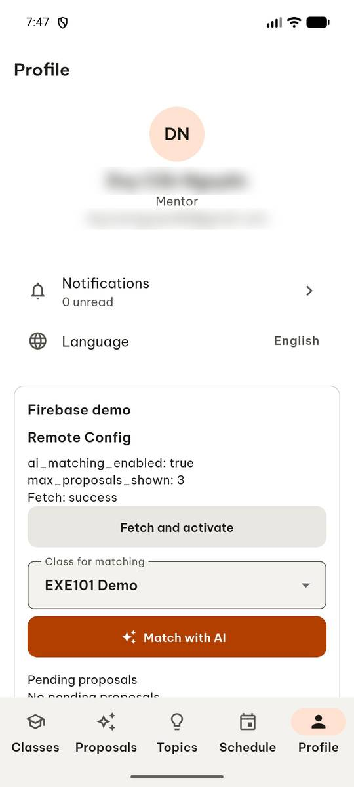
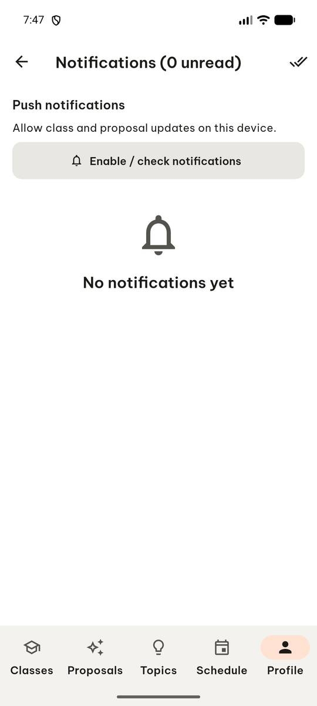
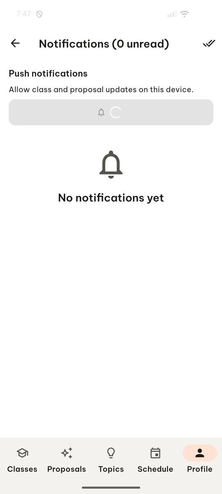
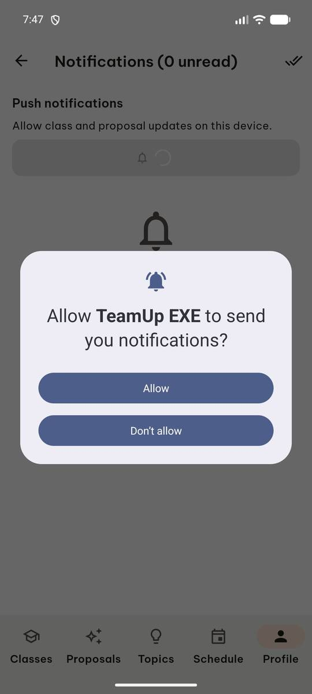

# test_tc12_notification_permission_dialog (run 1)

- Session: `b78dfb48-f930-4b6f-94a7-2073b612bb0a`
- Status: completed, 117.2s
- Output: `{"dialog_appeared": true, "permission_text": "Allowed. Manage permission in Android Settings."}`

| Step | Screen before | Action |
|---|---|---|
| 1 |  | `manage_app` app_name=com.group6.teamup_exe, action=stop |
| 2 |  | `manage_app` action=launch, app_name=com.group6.teamup_exe |
| 3 |  | `press_key` key=BACK |
| 4 |  | `click` target=23 |
| 5 |  | `wait_for_delay` time_in_ms=3000 |
| 6 |  | `click` target=16 |
| 7 |  | `click` target=6 |
| 8 |  | `click` target=[500, 227], target_description=Enable / check notifications button |
| 9 |  | `wait_for_delay` time_in_ms=2000 |
| 10 |  | `click` target_description=Allow button, target=[500, 560] |
| 11 |  | `report_task_status` completed: {"dialog_appeared": true, "permission_text": "Allowed. Manage permission in Android Settings."} |

Final screen:

