# test_tc13_offline_matching_shows_error_with_retry (run 1)

- Session: `a5bb08f9-93d3-49c6-8b8e-e41a91ea3450`
- Status: completed, 124.3s
- Output: `{"error_visible": true, "retry_label": "Try again", "recovered": true}`

| Step | Screen before | Action |
|---|---|---|
| 1 | 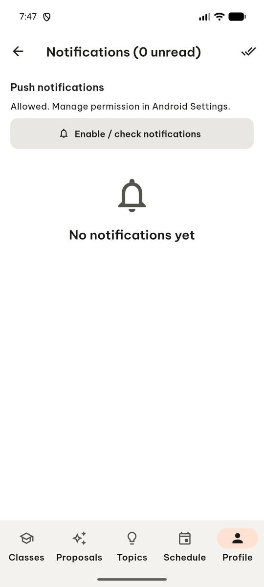 | `manage_app` action=stop, app_name=com.group6.teamup_exe |
| 2 |  | `manage_app` action=launch, app_name=com.group6.teamup_exe |
| 3 |  | `wait_for_delay` time_in_ms=2000 |
| 4 | 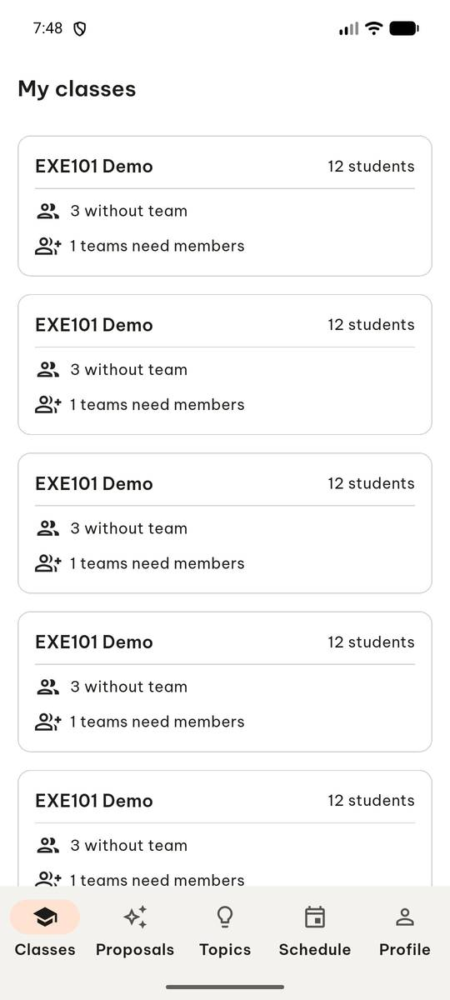 | `swipe` direction=up |
| 5 | 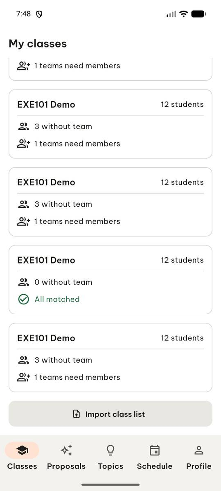 | `click` target=12 |
| 6 | 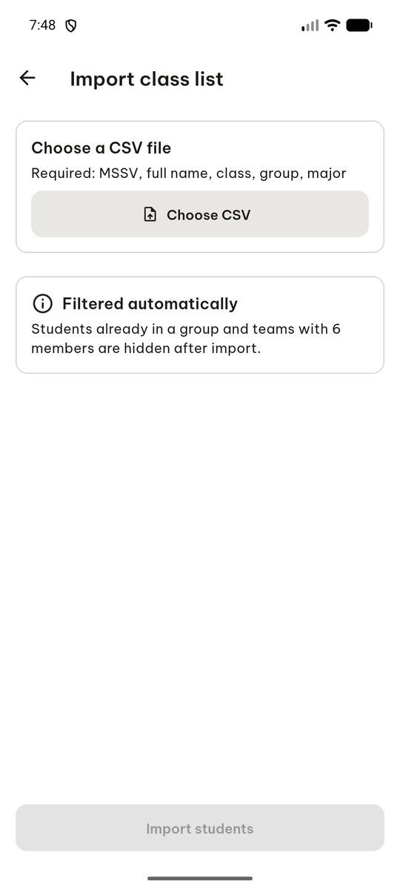 | `click` target_description=Choose CSV button, target=[499, 240] |
| 7 |  | `click` target=11 |
| 8 | 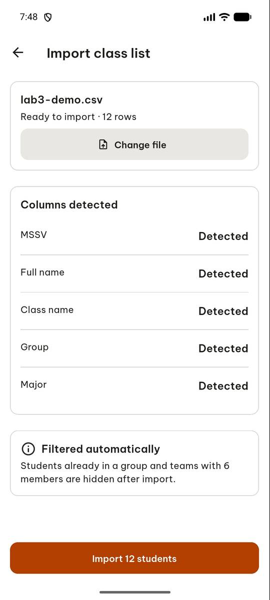 | `click` target=5 |
| 9 | 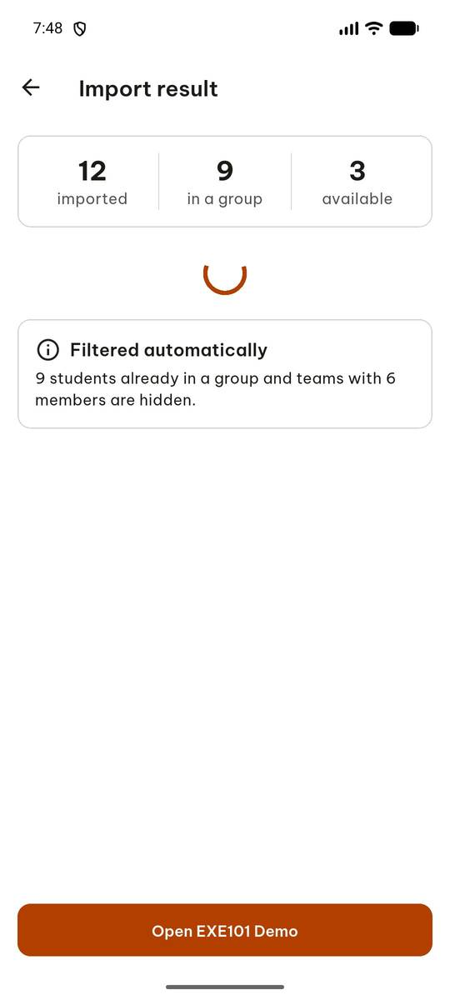 | `click` target=6 |
| 10 | 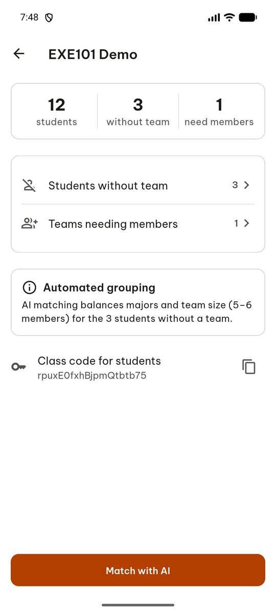 | `swipe` end=[500, 600], start=[500, 10], target_description=pull down status bar for quick settings |
| 11 | 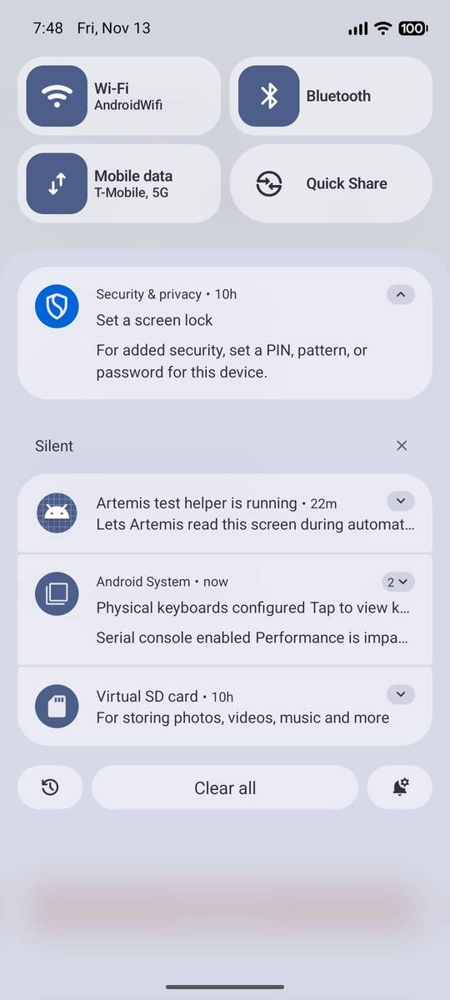 | `swipe` start=[500, 200], target_description=pull down quick settings further to reveal airplane mode, end=[500, 700] |
| 12 | 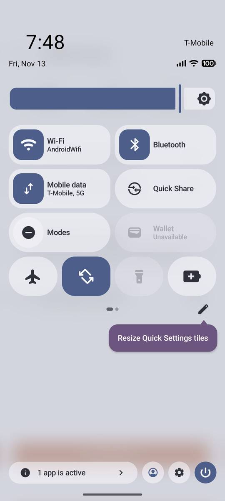 | `click` target=15 |
| 13 | 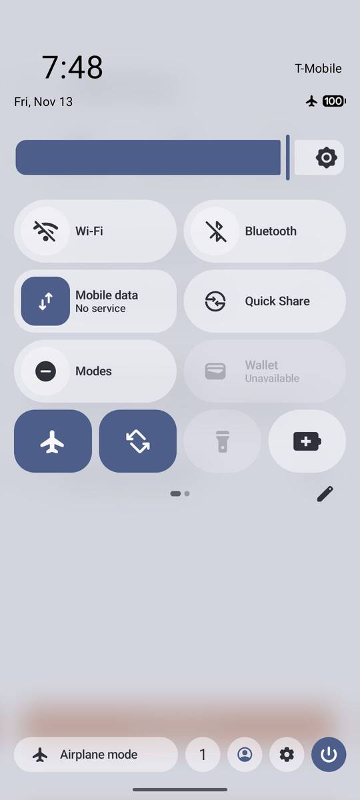 | `press_key` key=BACK |
| 14 | 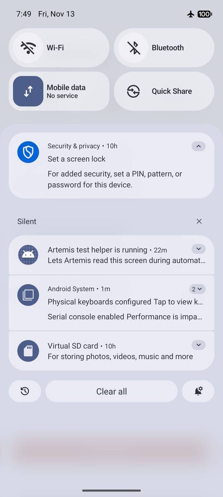 | `press_key` key=BACK |
| 15 | 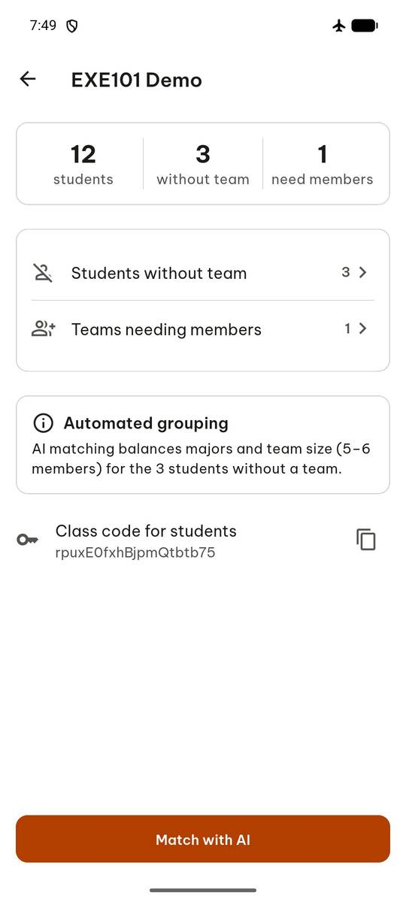 | `click` target=11 |
| 16 | 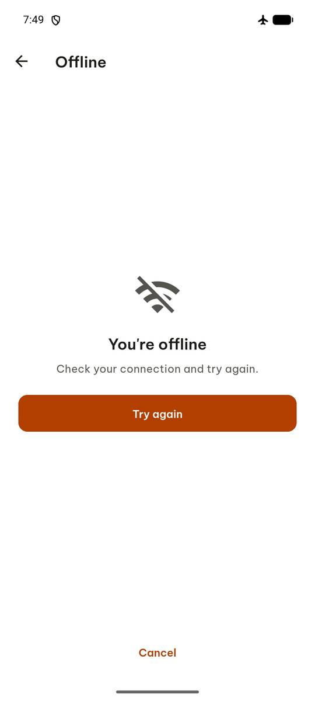 | `swipe` target_description=pull down status bar, start=[500, 10], end=[500, 600] |
| 17 | 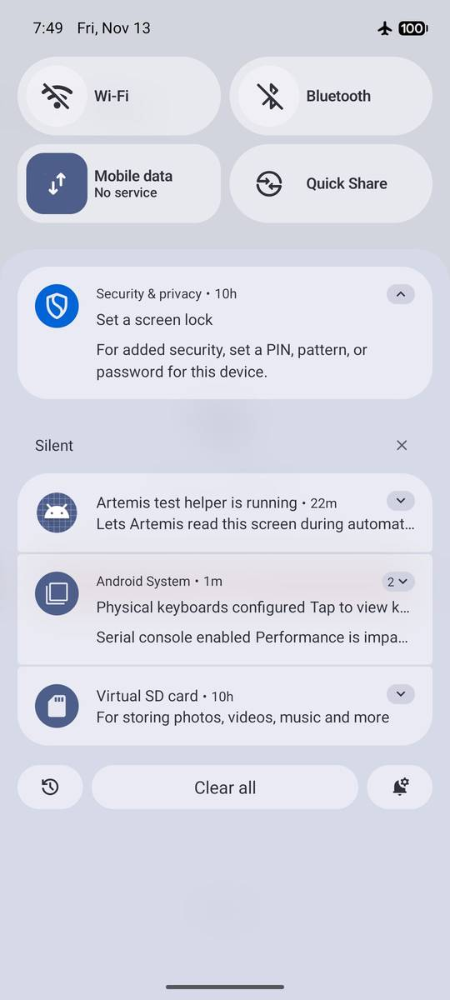 | `swipe` target_description=pull down quick settings further, start=[500, 200], end=[500, 700] |
| 18 | 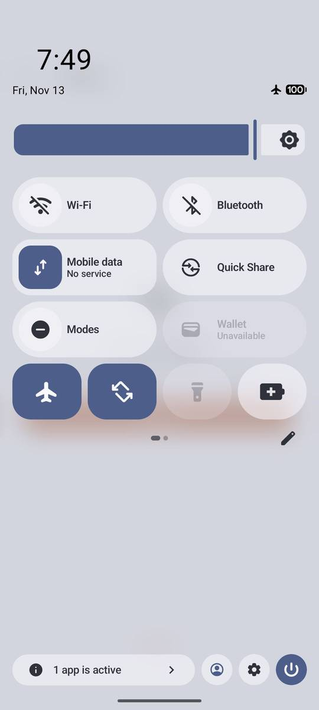 | `click` target=13 |
| 19 | 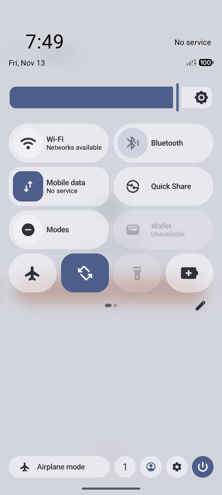 | `press_key` key=BACK |
| 20 | 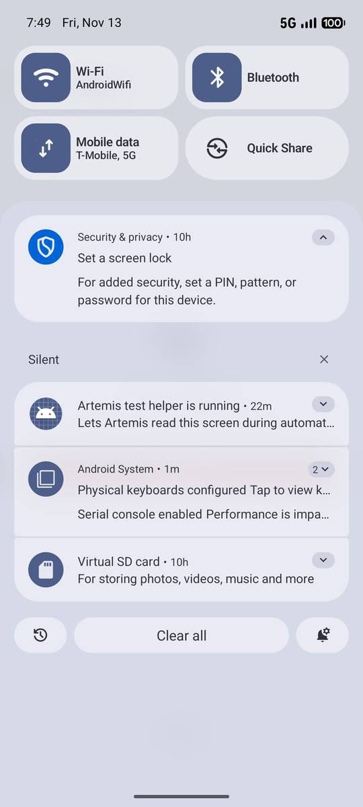 | `press_key` key=BACK |
| 21 | 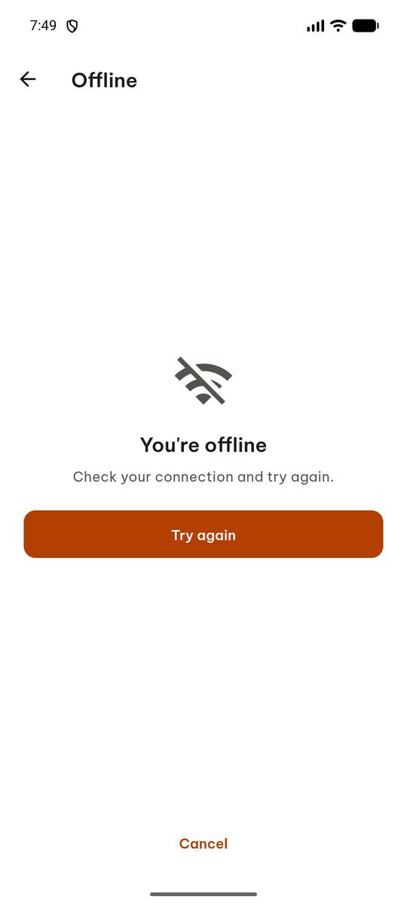 | `click` target=5 |
| 22 | 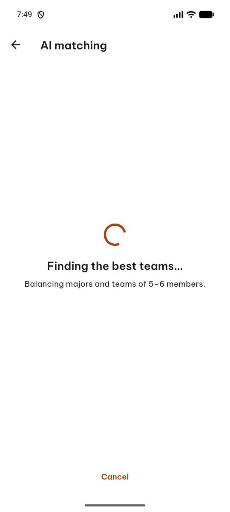 | `wait_for_delay` time_in_ms=5000 |
| 23 | 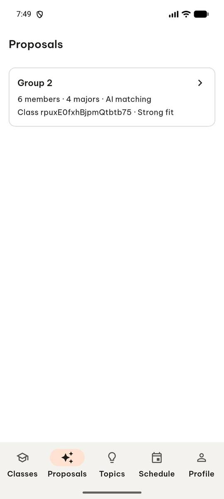 | `report_task_status` completed: {"error_visible": true, "retry_label": "Try again", "recovered": true} |

Final screen:

