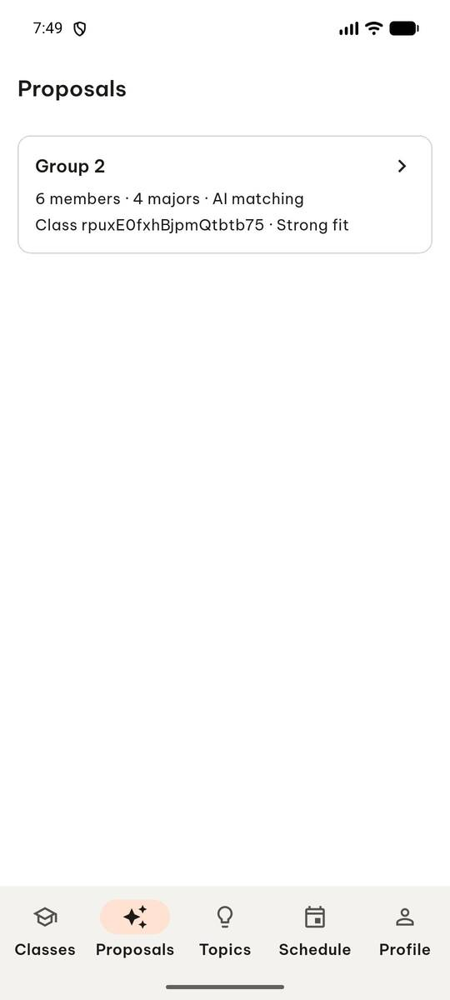
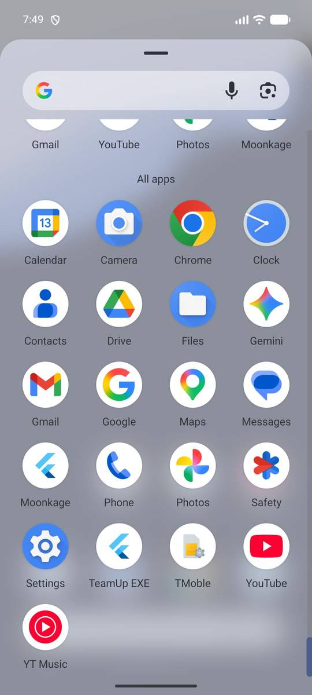
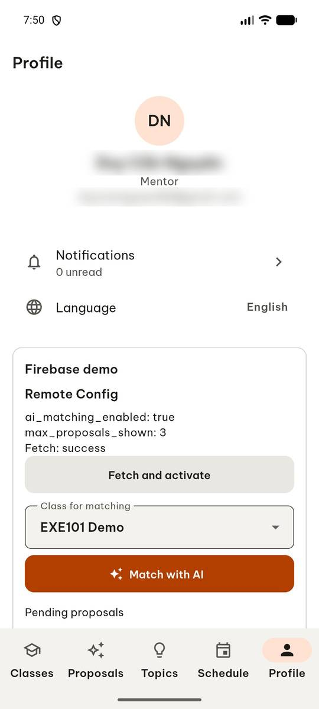
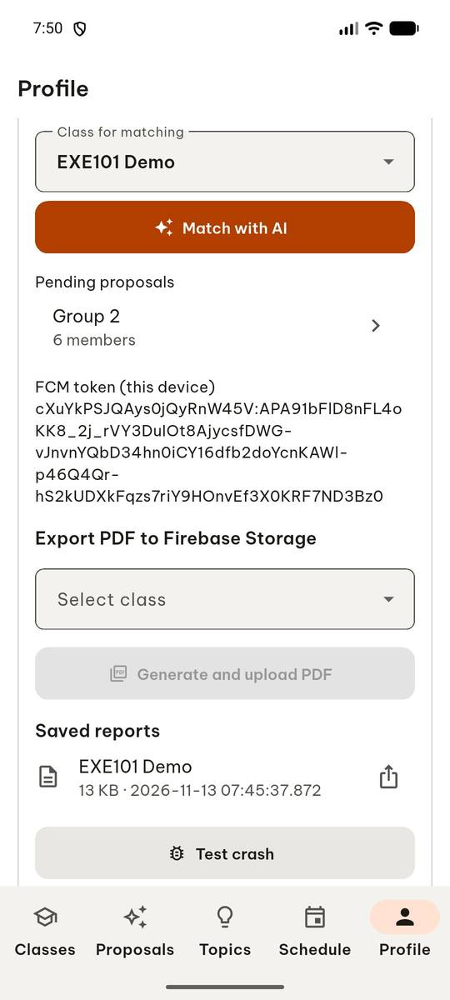
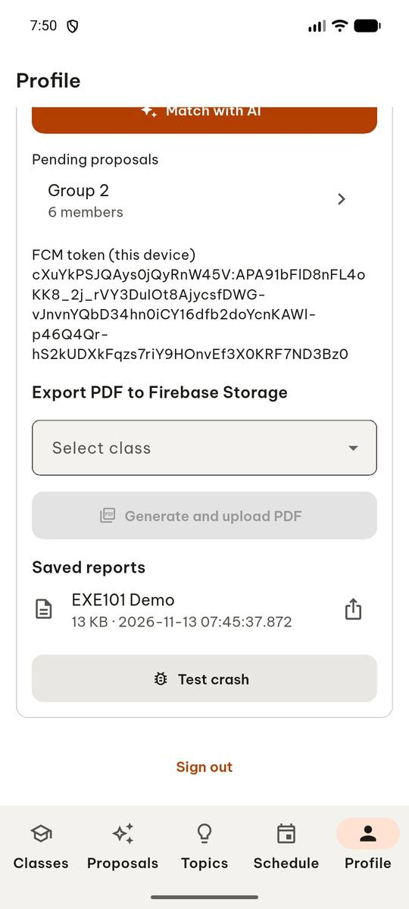
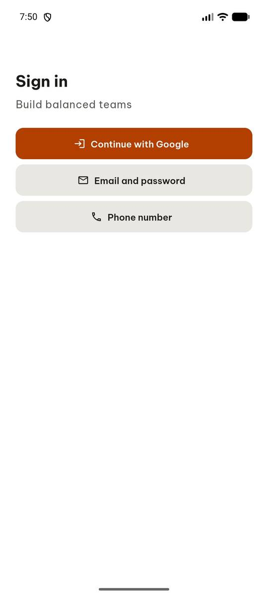
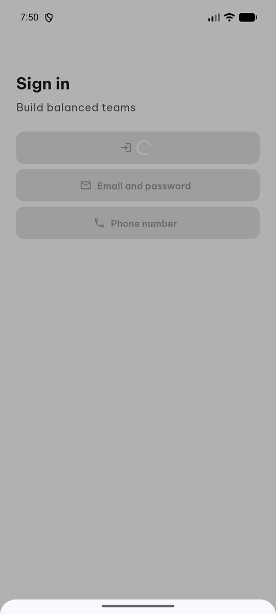
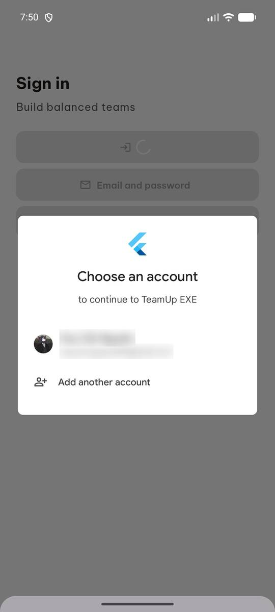
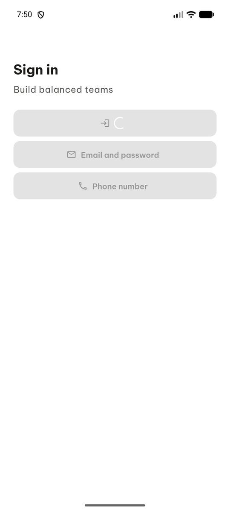
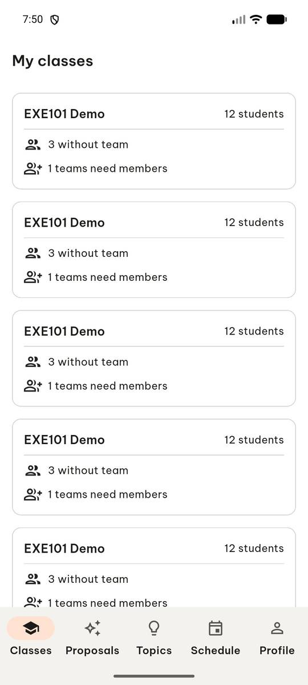

# test_tc01_google_sign_in_account_picker (run 2)

- Session: `f633d3cd-d08e-4aff-b660-27b0a3db93d8`
- Status: completed, 69.0s
- Output: `{"signed_in": true, "tabs": ["Classes", "Proposals", "Topics", "Schedule", "Profile"]}`

| Step | Screen before | Action |
|---|---|---|
| 1 |  | `manage_app` app_name=com.group6.teamup_exe, action=stop |
| 2 |  | `manage_app` app_name=com.group6.teamup_exe, action=launch |
| 3 |  | `wait_for_delay` time_in_ms=3000 |
| 4 |  | `click` target=16 |
| 5 |  | `swipe` direction=up |
| 6 |  | `swipe` direction=up |
| 7 |  | `click` target=11 |
| 8 |  | `click` target=11 |
| 9 |  | `click` target=3 |
| 10 |  | `wait_for_delay` time_in_ms=3000 |
| 11 |  | `click` target=3 |
| 12 |  | `wait_for_delay` time_in_ms=5000 |
| 13 |  | `report_task_status` completed: {"signed_in": true, "tabs": ["Classes", "Proposals", "Topics", "Schedule", "Profile"]} |

Final screen:

