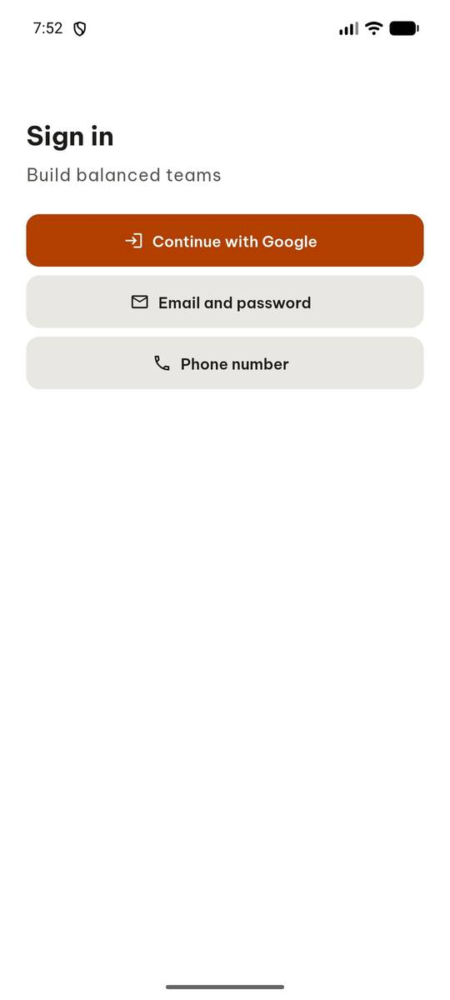
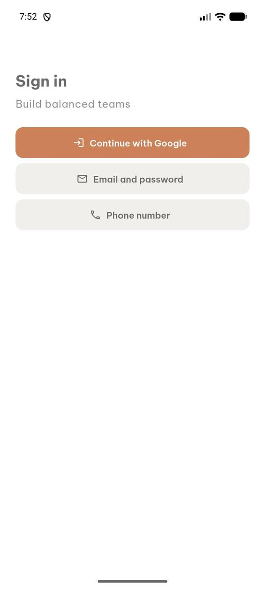
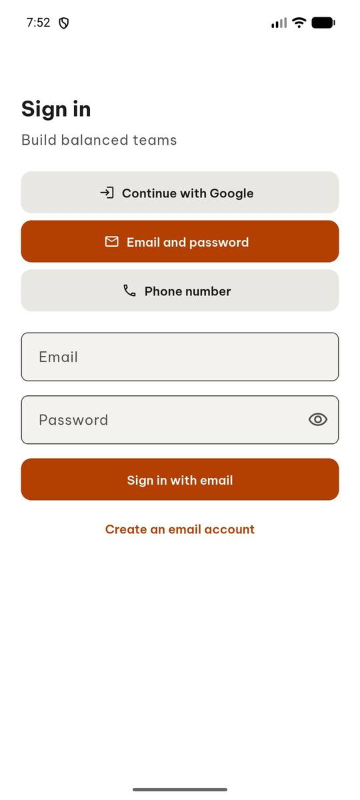
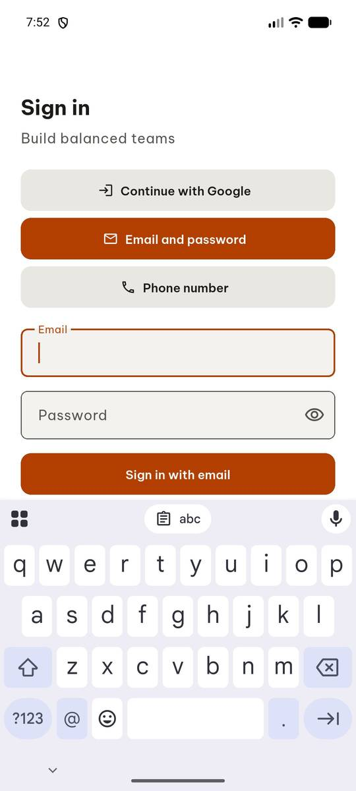
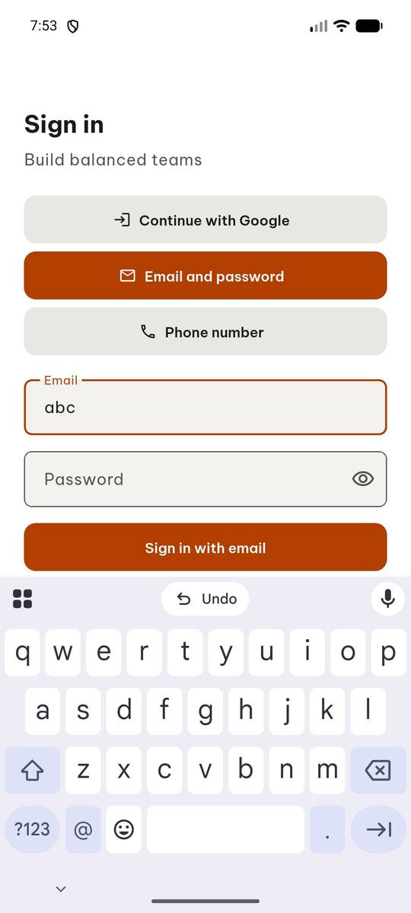
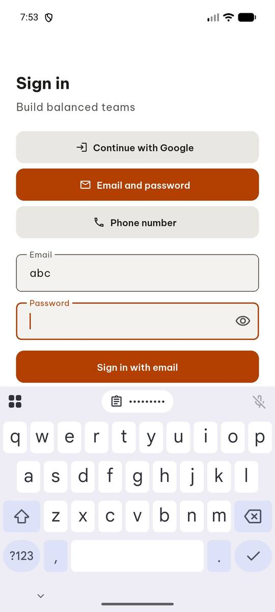
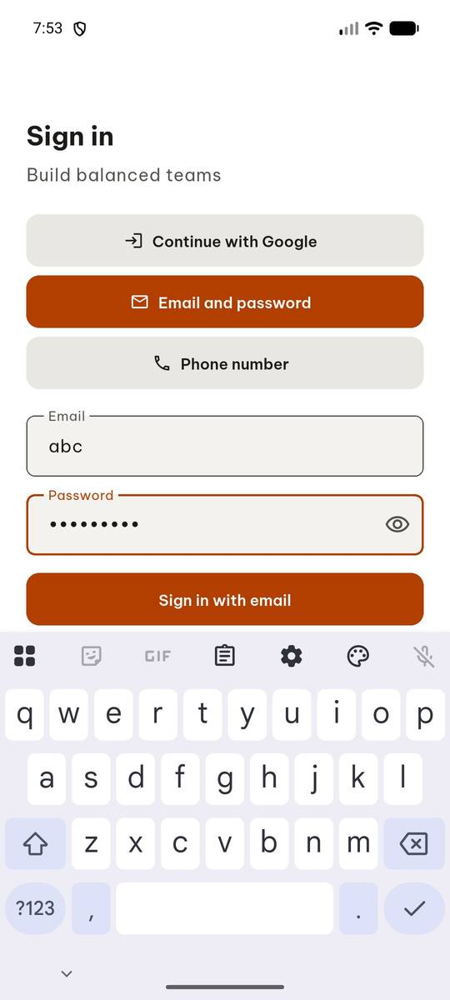
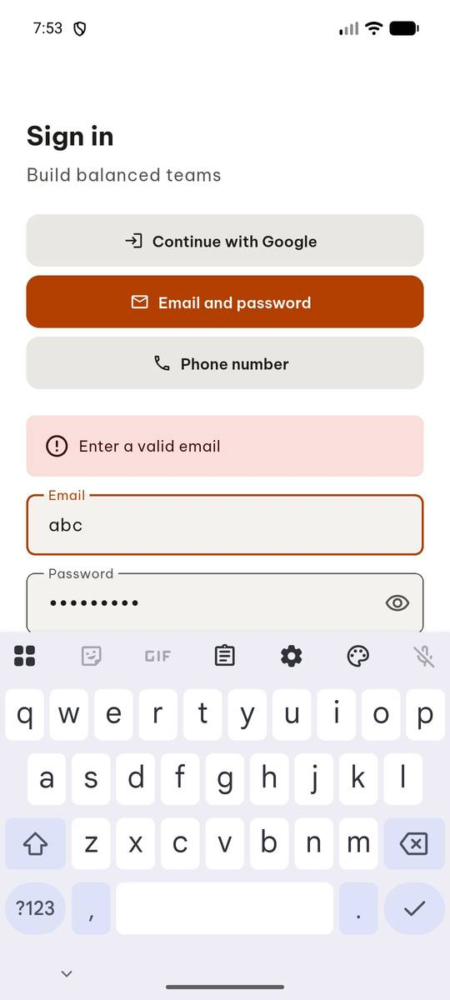

# test_tc03_invalid_email_shows_error (run 2)

- Session: `a4ea8a3f-a429-45d2-850d-f231e7783766`
- Status: completed, 84.9s
- Output: `{"error_text": "Enter a valid email", "reached_classes": false}`

| Step | Screen before | Action |
|---|---|---|
| 1 |  | `manage_app` app_name=com.group6.teamup_exe, action=stop |
| 2 |  | `manage_app` action=launch, app_name=com.group6.teamup_exe |
| 3 |  | `click` target=4 |
| 4 |  | `input_text` clear_exist=True, text=abc, target=6 |
| 5 |  | `input_text` text=abc, target=44, clear_exist=True |
| 6 |  | `click` target=2 |
| 7 |  | `input_text` target=46, clear_exist=True, text=Passw0rd! |
| 8 |  | `click` target=2 |
| 9 |  | `click` target=50 |
| 10 |  | `report_task_status` completed: {"error_text": "Enter a valid email", "reached_classes": false} |

Final screen:

