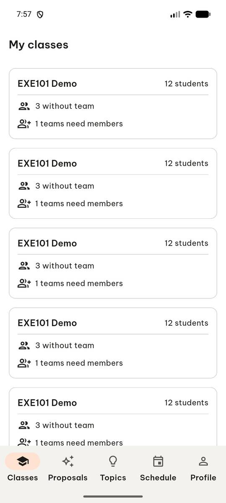
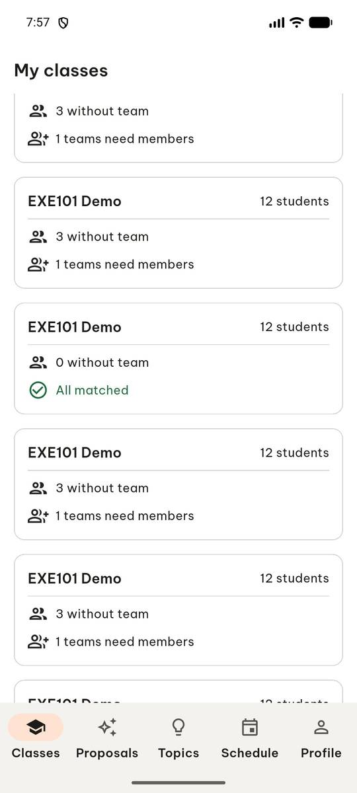
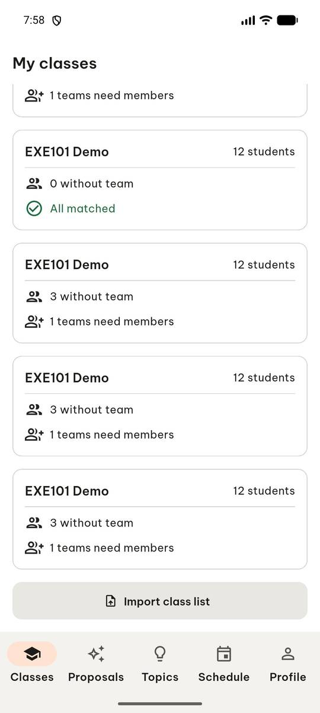
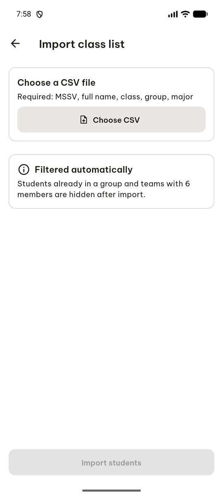
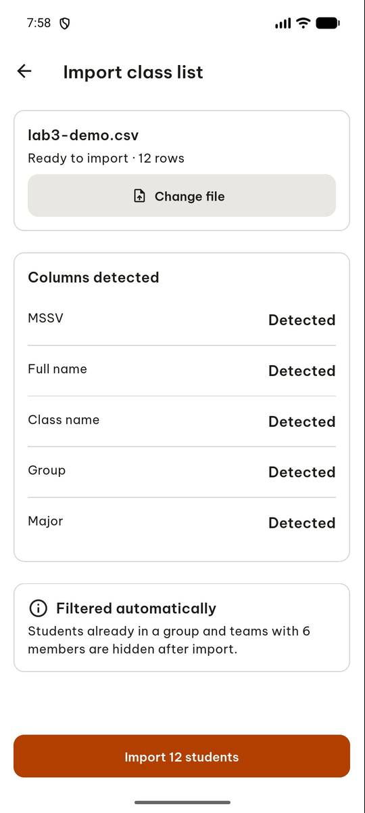
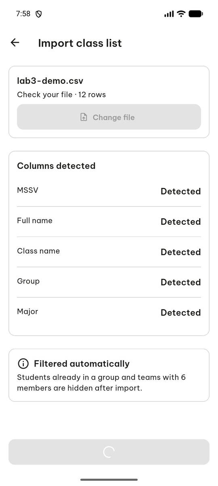
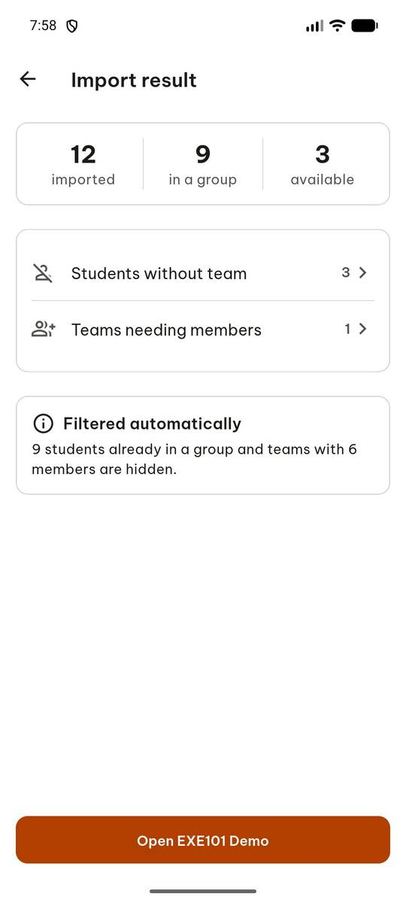

# test_tc04_import_csv_shows_counts (run 2)

- Session: `c17fb12f-686d-4366-83c3-4b451e691767`
- Status: completed, 96.6s
- Output: `{"preview_button": "Import 12 students", "imported": 12, "in_a_group": 9, "available": 3}`

| Step | Screen before | Action |
|---|---|---|
| 1 |  | `manage_app` app_name=com.group6.teamup_exe, action=stop |
| 2 |  | `manage_app` app_name=com.group6.teamup_exe, action=launch |
| 3 |  | `wait_for_delay` time_in_ms=2000 |
| 4 |  | `swipe` direction=up |
| 5 |  | `swipe` direction=up |
| 6 |  | `click` target=12 |
| 7 |  | `click` target=[500, 241], target_description=Choose CSV button |
| 8 |  | `click` target=11 |
| 9 |  | `click` target=6 |
| 10 |  | `wait_for_delay` time_in_ms=2000 |
| 11 |  | `report_task_status` completed: {"preview_button": "Import 12 students", "imported": 12, "in_a_group": 9, "available": 3} |

Final screen:

