# test_tc05_match_with_ai_then_approve (run 2)

- Session: `cf13c1e1-8ae4-4570-9ab4-d50419a82453`
- Status: completed, 207.6s
- Output: `{"group2_before": 2, "member_count": 6, "approved_message": "Team approved", "group2_after": 1}`

| Step | Screen before | Action |
|---|---|---|
| 1 |  | `manage_app` app_name=com.group6.teamup_exe, action=stop |
| 2 |  | `manage_app` action=launch, app_name=com.group6.teamup_exe |
| 3 |  | `wait_for_delay` time_in_ms=2000 |
| 4 |  | `swipe` direction=up |
| 5 |  | `click` target=18 |
| 6 | 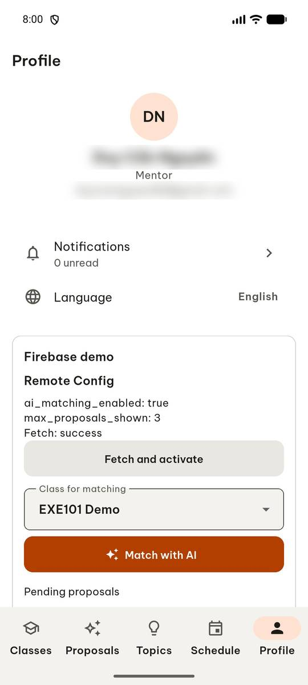 | `click` target=13 |
| 7 | 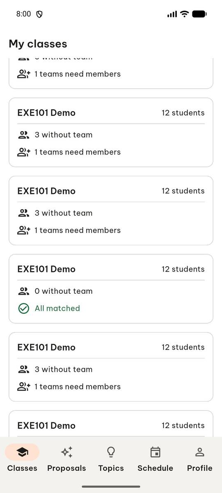 | `swipe` direction=down |
| 8 | 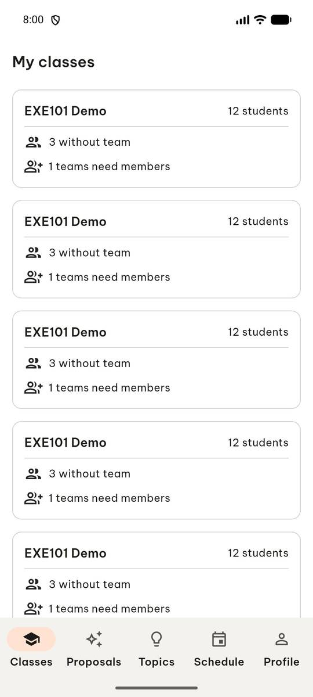 | `swipe` direction=up |
| 9 | 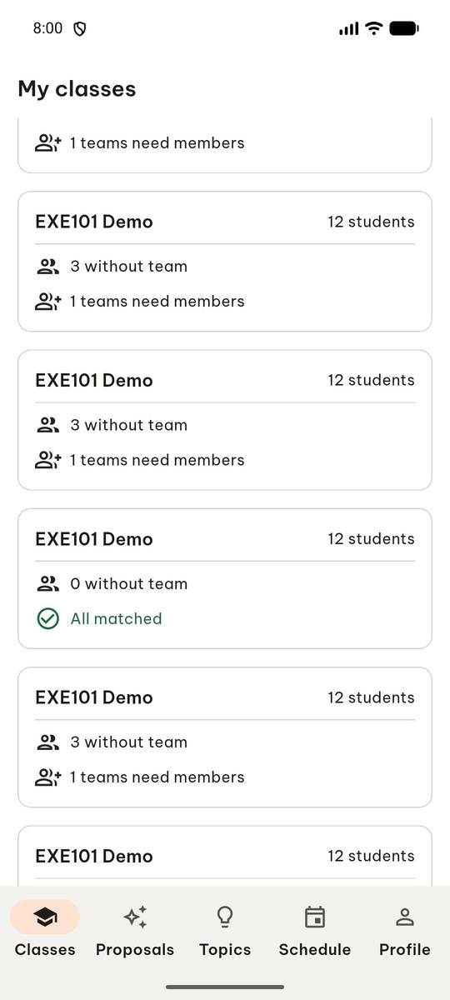 | `swipe` direction=up |
| 10 | 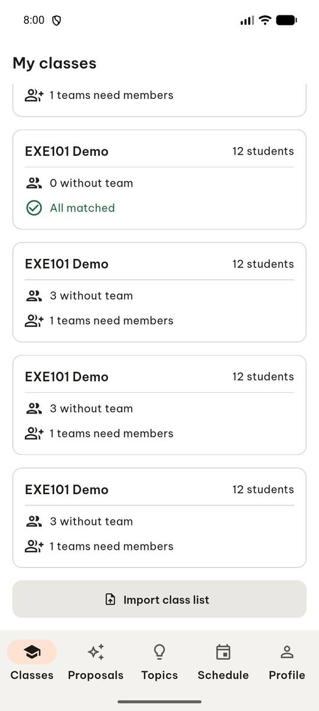 | `click` target=12 |
| 11 | 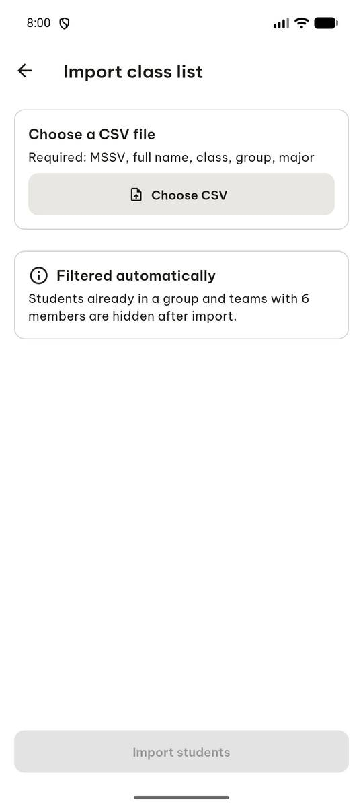 | `click` target=3 |
| 12 |  | `click` target=[500, 240], target_description=Choose CSV button |
| 13 | 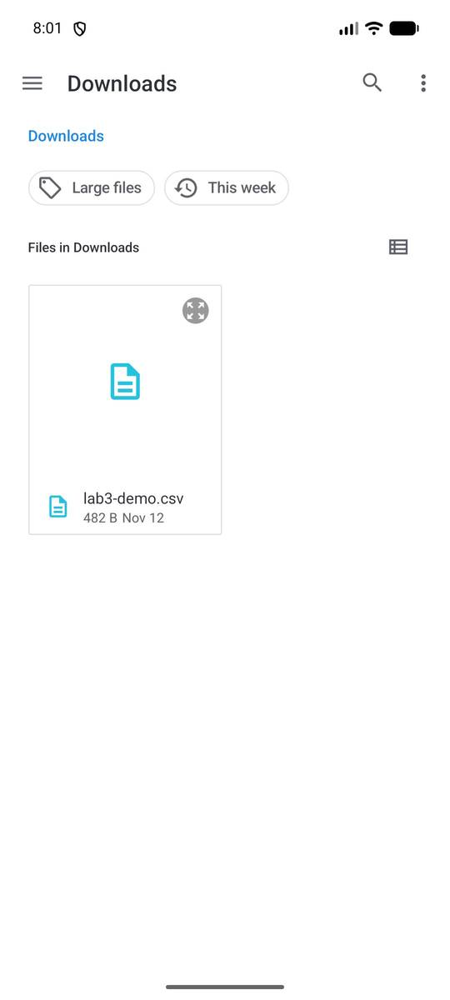 | `click` target=11 |
| 14 | 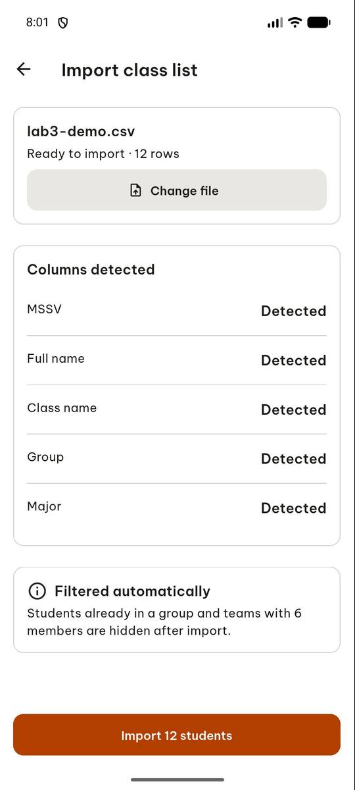 | `click` target=6 |
| 15 | 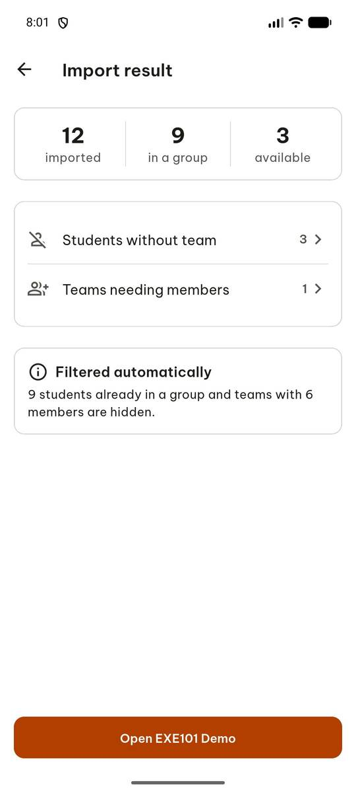 | `click` target=9 |
| 16 | 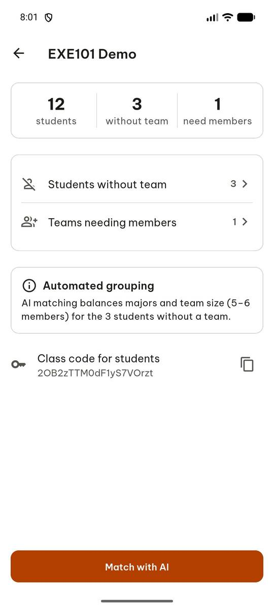 | `click` target=11 |
| 17 | 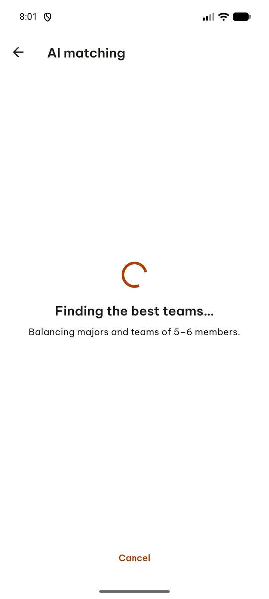 | `wait_for_delay` time_in_ms=10000 |
| 18 | 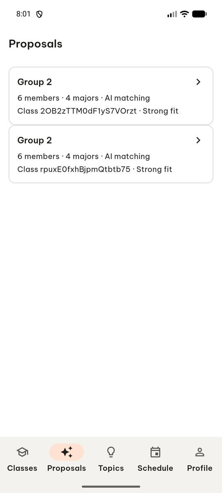 | `click` target=2 |
| 19 | 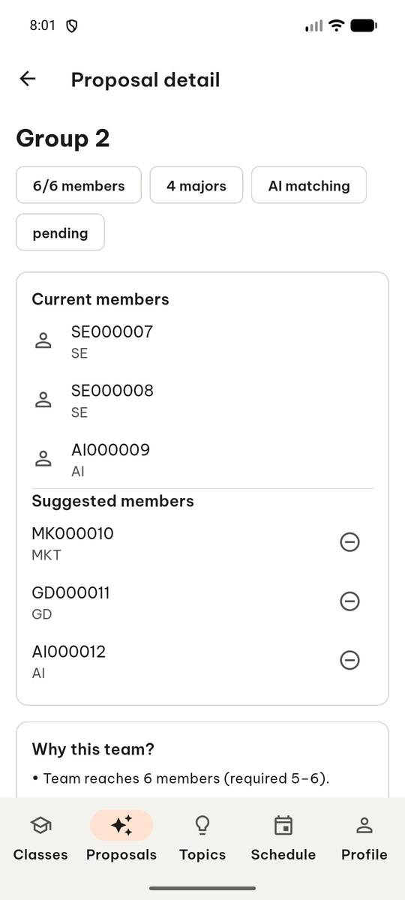 | `swipe` direction=up |
| 20 | 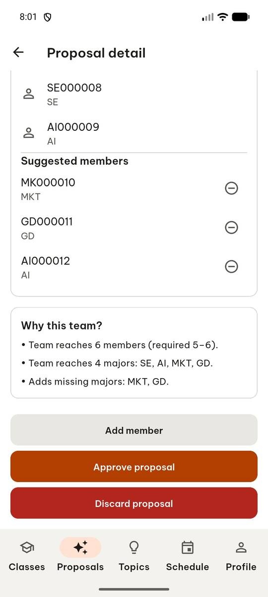 | `click` target=14 |
| 21 | 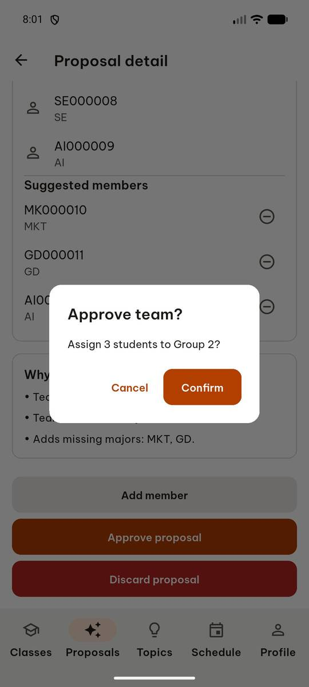 | `click` target=5 |
| 22 | 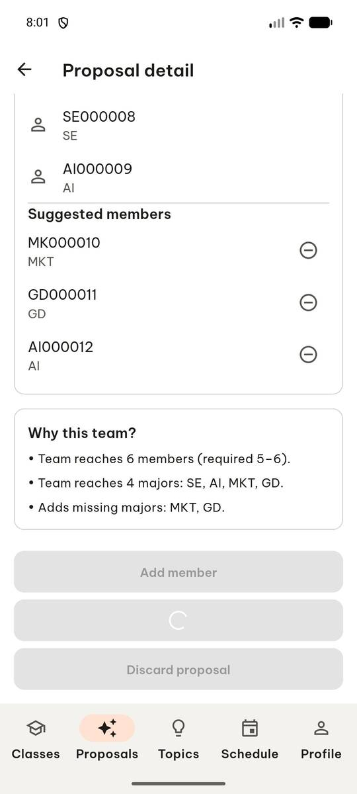 | `wait_for_delay` time_in_ms=2000 |
| 23 | 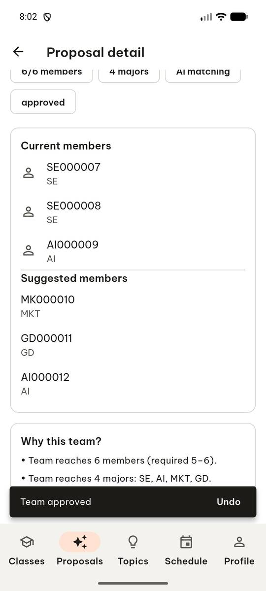 | `click` target=1 |
| 24 | 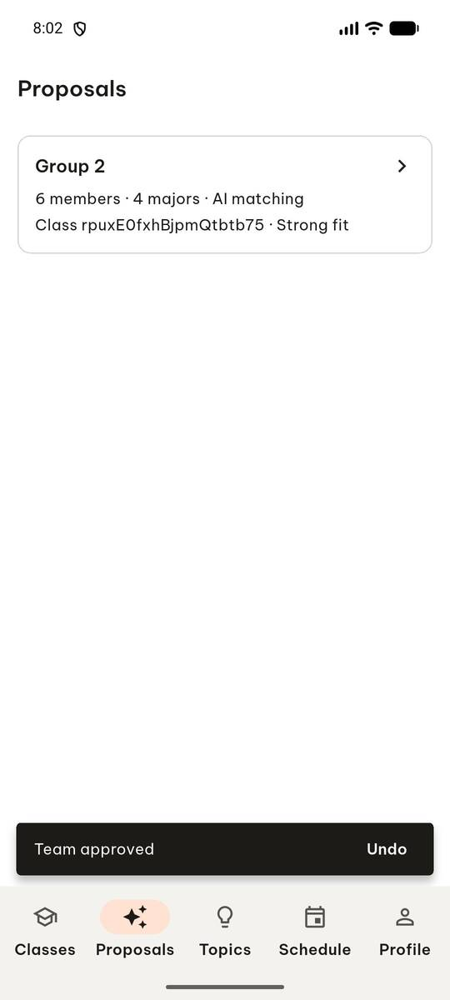 | `report_task_status` completed: {"group2_before": 2, "member_count": 6, "approved_message": "Team approved", "group2_after": 1} |

Final screen:

