# test_tc08_class_and_student_detail_values (run 2)

- Session: `7f53d2bd-23be-4d1a-89c0-25f9ac95d7fe`
- Status: completed, 161.4s
- Output: `{"without_team": 3, "need_members": 1, "student_ids": ["AI000012", "GD000011", "MK000010"], "student_id": "AI000012", "group": "None", "major": "AI"}`

| Step | Screen before | Action |
|---|---|---|
| 1 | 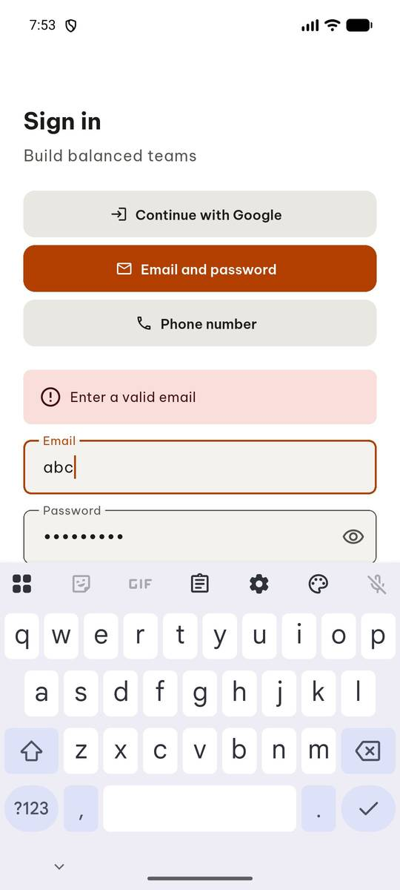 | `manage_app` action=stop, app_name=com.group6.teamup_exe |
| 2 |  | `manage_app` app_name=com.group6.teamup_exe, action=launch |
| 3 |  | `click` target=3 |
| 4 |  | `wait_for_delay` time_in_ms=3000 |
| 5 |  | `click` target=3 |
| 6 |  | `wait_for_delay` time_in_ms=3000 |
| 7 | 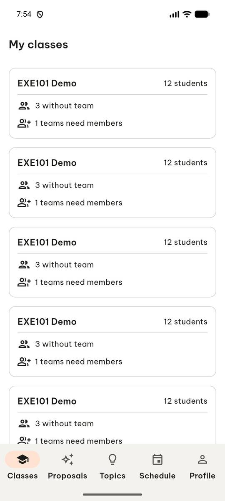 | `swipe` direction=down |
| 8 | 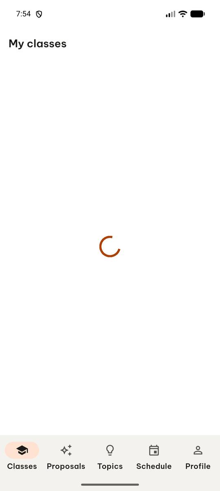 | `wait_for_delay` time_in_ms=2000 |
| 9 | 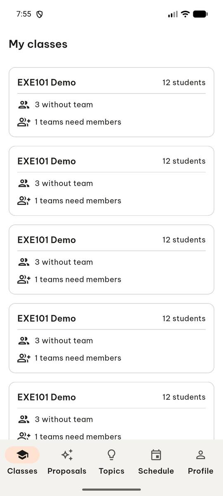 | `swipe` direction=up |
| 10 | 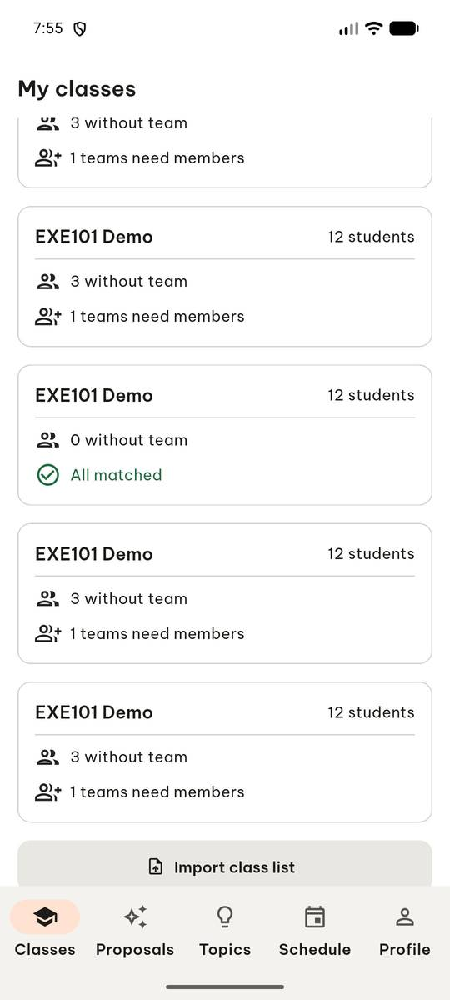 | `click` target=12 |
| 11 | 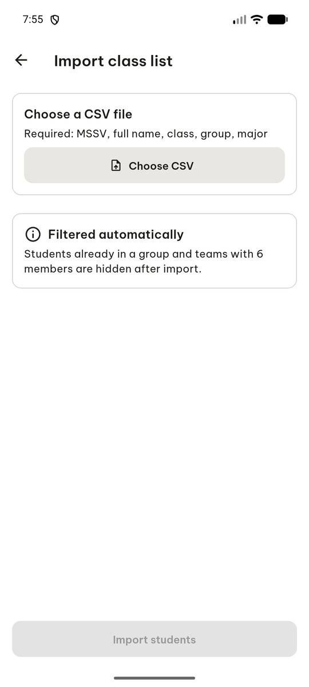 | `click` target_description=Choose CSV button, target=[500, 240] |
| 12 | 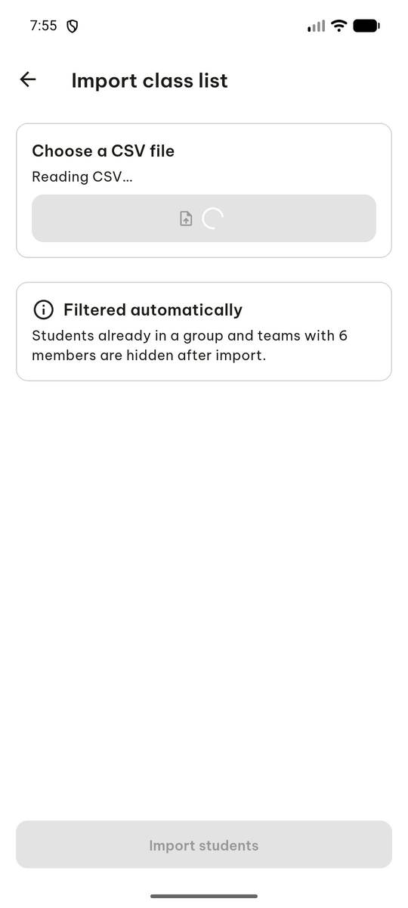 | `click` target=11 |
| 13 | 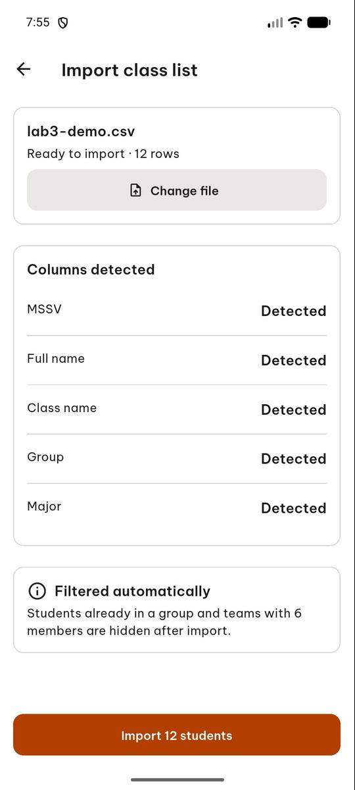 | `click` target=6 |
| 14 | 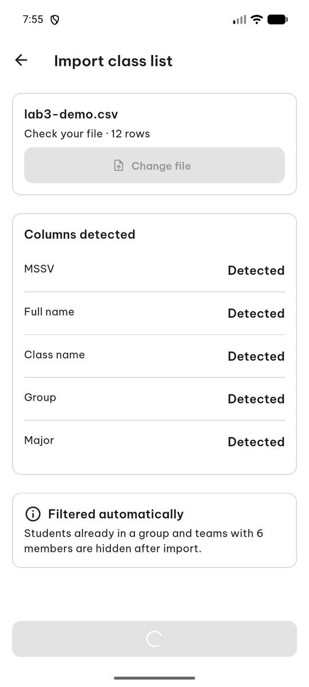 | `click` target=6 |
| 15 | 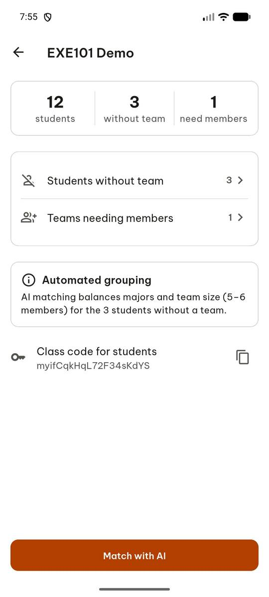 | `click` target=5 |
| 16 |  | `click` target_description=Dương Yến student item, target=[500, 210] |
| 17 | 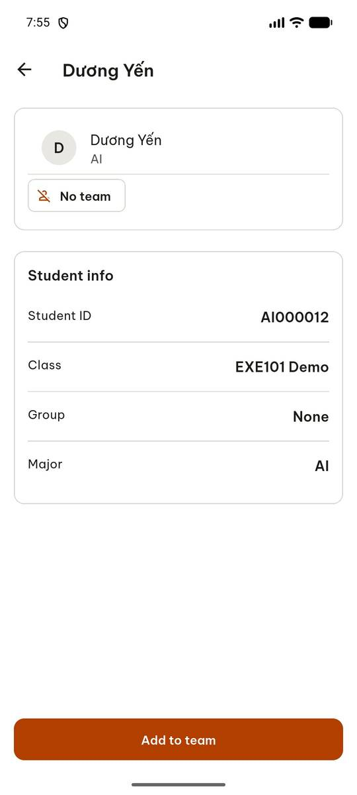 | `press_key` key=BACK |
| 18 |  | `click` target=[500, 280], target_description=Hồ Phúc item |
| 19 |  | `press_key` key=BACK |
| 20 | 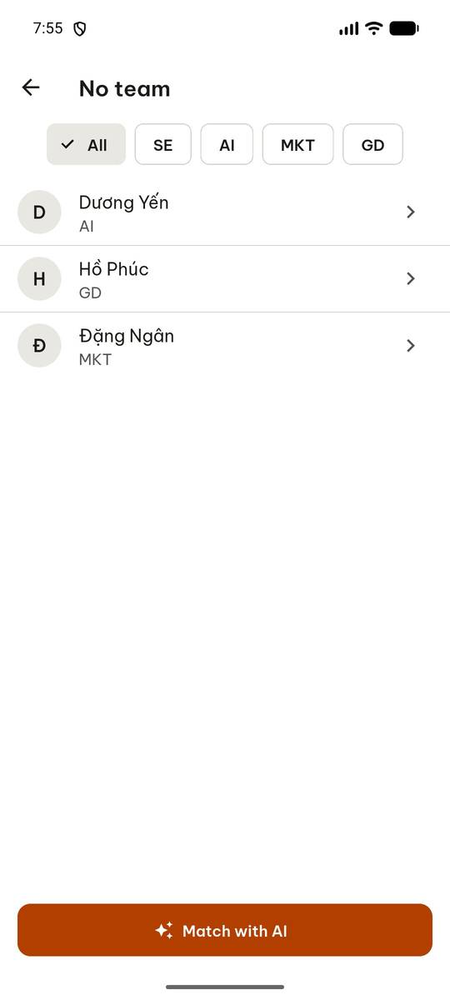 | `click` target=[500, 350], target_description=Đặng Ngân student item |
| 21 | 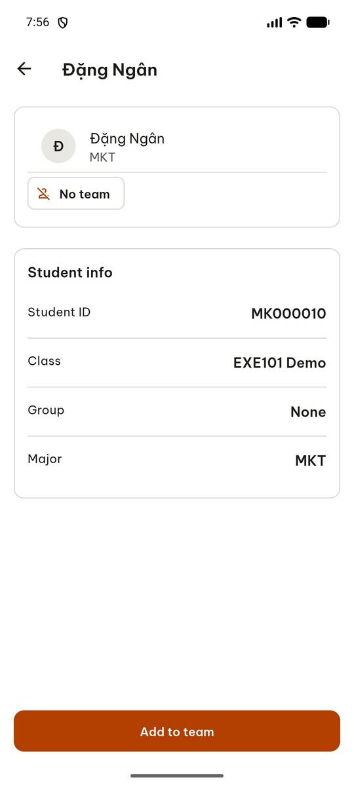 | `report_task_status` completed: {"without_team": 3, "need_members": 1, "student_ids": ["AI000012", "GD000011", "MK000010"], "student_id": "AI000012", "group": "None", "major": "AI"} |

Final screen:

