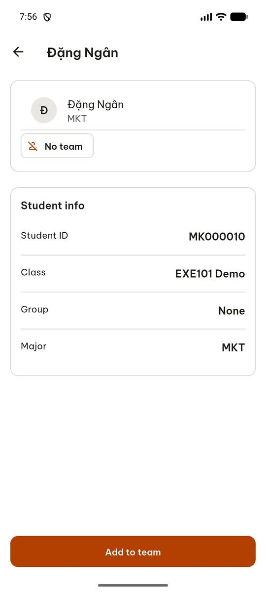
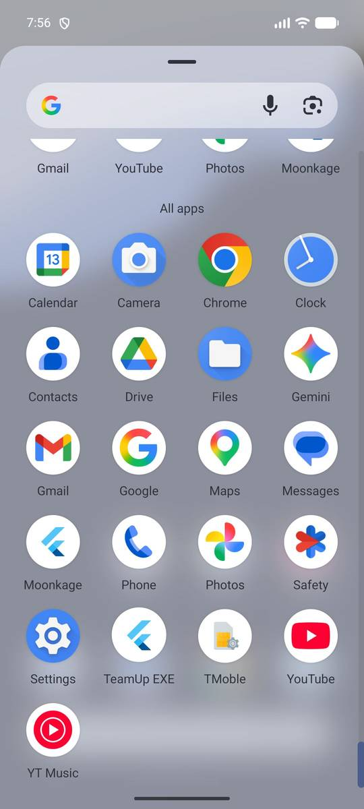
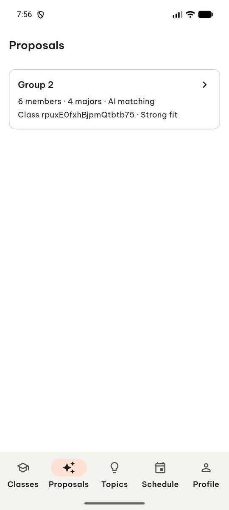
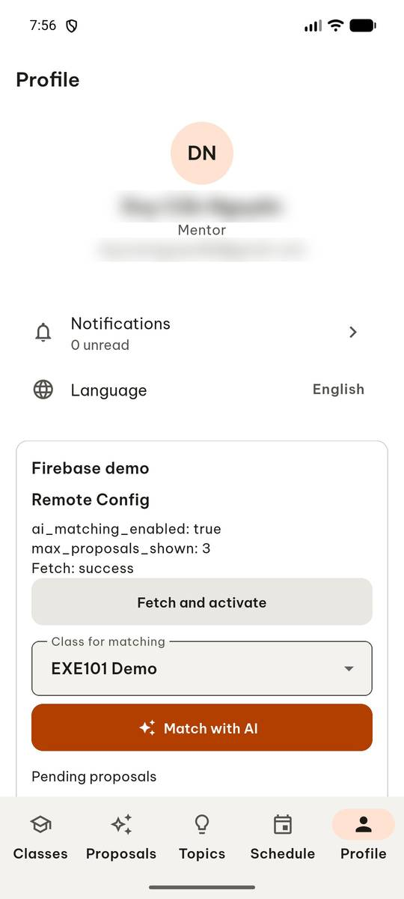
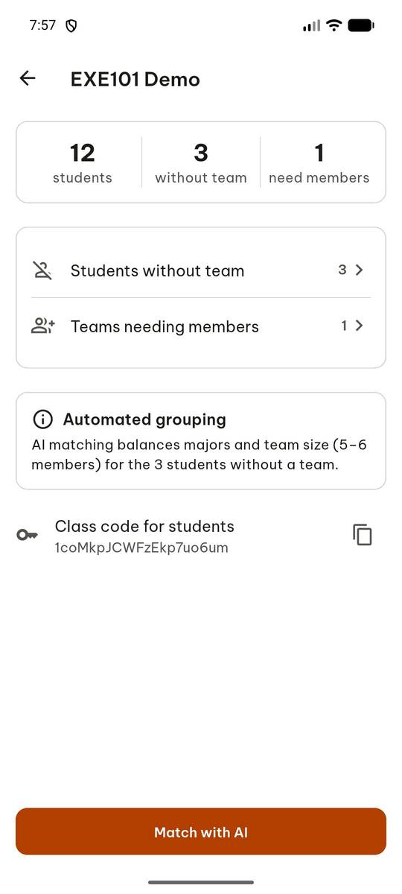
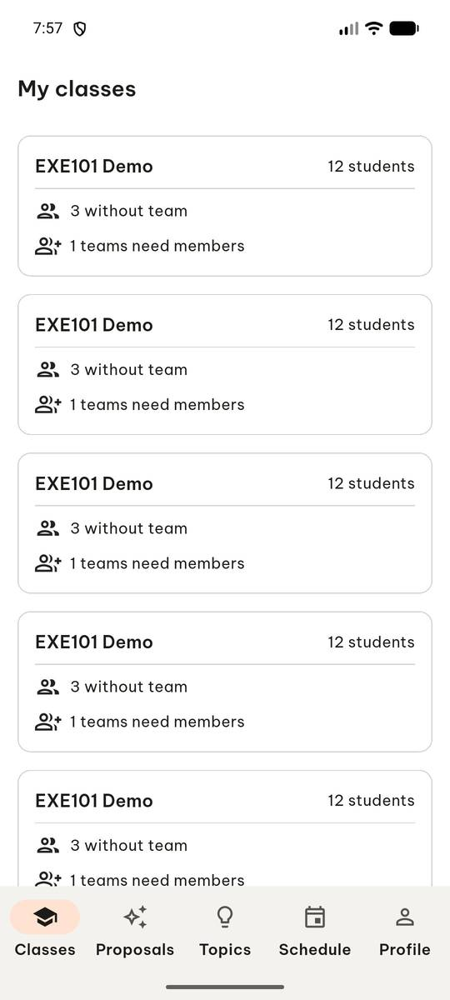

# test_tc09_tabs_and_back_navigation (run 2)

- Session: `5d42bec7-83de-4b60-b899-942a5fdbdf24`
- Status: completed, 60.6s
- Output: `None`

| Step | Screen before | Action |
|---|---|---|
| 1 |  | `manage_app` app_name=com.group6.teamup_exe, action=stop |
| 2 |  | `manage_app` app_name=com.group6.teamup_exe, action=launch |
| 3 |  | `wait_for_delay` time_in_ms=3000 |
| 4 |  | `click` target=13 |
| 5 |  | `click` target=7 |
| 6 |  | `click` target=13 |
| 7 |  | `click` target=2 |
| 8 |  | `press_key` key=BACK |
| 9 |  | `report_task_status` completed: {"proposals_title": "Proposals", "profile_title": "Profile", "classes_title": "My classes", "back_title": "My classes"} |

Final screen:

