# test_tc11_export_pdf_and_upload (run 2)

- Session: `b07b7cf9-fcd6-4c52-86e0-49d1fa23224c`
- Status: completed, 184.5s
- Output: `{"saw_progress": true, "status_text": "Uploaded 13 KB. Opening the PDF share dialog.", "saved_reports_visible": true}`

| Step | Screen before | Action |
|---|---|---|
| 1 | 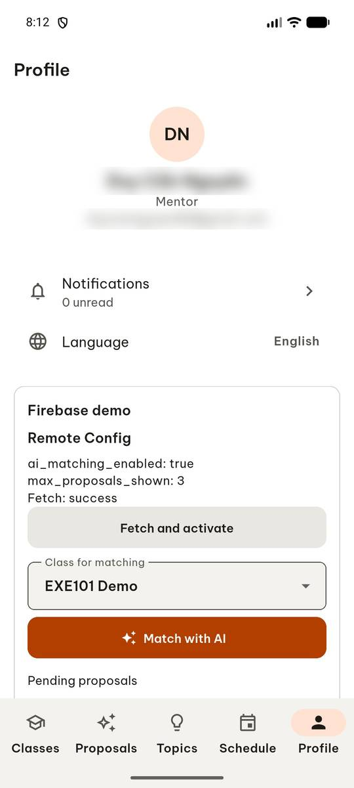 | `manage_app` action=stop, app_name=com.group6.teamup_exe |
| 2 |  | `manage_app` app_name=com.group6.teamup_exe, action=launch |
| 3 |  | `wait_for_delay` time_in_ms=2000 |
| 4 | 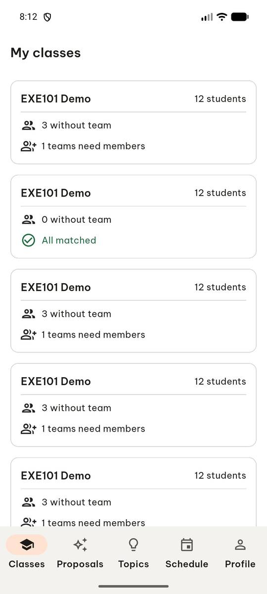 | `swipe` direction=up |
| 5 | 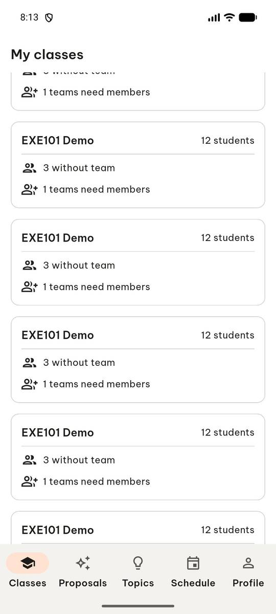 | `swipe` direction=up |
| 6 |  | `swipe` direction=up, target_description=scroll down list, start=[500, 700], end=[500, 200] |
| 7 | 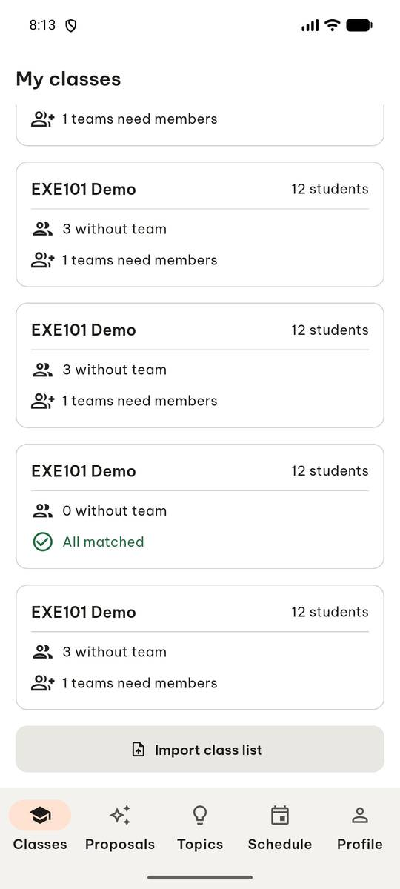 | `click` target=12 |
| 8 |  | `click` target=3 |
| 9 | 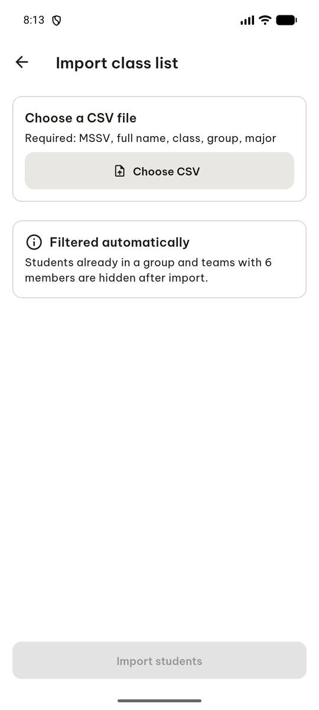 | `click` target_description=Choose CSV button, target=[500, 240] |
| 10 | 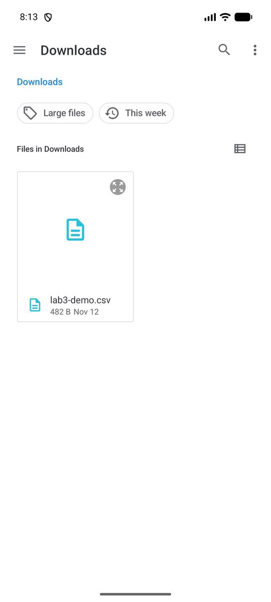 | `click` target=9 |
| 11 | 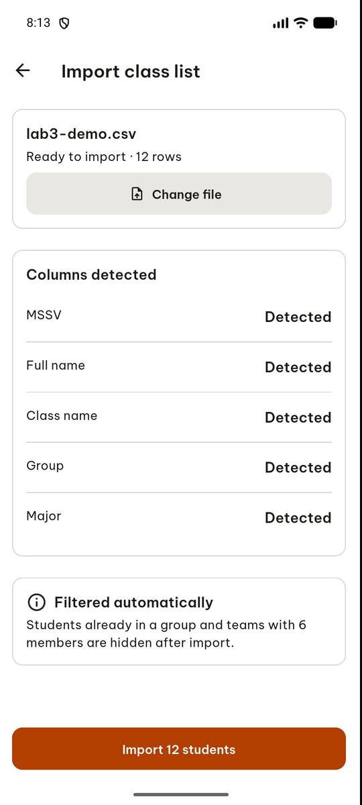 | `click` target=6 |
| 12 | 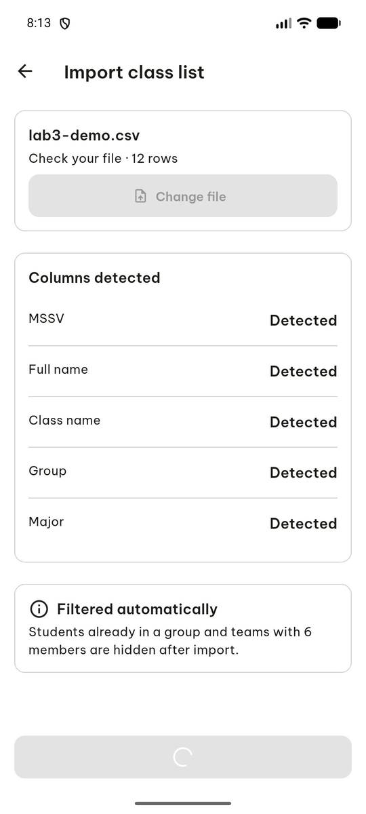 | `wait_for_delay` time_in_ms=2000 |
| 13 | 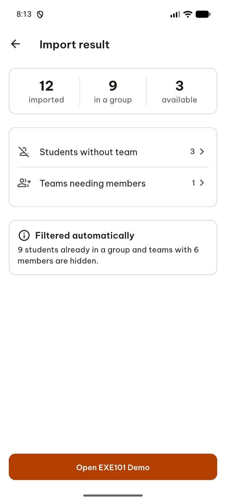 | `click` target=9 |
| 14 | 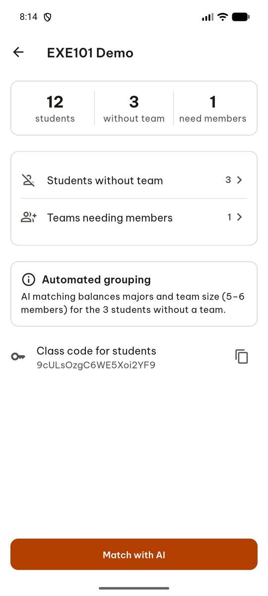 | `click` target=1 |
| 15 |  | `click` target=16 |
| 16 |  | `swipe` direction=up |
| 17 | 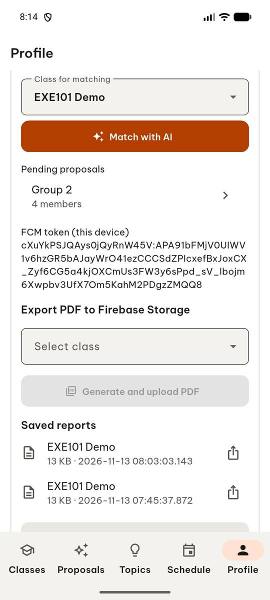 | `click` target=7 |
| 18 | 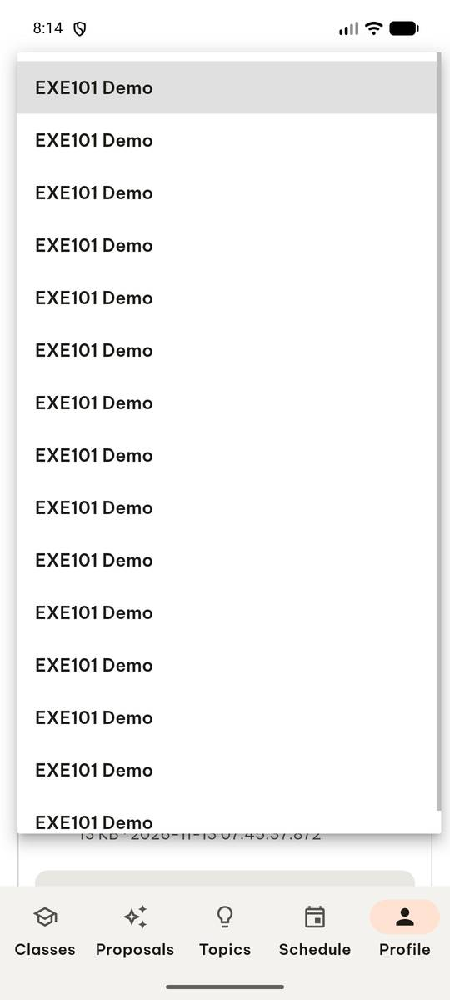 | `click` target=6 |
| 19 | 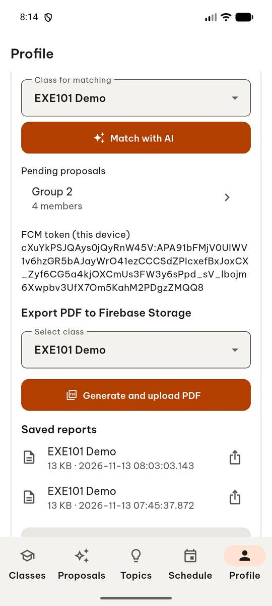 | `click` target=8 |
| 20 |  | `report_task_status` completed: {"saw_progress": true, "status_text": "Uploaded 13 KB. Opening the PDF share dialog.", "saved_reports_visible": true} |

Final screen:

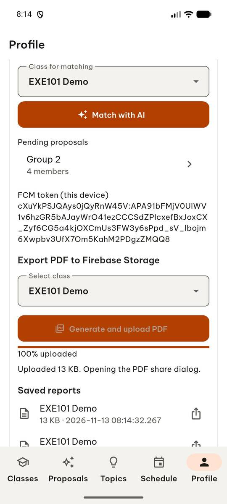
