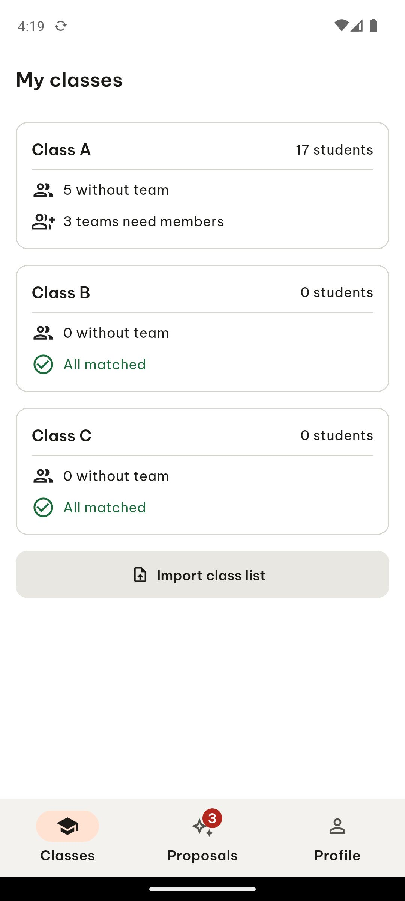
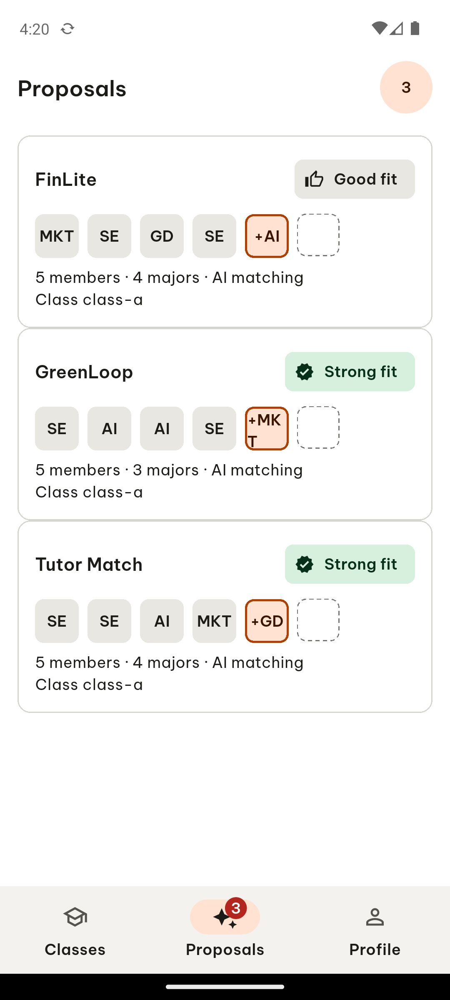
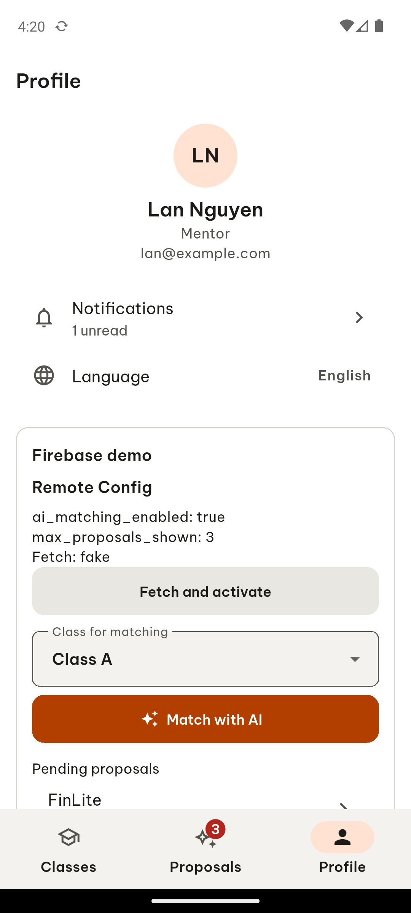

# ARTEMIS session 96f052cd-e98b-4d59-8eaf-82093aafdc3d

- **Goal**: In the TeamUp EXE app, signed in, tap the bottom navigation tab named 'Proposals' and report the screen title that appears. Then tap the tab named 'Profile' and report the screen title that appears. Then tap the tab named 'Classes' and report the screen title that appears. Report the three titles separated by commas.
- **Status**: completed
- **Steps**: 4

## Step 1

In Step 1, I tapped the 'Proposals' tab located at the bottom navigation bar marked in red; the screen transitioned to display the title 'Proposals' at the top left along with a list of proposal cards including 'FinLite', 'GreenLoop', and 'Tutor Match', while the bottom navigation bar highlighted the 'Proposals' tab with an active badge indicator showing '3'.

```json
{
  "action": "click",
  "coordinates": [
    500,
    930
  ],
  "coordinate_space": "normalized",
  "args": {
    "target": 15
  },
  "normalized_coordinates": [
    500,
    930
  ],
  "target_text": "3\nProposals\nTab 2 of 3",
  "target_bounds": [
    333,
    886,
    667,
    974
  ],
  "target_resource_id": "",
  "target_class": "android.widget.Button"
}
```





## Step 2

In Step 2, I tapped the 'Profile Tab 3 of 3' icon marked in red at the bottom right of the screen; the view transitioned to the Profile screen showing the title 'Profile' at the top left, user details for 'Lan Nguyen' with email 'lan@example.com', a 'Notifications' row with '1 unread', a 'Language' setting showing 'English', and a 'Firebase demo' section below.

```json
{
  "action": "click",
  "coordinates": [
    833,
    930
  ],
  "coordinate_space": "normalized",
  "args": {
    "target": 19
  },
  "normalized_coordinates": [
    833,
    930
  ],
  "target_text": "Profile\nTab 3 of 3",
  "target_bounds": [
    667,
    886,
    1000,
    974
  ],
  "target_resource_id": "",
  "target_class": "android.widget.Button"
}
```


## Step 3

In Step 3, I tapped the 'Classes' bottom navigation tab marked in red; the view changed to display the screen title 'My classes' at the top, presenting three class sections including 'Class A' with 17 students, 'Class B' with 0 students, and 'Class C' with 0 students, followed by an 'Import class list' button and the 'Classes' tab highlighted in the bottom navigation bar.

```json
{
  "action": "click",
  "coordinates": [
    167,
    930
  ],
  "coordinate_space": "normalized",
  "args": {
    "target": 18
  },
  "normalized_coordinates": [
    167,
    930
  ],
  "target_text": "Classes\nTab 1 of 3",
  "target_bounds": [
    0,
    886,
    333,
    974
  ],
  "target_resource_id": "",
  "target_class": "android.widget.Button"
}
```




## Step 4

```json
{
  "action": "report_task_status",
  "args": {
    "explanation": "Proposals, Profile, My classes",
    "status": "completed"
  }
}
```


