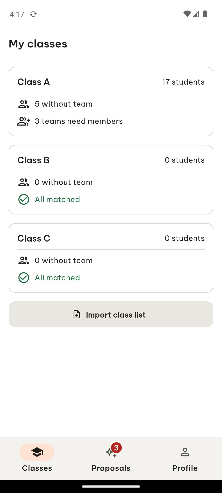

# ARTEMIS session a5cbbd37-131b-40f4-9dfd-0de881040561

- **Goal**: Open the app and report the screen title.
- **Status**: completed
- **Steps**: 1

## Step 1

```json
{
  "action": "report_task_status",
  "args": {
    "explanation": " The app is open and the screen title displayed at the top is 'My classes'.",
    "status": "completed"
  }
}
```


