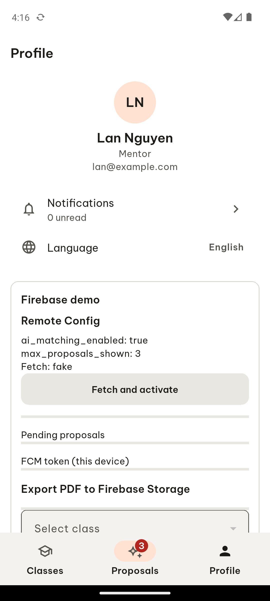
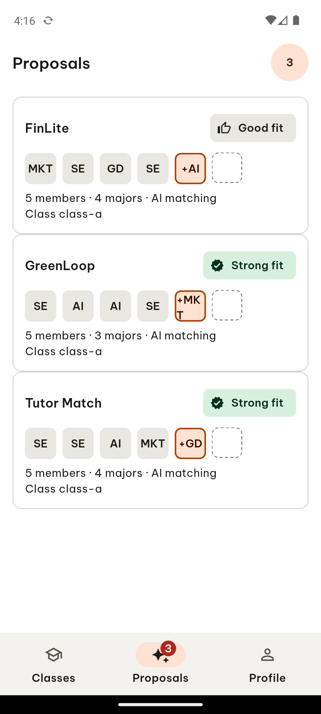
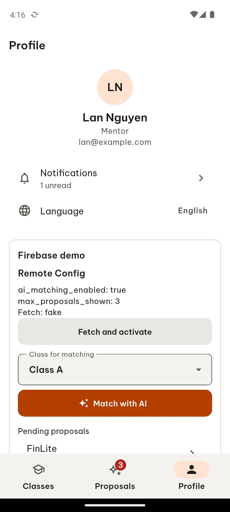
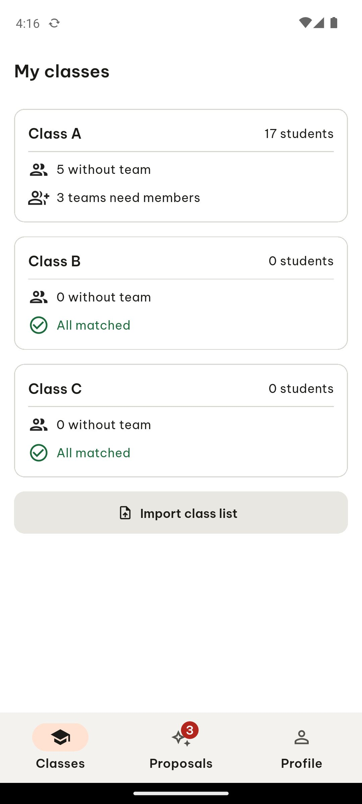

# ARTEMIS session b495eec3-ff06-485e-812c-0ee943068945

- **Goal**: In the TeamUp EXE app, signed in, tap the bottom navigation tab named 'Proposals' and report the screen title that appears. Then tap the tab named 'Profile' and report the screen title that appears. Then tap the tab named 'Classes' and report the screen title that appears. Report the three titles separated by commas.
- **Status**: completed
- **Steps**: 6

## Step 1

In Step 1, I tapped the 'Proposals' navigation tab marked with a red indicator at the bottom of the screen, which showed a notification badge with the number '3'. Following the tap, the screen remained unchanged, continuing to display the 'My classes' view with 'Class A', 'Class B', 'Class C', and the 'Import class list' button, while the 'Classes' tab remained highlighted in peach at the bottom navigation bar alongside 'Proposals' and 'Profile'.

```json
{
  "action": "click",
  "coordinates": [
    500,
    930
  ],
  "coordinate_space": "normalized",
  "args": {
    "target": 15
  },
  "normalized_coordinates": [
    500,
    930
  ],
  "target_text": "3\nProposals\nTab 2 of 3",
  "target_bounds": [
    333,
    886,
    667,
    974
  ],
  "target_resource_id": "",
  "target_class": "android.widget.Button"
}
```


## Step 2

In Step 2, I tapped the 'Profile' tab at the bottom right of the screen; the view transitioned to the Profile page showing the header 'Profile', user details for 'Lan Nguyen' with email 'lan@example.com', a 'Notifications' row showing '0 unread', a 'Language' setting set to 'English', and a 'Firebase demo' section below.

```json
{
  "action": "click",
  "coordinates": [
    833,
    930
  ],
  "coordinate_space": "normalized",
  "args": {
    "target": 19
  },
  "normalized_coordinates": [
    833,
    930
  ],
  "target_text": "Profile\nTab 3 of 3",
  "target_bounds": [
    667,
    886,
    1000,
    974
  ],
  "target_resource_id": "",
  "target_class": "android.widget.Button"
}
```


## Step 3

In Step 3, I tapped the bottom navigation tab labeled 'Proposals' with a notification badge showing '3' marked in red on the Profile screen; the view transitioned to display the 'Proposals' heading at the top left and loaded three proposal cards titled 'FinLite', 'GreenLoop', and 'Tutor Match', each indicating '5 members', 'AI matching', and fit labels like 'Good fit' or 'Strong fit'.

```json
{
  "action": "click",
  "coordinates": [
    500,
    930
  ],
  "coordinate_space": "normalized",
  "args": {
    "target": 19
  },
  "normalized_coordinates": [
    500,
    930
  ],
  "target_text": "3\nProposals\nTab 2 of 3",
  "target_bounds": [
    333,
    886,
    667,
    974
  ],
  "target_resource_id": "",
  "target_class": "android.widget.Button"
}
```




## Step 4

In Step 4, I tapped the 'Profile' tab in the bottom navigation bar marked in red; the screen transitioned to display the Profile view with the title 'Profile' at the top, showing user details for 'Lan Nguyen' with the email 'lan@example.com', a 'Notifications' section indicating 1 unread, a 'Language' setting set to 'English', a Firebase demo section with remote config details, a 'Class for matching' dropdown currently set to 'Class A', a 'Match with AI' button, and a pending proposals list at the bottom.

```json
{
  "action": "click",
  "coordinates": [
    833,
    930
  ],
  "coordinate_space": "normalized",
  "args": {
    "target": 19
  },
  "normalized_coordinates": [
    833,
    930
  ],
  "target_text": "Profile\nTab 3 of 3",
  "target_bounds": [
    667,
    886,
    1000,
    974
  ],
  "target_resource_id": "",
  "target_class": "android.widget.Button"
}
```




## Step 5

In Step 5, I tapped the 'Classes' tab at the bottom of the screen; the view transitioned to display the header title "My classes" along with sections for "Class A" showing 17 students, 5 without team, and 3 teams need members, "Class B" showing 0 students and "All matched", "Class C" showing 0 students and "All matched", and an "Import class list" button at the bottom.

```json
{
  "action": "click",
  "coordinates": [
    167,
    930
  ],
  "coordinate_space": "normalized",
  "args": {
    "target": 18
  },
  "normalized_coordinates": [
    167,
    930
  ],
  "target_text": "Classes\nTab 1 of 3",
  "target_bounds": [
    0,
    886,
    333,
    974
  ],
  "target_resource_id": "",
  "target_class": "android.widget.Button"
}
```




## Step 6

```json
{
  "action": "report_task_status",
  "args": {
    "status": "completed",
    "explanation": "The screen titles that appear when tapping the bottom navigation tabs 'Proposals', 'Profile', and 'Classes' are Proposals, Profile, and My classes respectively."
  }
}
```


