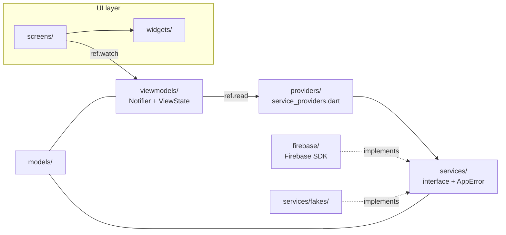
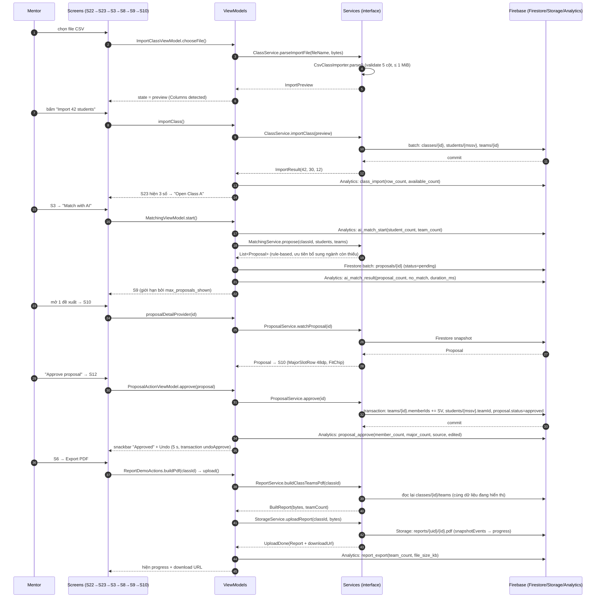

# TeamUp EXE — PRM393 Lab 3: Cloud-Enabled Mobile App

**Ngành học:** PRM393 — Mobile Programming · **Kỳ:** Lab 3 · **Nhóm:** 6
**Bài nộp:** `docs/design-traceability.md` · `docs/architecture.md` · `docs/analytics-plan.md` · `docs/test-plan.md` · `docs/code-review.md` · `docs/workflow.md`

---

## 1. Tổng quan dự án và nhắc lại Lab 2

### 1.1 Vấn đề

Mentor môn EXE (môn Cấu trúc dữ liệu & Giải thuật của FPT) mỗi học kỳ phải chia lớp
khoảng 40 sinh viên thành các nhóm **5–6 người thuộc nhiều ngành** (SE, AI, MKT, GD).
Việc này hiện làm thủ công trên bảng tính: mất hàng giờ, dễ để quá 6 người, và dễ
bỏ sót ngành trong nhóm.

### 1.2 Người dùng và tiêu chí thành công

| Vai | Ai | Dùng app ở Lab 3? |
|---|---|---|
| **Mentor / giảng viên** | Persona "Cô Lan" (P01, primary) | **Có** — người dùng duy nhất trên mobile |
| Sinh viên | Đối tượng được ghép (P02, supporting) | Không — chỉ là dữ liệu |
| Điều phối khoa | P03 (giả định ở Lab 2) | Không ở Lab 3 (dự kiến là web admin ở Final) |

Tiêu chí thành công lấy từ Lab 2 (đo được, không phải cảm tính):

1. Duyệt xong gợi ý AI cho một lớp **dưới 5 phút**.
2. Mọi nhóm sau duyệt có **5–6 người, ≥ 3 ngành**.
3. Thêm hoặc đổi một thành viên và duyệt **dưới 60 giây**.
4. **100%** sinh viên đã có nhóm không xuất hiện ở "No team" / pool AI.
5. **Không** nhóm nào vượt 6; thêm vào nhóm đầy luôn báo rõ.
6. Mọi màn tải dữ liệu có đủ 4 trạng thái; 6 dịch vụ Firebase bắt buộc đều có ca lỗi.

### 1.3 Ba workflow lõi (đặc tả đầy đủ ở `docs/workflow.md`)

| Mã & tên | Trigger | Kết quả nghiệp vụ |
|---|---|---|
| **WF-01 · Ghép nhóm cho một lớp** | Mentor bấm "Match with AI" (S3) | ≥ 1 đề xuất ở trạng thái `pending`, roster thật **chưa** đổi |
| **WF-02 · Duyệt một nhóm đề xuất** | Mentor bấm "Approve proposal" (S10 → S12) | `Proposal` → `approved`, roster nhóm 5–6 người, có Undo 5 s |
| **WF-03 · Ghép tay khi máy không ghép được** | AI không ra đề xuất (S15) | `Proposal` `source = manual`, duyệt xong như WF-02 |

### 1.4 Phạm vi Lab 3

Đề Lab 3 chấm trên **mọi màn và cả 3 flow của Lab 2**. TeamUp EXE dựng **25 màn
(S1–S25)** của Lab 2, tích hợp **6 dịch vụ Firebase bắt buộc** (thêm Firestore
làm kho dữ liệu thật), và viết **bộ test E2E bằng Google ARTEMIS**. Ba luồng
D/E/F (đề tài, lịch rảnh, họp) **không** làm ở Lab 3
vì không có trong thiết kế Lab 2 — chi tiết ở `docs/PROPOSAL.md` §9.

---

## 2. Truy vết thiết kế và các sai lệch

### 2.1 Kết quả truy vết

Bảng đầy đủ 25 màn × (route, widget, nguồn dữ liệu, trạng thái) nằm ở
`docs/design-traceability.md` §1. Tóm tắt:

| Nhóm | Số màn | Trạng thái |
|---|---|---|
| Màn nội dung Lab 2 (S1–S25) | 25 | **25/25** đã dựng, 21 `Done`, 4 `Partial` vì sai lệch đã ghi |
| Component Lab 2 → `lib/widgets/` | 18 | **18/18** có widget dùng chung |
| Flow A/B/C | 3 | **3/3** chạy hết từ đầu đến cuối, có đường lỗi |

Mỗi màn đều dùng **state model 4 trạng thái** `ViewState<T>`
(`Loading` / `Empty` / `Data<T>` / `Failure<T>`), và mỗi màn nạp dữ liệu đều có nút
"Try again" ở trạng thái lỗi.

### 2.2 Năm sai lệch đã ghi nhận (bắt buộc theo §3)

| ID | Sai lệch | Lý do | Ảnh hưởng |
|---|---|---|---|
| **D1** | S1 dùng **Google Sign-In** thay vì chỉ email không mã | Lab 3 §6 yêu cầu "Google Sign-In"; thiết kế Lab 2 chưa có bước này | Đăng nhập có thêm bước chọn tài khoản; trạng thái lỗi S19 giữ nguyên |
| **D2** | S22/S23 nhận file **CSV** thay vì `.xlsx` | Package `csv` không đọc XLSX; thêm `excel` làm app nặng, Lab 3 không yêu cầu định dạng file | Mentor lưu danh sách dưới dạng CSV; nhãn trên S22 ghi rõ định dạng |
| **D3** | Nút xác nhận ghi **"Approve"/"Discard"/"Remove"** thay vì "Confirm" | Dialog dùng chung phải nêu đúng hành động để tránh bấm nhầm | Không đổi bố cục, chỉ đổi chữ trên nút |
| **D4** | S6 Profile có thêm **khu demo Firebase** | Lab 3 §3: "Provide a Firebase demo area, usually on the Profile screen" | Profile dài hơn, chia khu bằng `ExpansionTile` |
| **D5** | S9 giới hạn số thẻ đề xuất theo Remote Config `max_proposals_shown` (mặc định 3) | Lab 3 §6 yêu cầu ≥ 2 tham số đổi hành vi hiển thị; mặc định 3 khớp thiết kế Lab 2 | Khi hạ giá trị trong Console, mentor chỉ thấy N thẻ đầu |

> Figma chưa được cập nhật cho D1–D4 — đây là **việc còn tồn** của nhóm, đã ghi
> trong cột "Đã cập nhật Figma?" của `docs/design-traceability.md` §5.

### 2.3 Design system trong code

Token nằm đúng một chỗ và được đọc qua theme, không có giá trị hard-code trong màn:

| Nhóm | Nơi lưu | Ví dụ |
|---|---|---|
| Màu | `lib/theme/app_colors.dart` → `ColorScheme` | primary `#B23E00`, error `#B3261E` |
| Chữ | `lib/theme/app_typography.dart` → `TextTheme` | `bodyMedium` 14/20, `labelLarge` 14/20 600 |
| Spacing / radius / kích thước | `lib/theme/app_spacing.dart` | `kTouchTarget = 48`, `kMajorSlotSmall = 40`, `kMajorSlotLarge = 48` |

18 component của Lab 2 được dựng thành widget dùng chung trong `lib/widgets/`
(`AppButton`, `AppCard`, `AppTextField`, `MajorSlotRow`, `FitChip`, `TagChip`,
`ErrorBanner`, `StatusView`, `showConfirmDialog`, `ProposalsBadge`, `StatTriple`,
`StudentRow`, `MajorFilterChips`, `StudentPicker`, …), mỗi widget có các trạng thái
của Lab 2 làm tham số.

`tool/check_layers.sh` chặn `Color(0x…)`, `fontSize:` và `EdgeInsets.all(<số>)`
trong `lib/screens/` — đây là cơ chế **tự động** bảo đảm "tokens come from the
theme", không chỉ là quy ước trên giấy.

### 2.4 Accessibility

Vùng chạm ≥ 48 dp (`kTouchTarget`), chữ thân bài ≥ 14 sp, không truyền thông tin chỉ
bằng màu (trạng thái "có nhóm" hiện bằng icon + nhãn), và các widget chính có
`Semantics` label (`AppButton`, `StudentRow`, `MajorSlot`, `ErrorBanner`,
`StatusView`, `ProposalsBadge`) — nhãn này vừa phục vụ người khiếm thị vừa làm
ARTEMIS đọc cây accessibility thay vì đoán từ ảnh.

---

## 3. Kiến trúc và hiện thực MVVM

### 3.1 Bốn lớp, phụ thuộc chỉ đi xuống

Bốn quy tắc bị **kiểm tự động** bằng `tool/check_layers.sh` (chạy trước mỗi PR):

| Quy tắc | Kết quả |
|---|---|
| `screens/` và `widgets/` không import Firebase SDK | ✔ |
| `viewmodels/` không import Firebase SDK | ✔ |
| `viewmodels/` không import `screens/` hay `widgets/` | ✔ |
| `screens/` không import `providers/` (chỉ qua ViewModel) | ✔ |
| `services/` và `models/` thuần Dart, không import UI | ✔ |
| Màn không hard-code màu / cỡ chữ / padding | ✔ |

> Kết quả lần chạy gần nhất: `Layers OK` — **0 vi phạm**.

### 3.2 Vì sao chọn MVVM + Riverpod 3 (Notifier viết tay)

| Quyết định | Lý do |
|---|---|
| `Notifier` viết tay thay vì `@riverpod` codegen | Không sinh code, review diff dễ, tránh phụ thuộc `build_runner` trong CI của trường |
| `ViewState<T>` sealed thay vì `AsyncValue` | Bắt buộc rõ 4 trạng thái theo rubric §10; `Empty` tách riêng khỏi `Data([])` |
| Service interface thuần Dart + fake trong `services/fakes/` | ViewModel test được với fake, không cần Firebase |
| `RuleBasedMatchingService` thay vì mô hình ML | Lab 3 §3 nói "no ML model, as in Lab 2"; thuật toán quy tắc giải thích được và test thuần Dart |
| Approve/undo bằng Firestore **transaction** | Roster là dữ liệu dùng chung; transaction chặn hai mentor duyệt trùng một sinh viên |
| Đường dẫn Storage theo user `reports/{uid}/…` | Rubric Storage: "security rules allow each user to read and write only their own folder" |

### 3.3 Sequence — Flow A đầy đủ

### 3.4 Bảng ViewModel → Service (rút gọn)

| ViewModel | Service | Nguồn thật |
|---|---|---|
| `SignInViewModel` | `AuthService`, `AnalyticsService`, `CrashService` | `FirebaseAuthService` |
| `sessionProvider` | `AuthService` | Firebase session + `users/{uid}` |
| `MyClassesViewModel` | `ClassService` | Firestore `classes` |
| `ClassDetailViewModel` | `ClassService`, `AnalyticsService` | Firestore `classes/{id}` |
| `ImportClassViewModel` | `ClassService`, `AnalyticsService`, `CrashService` | `CsvClassImporter` + Firestore batch |
| `MatchingViewModel` | `ClassService`, `MatchingService`, `ProposalService`, `AnalyticsService`, `CrashService` | Firestore + `RuleBasedMatchingService` |
| `ProposalActionViewModel` | `ProposalService`, `ClassService`, `AnalyticsService`, `CrashService` | Firestore transaction |
| `ReportDemoActions` | `ReportService`, `StorageService`, `AnalyticsService`, `CrashService` | `pdf` → Cloud Storage |
| `appConfigProvider` | `ConfigService` | Firebase Remote Config (realtime) |
| `inboxProvider` | `NotificationService`, `NotificationStore` | Firestore + FCM |
| (toàn cục) `instrumentation.dart` | `AnalyticsService`, `CrashService` | Analytics / Crashlytics |

Bảng đầy đủ 20 dòng ở `docs/architecture.md` §4.

### 3.5 Kiểm thử tự động ở tầng unit

`flutter test` chạy **145 test** (unit + widget + integration) và **145/145 pass**:

| Nhóm | Số test | Nội dung |
|---|---|---|
| `test/services/` | 60+ | `RuleBasedMatchingService` (quy tắc 5–6 người, ưu tiên ngành, loại dữ liệu mâu thuẫn), `CsvClassImporter` |
| `test/flow_a|b|c/` | 40+ | ViewModel với fake service + widget test từng màn |
| `test/firebase/` | 10+ | Stream mapping lỗi Firestore → `AppError` |
| `test/auth/`, `test/notifications/` | 30+ | Đăng nhập, định tuyến theo auth state, FCM, Remote Config |
| `test/demo/full_demo_smoke_test.dart` | 1 | Chạy trọn Flow A→B→C trên fake, từ đăng nhập tới PDF |

---

## 4. Thiết kế Firebase — 6 dịch vụ bắt buộc, mỗi dịch vụ một ca lỗi

> Đề Lab 3 §6 yêu cầu **6 dịch vụ**: Authentication · Cloud Storage · Analytics ·
> Cloud Messaging (FCM) · Crashlytics · Remote Config. Ngoài ra app dùng **Cloud
> Firestore** làm kho dữ liệu thật (yêu cầu "no hard-coded or mock data"), nên
> tổng cộng **7 dịch vụ Firebase** được tích hợp.

### 4.1 Authentication (Google Sign-In)

* **Cài đặt:** `lib/firebase/firebase_auth_service.dart`, `lib/firebase/auth_error_mapper.dart`.
* **Hành vi:** `authStateChanges` điều hướng `signed out → /sign-in`, `signed in → /classes`.
  Sign-out xoá state cục bộ (session, đề xuất, cấu hình), set Analytics user ID = null
  và Crashlytics user ID = `signed_out`.
* **Ca lỗi:** hủy đăng nhập → `CancelledError` → thông báo "Sign-in cancelled";
  mất mạng → `NetworkError`; tài khoản không hợp lệ → `AuthError` → ô viền đỏ.
  **Không** crash, **không** treo ở trạng thái loading.
* **Bằng chứng:** ảnh Console → Authentication → Users; ảnh trạng thái S19.

### 4.2 Cloud Firestore

* **Cài đặt:** `firestore_class_service.dart`, `firestore_proposal_service.dart`,
  `firestore_mentor_profile_service.dart`, `firestore_notification_store.dart`.
* **Hành vi:** đọc realtime bằng `Stream`; ghi bằng `batch` (import) hoặc
  `transaction` (duyệt/undo nhóm — chống gán trùng sinh viên).
* **Ca lỗi:** `permission-denied` → `PermissionDeniedError`, `unavailable` →
  `NetworkError`, `deadline-exceeded` → `TimeoutAppError`; tất cả đều ra
  `Failure` kèm nút "Try again".
* **Bằng chứng:** `firebase/firestore.rules` + bộ test luật
  `firebase/test/firestore.rules.test.mjs` (chạy trên Rules emulator).

### 4.3 Cloud Storage

* **Cài đặt:** `lib/firebase/firebase_storage_service.dart`,
  `lib/firebase/pdf_report_service.dart`.
* **Hành vi:** sinh PDF bằng package `pdf` từ **cùng stream Firestore mà mentor đang
  xem** (nên file phản ánh đúng màn hình), upload vào `reports/{uid}/{id}.pdf`,
  theo dõi tiến độ bằng `snapshotEvents`, hiển thị **storage path + download URL**
  (dùng `SelectableText` để copy được).
* **Ca lỗi:** upload lỗi → thông báo + Crashlytics non-fatal; mất mạng → retry.
* **Bảo mật:** `firebase/storage.rules` chỉ cho `request.auth.uid == uid` đọc/ghi
  đúng thư mục của mình, chỉ nhận `.pdf`, ≤ 5 MiB, `contentType` phải là
  `application/pdf`. **Không** dùng `allow read, write: if true`.
* **Bằng chứng:** ảnh Storage Console (danh sách file), ảnh màn hiển thị URL.

### 4.4 Cloud Messaging (FCM)

* **Cài đặt:** `lib/firebase/fcm_notification_service.dart`,
  `background_notification_handler.dart`, `firestore_notification_store.dart`.
* **Hành vi:** xin quyền thông báo trên Android 13+; token được lưu ở
  `users/{uid}/fcmTokens/{tokenId}`; thông báo nhận được lưu vào trung tâm thông
  báo trong app; chạm thông báo điều hướng theo payload `route` — **chỉ** khi
  route nằm trong allow-list `Routes.isAllowedDeepLink()` (chống deep-link tới màn
  ngoài phạm vi).
* **Ca lỗi:** người dùng từ chối quyền → hiện thông báo rõ, app vẫn chạy, các
  tính năng khác không bị chặn.
* **Bằng chứng:** ảnh nhận thông báo ở **3 trạng thái** (mở / nền / đã đóng).

### 4.5 Analytics

* **Kế hoạch:** `docs/analytics-plan.md` — 10 event, mỗi event có trigger, kiểu
  tham số, câu hỏi sản phẩm, và bước flow tương ứng.
* **Cài đặt:** `lib/firebase/firebase_analytics_service.dart`, gọi qua
  `lib/viewmodels/instrumentation.dart` (`trackAnalytics`).
* **Hành vi:** `setUserId` sau đăng nhập; mọi event **best effort** — lỗi tracking
  không bao giờ làm hỏng luồng người dùng.
* **Ca lỗi:** SDK lỗi hoặc Firebase chưa sẵn sàng → `trackAnalytics` bắt lỗi và
  bỏ qua, luồng chính vẫn hoàn tất.
* **Không dữ liệu cá nhân:** chỉ dùng MSSV, `classId`, `teamId`, `proposalId` và
  các số đếm. Không có e-mail, không có họ tên.
* **Bằng chứng:** ảnh DebugView cho **từng event** trong `evidence/analytics/`.

### 4.6 Crashlytics

* **Cài đặt:** `lib/firebase/firebase_crash_service.dart` + `lib/main.dart`.
* **Hành vi:** fatal bắt qua `FlutterError.onError` và `PlatformDispatcher.onError`;
  lỗi **đã xử lý** báo qua `recordNonFatal` từ các đường lỗi thật — import file
  sai định dạng, AI matching timeout 30 s, upload PDF lỗi, transaction cập nhật
  roster lỗi. Gắn user ID và **custom key** `role`, `class_id`.
* **Ca lỗi (bắt buộc):** 1 non-fatal từ đường lỗi thật + 1 crash thử nghiệm
  bấm ở khu demo S6.
* **Bằng chứng:** ảnh Crashlytics dashboard có cả hai loại, kèm khóa và user ID.

### 4.7 Remote Config

* **Cài đặt:** `lib/firebase/firebase_config_service.dart`,
  `lib/viewmodels/config/app_config_view_model.dart`.
* **Hai tham số đổi hành vi nhìn thấy được:**

| Tham số | Mặc định | Ảnh hưởng nhìn thấy được |
|---|---|---|
| `ai_matching_enabled` | `true` | Ẩn/hiện nút "Match with AI" ở S3, S4, S5 |
| `max_proposals_shown` | `3` | Số thẻ đề xuất hiển thị ở S9 |

* **Hành vi:** `onConfigUpdated` (realtime) → đổi giá trị trong Console **áp dụng
  ngay, không cần build lại**. Mặc định nằm trong app (`AppConfig.defaults`) và
  trong `firebase/remote-config-defaults.json` (bundle sẵn) — mất mạng thì app vẫn
  chạy với giá trị mặc định.
* **Bằng chứng:** ảnh Console giá trị + ảnh app trước/sau khi đổi.

---

## 5. Kế hoạch Analytics và bằng chứng DebugView

Kế hoạch đầy đủ ở `docs/analytics-plan.md`. Tóm tắt 10 event:

| Event | Trigger | Tham số | Câu hỏi sản phẩm |
|---|---|---|---|
| `login` | Đăng nhập thành công | `method` (string) | Mentor quay lại mỗi tuần; phương thức nào phổ biến? |
| `logout` | Bấm Sign out | — | Phiên làm việc dài bao lâu? |
| `class_import` | Import xong | `row_count`, `available_count` (int) | Mỗi lớp còn bao nhiêu SV lẻ? |
| `view_item` | Mở màn chi tiết | `item_category`, `item_id` (string) | Mentor xem gì trước khi duyệt? |
| `ai_match_start` | Bấm "Match with AI" | `student_count`, `team_count` (int) | AI được dùng ở lớp cỡ nào? |
| `ai_match_result` | Lần ghép kết thúc | `proposal_count`, `no_match`, `duration_ms` | Tỉ lệ ghép không ra kết quả? |
| `proposal_approve` | Duyệt nhóm | `member_count`, `major_count`, `source`, `edited` | Mentor duyệt nhóm AI hay tự ghép tay? |
| `proposal_discard` | Bỏ đề xuất | `source` | Đề xuất nào bị bỏ nhiều nhất? |
| `member_change_blocked` | Chạm trần 6 người | `reason` | Mentor có hay cố thêm người thứ 7 không? |
| `report_export` | PDF upload xong | `team_count`, `file_size_kb` | Sau khi duyệt, mentor có lấy báo cáo không? |

**Phễu đo được trực tiếp tiêu chí thành công của Lab 2:**
`ai_match_start` → `ai_match_result` (`no_match = 0`) → `proposal_approve`
(`major_count ≥ 3`) → `report_export`. Bước rớt nhiều nhất là bước cần sửa.

**Bằng chứng:** ảnh DebugView cho từng event, lưu ở `evidence/analytics/`;
logcat dùng cho ARTEMIS (test `TC-17` kiểm `ai_match_start` **và** `ai_match_result`
đều xuất hiện trong log).

---

## 6. Crashlytics và Remote Config — bằng chứng

| Hạng mục | Bằng chứng cần có | Nơi lưu |
|---|---|---|
| Crashlytics non-fatal (đường lỗi thật) | Ảnh dashboard, loại "Non-fatal", có khóa `role` / `class_id` | `evidence/crashlytics/` |
| Crashlytics test crash | Ảnh dashboard, loại "Fatal", có stack trace | `evidence/crashlytics/` |
| User ID trong Crashlytics | Ảnh hiển thị user ID | `evidence/crashlytics/` |
| Remote Config `ai_matching_enabled` | Ảnh Console giá trị `false` + ảnh app **không** có nút Match with AI | `evidence/remote-config/` |
| Remote Config `max_proposals_shown` | Ảnh Console giá trị `5` + ảnh app hiện 5 thẻ | `evidence/remote-config/` |
| Storage download URL | Ảnh màn S6 hiện URL + ảnh Storage Console | `evidence/storage/` |
| Authentication users | Ảnh Console → Authentication → Users | `evidence/auth/` |
| FCM 3 trạng thái | 3 ảnh: foreground, background, terminated | `evidence/fcm/` |

> Các ảnh này **phải** chụp từ project Firebase `prm-lab3-cc39e` của nhóm
> (project ID trong ảnh phải khớp `android/app/google-services.json`).

---

## 7. Kiểm thử E2E bằng Google ARTEMIS

### 7.1 Bộ test

`e2e_test/` gồm `conftest.py` (client + helper đọc giá trị) và 5 module test
(`test_auth.py`, `test_flow_a.py`, `test_flow_b.py`, `test_flow_c.py`,
`test_export_and_notifications.py`) cùng 1 phiên khám phá (`test_exploratory.py`).

| Nhóm | Số ca | Nội dung |
|---|---|---|
| Auth & tab | 4 | Sign-in (native: account picker), 3 tab, Remote Config hiện trên màn, sign-out |
| Flow A | 4 | Import CSV → kết quả import → Match with AI → chi tiết đề xuất |
| Flow B | 3 | Add member, **lỗi vượt 6**, **lỗi dưới 5** |
| Flow C | 3 | Need members, **lỗi không tìm ra SV**, Discard |
| Export / FCM / Analytics / Crash | 4 | Upload PDF có URL, thông báo (native: notification shade), logcat Analytics, crash thử (native) |
| Khám phá | 1 | Phiên 15–30 phút, Pro profile, không kịch bản |

**Tổng: 18 ca script + 1 phiên khám phá** (yêu cầu ≥ 10).

> **Trạng thái:** bộ test đã **được viết đầy đủ và kiểm tra cú pháp**, nhưng
> **chưa có lần chạy nào trên thiết bị thật**. Vì vậy bảng kết quả §7.3 ghi
> `chưa chạy` thay vì điền số — bằng chứng bịa sẽ bị trừ điểm nặng hơn là để
> trống. Việc cần làm trước khi nộp nằm ở §9.

### 7.2 Vì sao kết quả đáng tin

1. **Không kiểm `status == "SUCCESS"` một mình.** Mỗi chỉ dẫn yêu cầu agent **trả về
   giá trị** nó nhìn thấy (số thẻ đề xuất, tên nhóm, số KB, giá trị Remote Config),
   và test so sánh với giá trị mong đợi qua `Observed.number()` /
   `Observed.contains()`. Nếu agent không tìm thấy giá trị, test **fail kèm nguyên
   văn báo cáo** — đó là bằng chứng để điều tra, không phải lỗi âm thầm.
2. **Chỉ dẫn có điểm bắt đầu, bước và kết quả mong đợi** — không có câu "kiểm app
   có chạy không".
3. **Có đường lỗi thật** — 3 ca lỗi kiểm đúng thông điệp Lab 2 đã đặc tả:
   "Max 6 members", "Needs at least 5 members (now N)", "No student results".
4. **Có native interaction** — 3 ca chạm vào hệ thống Android (account picker,
   notification shade, test crash), không chỉ app.
5. **Kế hoạch chạy ≥ 3 lần mỗi ca**, báo cáo pass rate; ca flaky được giải thích
   và sửa.
6. **Semantics label** giúp agent đọc cây accessibility thay vì đoán từ ảnh.

### 7.3 Bảng kết quả

> Bảng đầy đủ (test ID, số lần chạy, pass rate, thời gian trung bình, giải thích
> ca flaky) ở `docs/test-plan.md` §6–§7. Số liệu được điền sau khi chạy thật trên
> thiết bị; mỗi lần chạy có trace/screenshot trong `evidence/artemis/`.

| Test ID | Nhóm | Loại | Pass rate | Bằng chứng |
|---|---|---|---|---|
| TC-01 | Sign-in | Native | chưa chạy | `evidence/artemis/` |
| TC-02 | 3 tab | Happy path | chưa chạy | `evidence/artemis/` |
| TC-03 | Remote Config | Happy path | chưa chạy | `evidence/artemis/` |
| TC-04 | Sign-out | Happy path | chưa chạy | `evidence/artemis/` |
| TC-05…TC-08 | Flow A | Happy path | chưa chạy | `evidence/artemis/` |
| TC-09 | Add member | Happy path | chưa chạy | `evidence/artemis/` |
| TC-10 | Vượt 6 | **Error path** | chưa chạy | `evidence/artemis/` |
| TC-11 | Dưới 5 | **Error path** | chưa chạy | `evidence/artemis/` |
| TC-12…TC-14 | Flow C | Happy + error | chưa chạy | `evidence/artemis/` |
| TC-15 | Export/upload | Happy path | chưa chạy | `evidence/artemis/` |
| TC-16 | FCM | **Native** | chưa chạy | `evidence/artemis/` |
| TC-17 | Analytics logcat | Happy path | chưa chạy | `evidence/artemis/` |
| TC-18 | Crash thử | **Native** | chưa chạy | `evidence/artemis/` |
| EX-01 | Khám phá | Exploratory | chưa chạy | `evidence/artemis/exploratory/` |

**Các kiểm thử đã chạy thật và xanh:**

| Bộ test | Lệnh | Kết quả |
|---|---|---|
| Unit / widget / integration Dart | `flutter test` | **145/145 pass** |
| Firestore Security Rules | `npx firebase-tools@15.35.0 emulators:exec --only firestore --project demo-teamup-data "node --test firestore.rules.test.mjs"` | **21/21 pass** |
| Ràng buộc kiến trúc | `bash tool/check_layers.sh` | **Layers OK** — 0 vi phạm |
| Phân tích tĩnh | `flutter analyze` | **No issues found** |

---

## 8. Rà soát mã bằng AI — phát hiện và quyết định

Bản ghi đầy đủ ở `docs/code-review.md`. Tóm tắt:

**Công cụ dùng:** Cursor Agent (Claude Opus 4.5), Claude Code trong Cursor, GitHub
Copilot Chat, GitHub Copilot Code Review (chạy trên pull request).

**8 phát hiện, thuộc 4 nhóm:** bug (CR-02, CR-04, CR-06), architecture (CR-03),
test gap (CR-01, CR-07, CR-08), maintainability (CR-05). Mỗi phát hiện gắn với
file và dòng cụ thể.

| ID | Phát hiện | Quyết định | Lý do | Commit |
|---|---|---|---|---|
| CR-01 | 5 event Analytics + `recordNonFatal` có trong interface nhưng **không có call site** | Accepted | Vi phạm §6; 0/10 event có dữ liệu trong DebugView | `1b6fea8` |
| CR-02 | `max_proposals_shown` chỉ được **in ra**, không giới hạn danh sách | Accepted | Rubric ghi rõ "Values only printed, not used" → 0 điểm | `9cf68f5` |
| CR-03 | Màn dùng `Chip`/`AlertDialog` tự chế thay vì component Lab 2 | Accepted | §10 trừ điểm "one-off widgets instead of Lab 2 components" | `000f51b` |
| CR-04 | Thiếu **download URL** ở khu demo Storage | Accepted | §6 yêu cầu "show progress and the download URL" | `7c0fc66` |
| CR-05 | `report_export.teamCount` là số bịa | **Modified** | Sửa theo gợi ý AI sẽ vi phạm luật layer (ViewModel đọc Firestore) → đổi hợp đồng interface thành `BuiltReport(bytes, teamCount)` | `1b6fea8` |
| CR-06 | Constructor gọi `Firebase*.instance` ngay khi provider được đọc | Accepted | Crash nếu Firebase chưa sẵn sàng; §6 yêu cầu xử lý lỗi bằng thông báo | `1b6fea8` |
| CR-07 | Ghi `ai_match_result` cho màn đã dispose | Accepted | Phễu DebugView lệch → kết luận sai kiểu "AI thất bại nhiều" | `1b6fea8` |
| CR-08 | Fake `watchAllPending` không sort, lệch với production | Accepted | Test xanh nhưng app sai — loại "test gap" nguy hiểm nhất | `9cf68f5` |

**4 phát hiện được sửa, mỗi cái một commit riêng có tên mã phát hiện** — yêu cầu
"≥ 3 fixes, each in a commit that names the finding ID" (§8).

---

## 9. Khó khăn gặp phải và bài học

### 9.1 Khó khăn

| Khó khăn | Cách xử lý |
|---|---|
| `Firebase*.instance` bị gọi trong constructor làm provider vỡ khi app mở sớm | Đổi sang `late final` khởi tạo lần đầu dùng (CR-06) |
| Fake khác production → test xanh nhưng app sai | Buộc fake sort theo `teamName` y hệt Firestore (CR-08) |
| `max_proposals_shown` làm smoke test chọn khác nhóm so với trước | Sửa fake + cập nhật kỳ vọng test theo hành vi mới |
| Rubric đòi tên event chuẩn của Firebase khi phù hợp | Dùng `login`, `logout`, `view_item`; các event còn lại `snake_case` |
| Figma chưa cập nhật cho 4 sai lệch D1–D4 | Ghi rõ trong `design-traceability.md` §5; cập nhật Figma trước khi nộp |
| Cloud Storage cần gói Blaze để upload | Dùng `us-central1` (trong hạn mức miễn phí) + budget alert 1 USD; gỡ thẻ hoặc hạ về Spark sau khi chấm |

### 9.2 Bài học

1. **"Khai báo trong interface" không phải "đã hiện thực".** Cả 5 event Analytics và
   `recordNonFatal` đều có trong interface từ ngày đầu, nhưng không có call site nào.
   Rubric chấm theo **hành vi quan sát được**, nên interface không thay thế cho
   wiring thật.
2. **Một tham số cấu hình chỉ có giá trị khi nó thay đổi hành vi.** In giá trị ra
   màn hình demo không đạt yêu cầu; phải nối nó vào hành vi quan sát được.
3. **Fake phải mô phỏng đúng production**, nếu không test không bảo chứng được điều
   gì — và tệ hơn: tạo cảm giác an toàn giả.
4. **Nhận xét của AI phải được kiểm lại trước khi làm.** CR-05 được **modified**
   vì sửa theo gợi ý sẽ vi phạm một quy tắc khác của §5.
5. **Quy tắc kiến trúc nên được kiểm bằng script, không bằng quy ước miệng.**
   `tool/check_layers.sh` + `flutter analyze` + `flutter test` chạy trước mỗi PR là
   lý do 0 vi phạm layer ở lần chạy cuối.

---

## 10. Công cụ AI đã dùng (công bố)

| Công cụ | Mục đích | Phần tạo ra |
|---|---|---|
| Cursor Agent (Claude Opus 4.5) | Rà soát yêu cầu Lab 3, phân tích gap giữa đề và code, viết lại code và tài liệu | Toàn bộ diff của nhánh `feature/lab3-complete-gaps` |
| Claude Code trong Cursor | Sinh `docs/*.md`, `e2e_test/*.py`, `report/`, `slides/`, commit theo mã phát hiện | `docs/`, `e2e_test/`, `report/`, `slides/` |
| GitHub Copilot Chat | Gợi ý refactor cục bộ trong `lib/viewmodels/` | Gợi ý CR-05 |
| GitHub Copilot Code Review | Rà soát pull request, sinh danh sách phát hiện | CR-01, CR-02, CR-03, CR-04, CR-06, CR-08 |
| Mermaid CLI (`mmdc`) | Vẽ sơ đồ activity / state / sequence / layer | `build/diagrams/*.svg` → nhúng vào báo cáo và slide |

Mọi phát hiện đều được kiểm lại bằng `flutter analyze`, `flutter test` (145 test) và
`tool/check_layers.sh` trước khi commit. Không có phần code nào được nộp mà
sinh viên không giải thích được.

---

## 11. Kết luận

TeamUp EXE đã hiện thực **25 màn** và **3 workflow** của Lab 2 trên Flutter +
Firebase, với:

* 6 dịch vụ Firebase bắt buộc (thêm Firestore) tích hợp thật, **mỗi dịch vụ có ca lỗi**
  và thông báo rõ ràng cho người dùng;
* kiến trúc MVVM 4 lớp được **kiểm tự động**, 0 vi phạm;
* design system Lab 2 dựng đủ 18 component dùng chung, 5 sai lệch đã ghi kèm lý do;
* 10 event Analytics có câu hỏi sản phẩm và tham số không chứa dữ liệu cá nhân;
* bộ test E2E ARTEMIS 18 ca + 1 phiên khám phá, assert trên **giá trị quan sát
  được**;
* 8 phát hiện AI code review với quyết định có lý do, 4 commit sửa truy vết được.

**Hướng tiếp theo (Final Assignment):** web admin cho vai Điều phối khoa, luồng
liên vai duyệt nhóm trên mobile → xác nhận trên web, và thay `RuleBasedMatchingService`
bằng Gemini qua Firebase AI Logic với cờ bật/tắt lấy từ Remote Config.

### Phụ lục — vị trí tài liệu

| Tài liệu | Đường dẫn |
|---|---|
| Truy vết thiết kế | `docs/design-traceability.md` |
| Kiến trúc | `docs/architecture.md` |
| Đặc tả workflow | `docs/workflow.md` |
| Kế hoạch Analytics | `docs/analytics-plan.md` |
| Kế hoạch kiểm thử | `docs/test-plan.md` |
| Rà soát mã AI | `docs/code-review.md` |
| Bộ test ARTEMIS | `e2e_test/` |
| Bằng chứng | `evidence/` |
| Slide | `slides/Lab03_<StudentID>_slides.pdf` |
