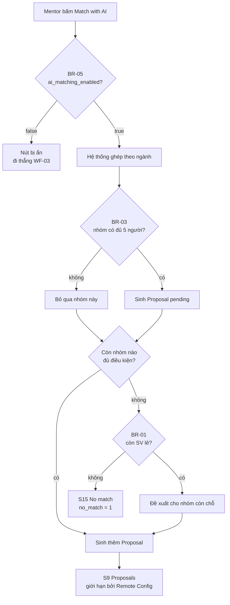
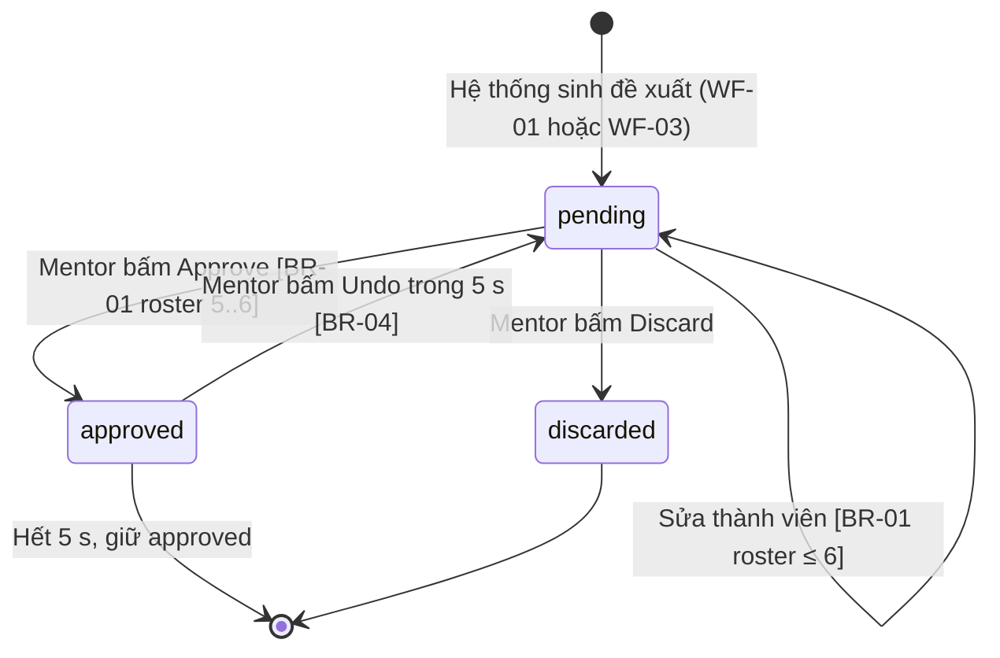
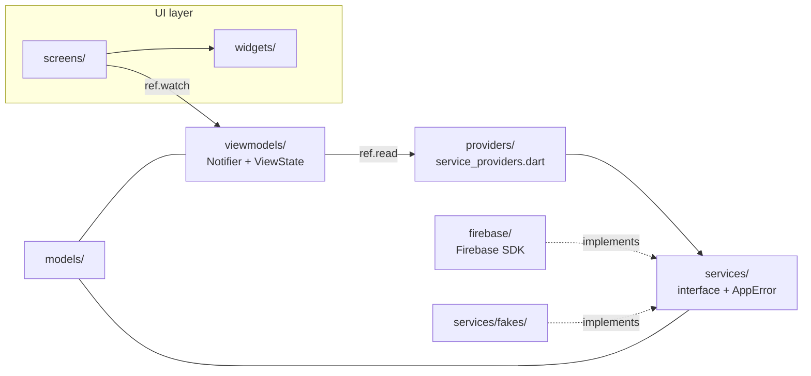
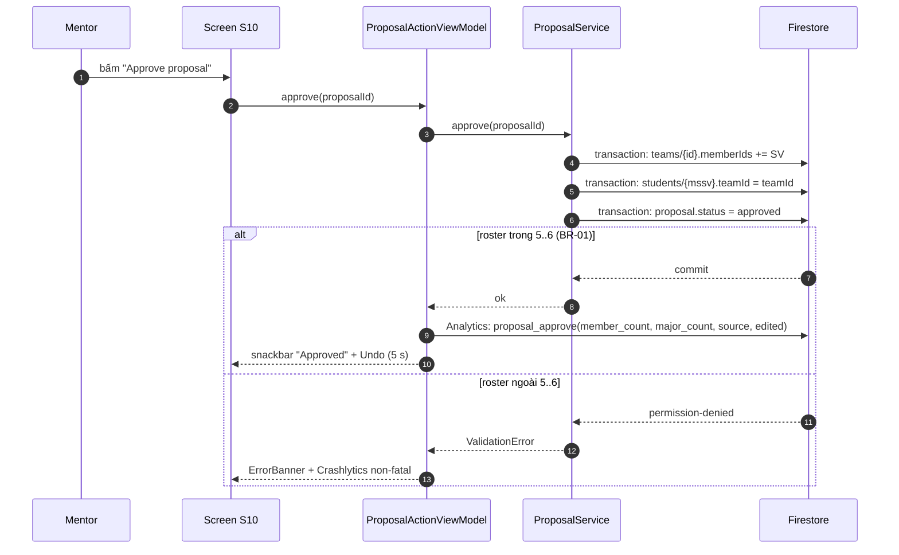

# TeamUp EXE — PRM393 Lab 3

## 01 · Overview — app Flutter + Firebase giúp mentor ghép nhóm 5–6 người đa ngành

**TeamUp EXE** · nhóm 6 · PRM393 Mobile Programming · Lab 3 · 12/11/2026

| | |
|---|---|
| **Người dùng** | Mentor / giảng viên môn EXE (persona "Cô Lan") — người dùng duy nhất trên mobile |
| **Giá trị** | Chia lớp ~40 sinh viên thành nhóm 5–6 người đa ngành (SE/AI/MKT/GD) trong một lần ghép |
| **Nền tảng** | Android · Flutter 3.47 + Material 3 · Firebase (7 dịch vụ) |
| **Bằng chứng** | App chạy thật trên máy · 145/145 test Dart · 21/21 test Firestore rules · 18 ca ARTEMIS + 1 phiên khám phá (đã viết) · 8 phát hiện AI review có 4 commit sửa |

**Tiêu chí thành công (Lab 2):** duyệt xong một lớp **< 5 phút** · mọi nhóm có **5–6 người, ≥ 3 ngành** · thêm/đổi một thành viên và duyệt **< 60 giây** · **100%** SV đã có nhóm không lọt vào pool AI · **0** nhóm vượt 6.

## 02 · Context & Problem — chia nhóm đang làm thủ công, và 3 điểm nghẽn

**Hiện trạng:** FPT University · môn EXE · mỗi học kỳ một lớp ~40 SV. Mentor xuất danh sách từ bảng điểm → xếp nhóm tay trong Excel → rà lại số người và số ngành từng nhóm. Công cụ: Excel / Google Sheets, nhắn tin Zalo, bảng ghi tay.

| Pain point | Nguyên nhân | Hậu quả đo được |
|---|---|---|
| Chia nhóm tốn thời gian | Không có công cụ gợi ý nhóm theo ngành | Mất hàng giờ mỗi kỳ, chậm khoảnh khắc bắt đầu học |
| Nhóm thiếu ngành | Chỉ chia theo số người, không theo ngành | Nhóm 5 người nhưng cùng một ngành → đề tài không đa dạng |
| Vượt 6 người / thiếu người | Không có kiểm soát số người khi thêm | Phải sửa tay sau mỗi lần thêm, dễ sót nhóm thiếu người |

**Ai chịu ảnh hưởng nhiều nhất:** mentor — toàn bộ công việc chia nhóm dồn vào một người; gián tiếp là sinh viên khi phải ngồi nhóm thiếu đa dạng.

## 03 · Proposed Solution — bản đồ pain point → tính năng → giá trị

| Pain point | Solution | Expected value |
|---|---|---|
| Chia nhóm tốn thời gian | Import danh sách lớp + **Match with AI** gợi ý nhóm theo ngành còn thiếu | Duyệt xong một lớp **< 5 phút** |
| Nhóm thiếu ngành | Mỗi đề xuất có **nhãn mức phù hợp** + lý do ("Team reaches 3 majors") + chip ô ngành | Mọi nhóm sau duyệt có **≥ 3 ngành** |
| Vượt 6 / thiếu người | Chặn ở UI **và** ở Firestore rules: "Max 6 members" / "Needs at least 5 members (now N)" | **0** nhóm vượt 6 · **100%** SV có nhóm |

**In-scope (MVP):** import danh sách · xem lớp / SV lẻ / nhóm thiếu người · ghép theo ngành · sửa & duyệt nhóm · undo · ghép tay · xuất PDF · khu demo Firebase.
**Out-of-scope (giai đoạn sau, có lý do):** đề tài nhóm (D), lịch rảnh (E), họp và biên bản (F) — **không có trong thiết kế Lab 2**, mà Lab 3 chấm đúng theo Lab 2.

## 04 · Main Actors & Main Features — 3 workflow lõi sẽ demo

| Actor | Mô tả | Quyền hạn chính |
|---|---|---|
| **Mentor (Cô Lan)** | Giảng viên môn EXE, dùng app một tay giữa giờ | Import lớp · xem & sửa nhóm **của lớp mình** · duyệt/bỏ · xuất báo cáo |
| **Hệ thống ghép** | `RuleBasedMatchingService` — thuật toán quy tắc theo ngành | Chỉ **sinh đề xuất**; tuyệt đối không đổi roster thật |
| **Sinh viên** | Đối tượng được ghép, không có tài khoản app | Không có giao diện — chỉ là dữ liệu (MSSV, tên, lớp, nhóm, ngành) |
| **Firebase** | Auth · Firestore · Storage · FCM · Analytics · Crashlytics · Remote Config | Xác thực · lưu trữ · đẩy thông báo · đo lường · cấu hình từ xa |

| WF | Trigger | Kết quả nghiệp vụ | Tính năng chính |
|---|---|---|---|
| **WF-01 · Ghép nhóm cho một lớp** | Bấm "Match with AI" (S3) | ≥ 1 đề xuất `pending`; roster thật **chưa** đổi | Import CSV · lọc SV lẻ · ưu tiên bổ sung ngành thiếu |
| **WF-02 · Duyệt một nhóm đề xuất** | Bấm "Approve proposal" (S10→S12) | Nhóm 5–6 người `approved`, có **Undo 5 s** | Thêm/bớt thành viên · chặn 6 · duyệt · undo · bỏ |
| **WF-03 · Ghép tay khi máy không ghép được** | AI không ra đề xuất (S15) | `Proposal` `source = manual`, chip "Added by you" | Xem nhóm thiếu người · tìm SV · khoá SV đã có nhóm |

## 05 · Business Flow — WF-01: ghép nhóm cho một lớp

**Kết quả:** đề xuất ở S9, mentor mở S10 để quyết định — **roster thật chưa đổi** cho tới bước 7 của WF-02.
**Ngoại lệ:** AI bị tắt (BR-05) · không nhóm nào đủ 5 người (BR-03) → S15 "No match" · mất mạng quá 30 s → S18 "Offline" + "Try again".

## 06 · State Machine & Business Rules — đối tượng nghiệp vụ `Proposal`

| Mã | Business rule | Nơi kiểm tra | Test |
|---|---|---|---|
| **BR-01** | Nhóm 5–6 người. Dưới 5 → khoá Approve (S25); trên 6 → khoá Add (S13) | `Proposal.canApprove`, `TeamRules`, `firestore.rules` | TC-10, TC-11 |
| **BR-02** | SV đã có nhóm không thêm vào nhóm khác; dòng bị khoá "In a team" | `ProposalStudentPicker`, `firestore.rules` | TC-13 |
| **BR-03** | Ghép ưu tiên bổ sung ngành còn thiếu; đủ 5 trước khi lấp chỗ thứ 6 | `RuleBasedMatchingService` | unit test |
| **BR-04** | Chưa Approve thì roster không đổi; Undo 5 s; Discard thì không đề xuất lại | `FirestoreProposalService`, `firestore.rules` | TC-08, TC-14 |
| **BR-05** | `ai_matching_enabled` bật/tắt nút "Match with AI" | `RemoteConfigService` | ảnh RC |
| **BR-06** | Import tự lọc SV đã có nhóm và nhóm đủ 6 | `CsvClassImporter` | TC-05, TC-06 |
| **BR-07** | Chỉ mentor sở hữu lớp được sửa lớp đó | `firestore.rules`, `storage.rules` | rules test |

## 07 · System Architecture & Technology Stack — 4 lớp, phụ thuộc chỉ đi xuống

| Nhóm | Công nghệ | Dùng để làm gì |
|---|---|---|
| **Mobile** | Flutter 3.47.9 · Dart 3.13.7 · Material 3 | Giao diện Android một tay, đúng design system Lab 2 |
| **State** | Riverpod 3.4.3 (`Notifier` viết tay) | 4 trạng thái rõ ràng, service inject được, test bằng fake |
| **Navigation** | go_router 18.1.3 + `StatefulShellRoute` | 3 tab, chặn route theo auth state, deep-link allow-list |
| **Cloud** | Firebase Auth · Firestore · Storage · FCM · Analytics · Crashlytics · Remote Config | **6 dịch vụ bắt buộc** (§6) + Firestore làm kho dữ liệu thật |
| **File** | `pdf` · `file_picker` · `csv` | Sinh PDF từ dữ liệu đang xem; đọc CSV import |
| **AI/Logic** | `RuleBasedMatchingService` (thuật toán quy tắc thuần Dart) | "AI" ghép theo ngành — giải thích được, test được, không cần ML |
| **Dev / Test** | Git · Figma · Copilot Code Review · `flutter_test` · Google ARTEMIS | Review truy vết + unit/widget + E2E trên thiết bị thật |

**Quyết định kiến trúc:** chỉ `lib/providers/service_providers.dart` nối interface → bản cài đặt, nên test thay fake bằng `overrideWithValue` mà không sửa ViewModel. `tool/check_layers.sh` kiểm 6 quy tắc tự động — lần chạy cuối: **Layers OK, 0 vi phạm**.

## 08 · Sequence Diagram — bên trong một lần duyệt nhóm (WF-02)

**Vì sao dùng transaction:** roster là dữ liệu dùng chung — transaction + `rosterChangeProposalId` trong rules chặn hai mentor duyệt trùng một sinh viên. Đây là một trong các ca lỗi thật được Crashlytics ghi lại.

## 09 · UI/UX Design — design system Lab 2 trong code + 5 sai lệch đã ghi

| Token | Nơi lưu | Component Lab 2 | Widget Flutter |
|---|---|---|---|
| Màu → `ColorScheme` | `lib/theme/app_colors.dart` | Nút primary/tonal/destructive | `AppButton` |
| Chữ → `TextTheme` | `lib/theme/app_typography.dart` | Thẻ / hộp nhập | `AppCard`, `AppTextField` |
| Spacing / radius / size | `lib/theme/app_spacing.dart` | Chip ngành · ô ngành | `MajorFilterChips`, `MajorSlotRow` |
| — | — | Chip mức phù hợp · tag "Added by you" | `FitChip`, `TagChip` |
| — | — | Banner lỗi · dialog xác nhận | `ErrorBanner`, `showConfirmDialog` |
| — | — | Loading / Empty / Error | `StatusView` |

**18 component dùng chung**, mỗi cái có trạng thái Lab 2 làm tham số; không có giá trị màu/cỡ chữ/padding hard-code trong màn — `check_layers.sh` chặn tự động. **Accessibility:** vùng chạm ≥ 48 dp · chữ thân bài ≥ 14 sp · không truyền thông tin chỉ bằng màu · `Semantics` label trên widget chính.

| ID | Sai lệch so với Figma | Lý do | Ảnh hưởng |
|---|---|---|---|
| **D1** | S1 dùng **Google Sign-In** thay vì chỉ email không mã | Lab 3 §6 yêu cầu Google Sign-In; Lab 2 chưa có bước này | Thêm bước chọn tài khoản; trạng thái lỗi S19 giữ nguyên |
| **D2** | S22/S23 nhận **CSV** thay vì `.xlsx` | Package `csv` không đọc XLSX; thêm `excel` làm app nặng | Mentor lưu danh sách dạng CSV; nhãn S22 ghi rõ định dạng |
| **D3** | Nút dialog ghi **"Approve"/"Discard"/"Remove"** thay vì "Confirm" | Dialog dùng chung phải nêu đúng hành động để tránh bấm nhầm | Không đổi bố cục, chỉ đổi chữ |
| **D4** | S6 có thêm **khu demo Firebase** | Lab 3 §3 bắt buộc khu demo | Profile dài hơn, chia khu bằng `ExpansionTile` |
| **D5** | S9 giới hạn số thẻ theo Remote Config `max_proposals_shown` | §6 yêu cầu ≥ 2 tham số đổi hành vi; mặc định 3 khớp Lab 2 | Hạ giá trị trong Console → mentor chỉ thấy N thẻ |

## 10 · Firebase — Authentication & Cloud Firestore

**Authentication (Google Sign-In)** — `authStateChanges` điều hướng `signed out → /sign-in`, `signed in → /classes`. Sign-out xoá state cục bộ, set Analytics user ID = null, Crashlytics user ID = `signed_out`.
*Ca lỗi:* hủy đăng nhập → "Sign-in cancelled" · mất mạng → "Network error" · email sai → ô viện đỏ (S19). **Không crash, không treo loading.**
*Bằng chứng:* ảnh Console → Authentication → Users.

**Cloud Firestore** — đọc realtime bằng `Stream`, ghi bằng `batch` (import) hoặc `transaction` (duyệt/undo). `firestore.rules` khoá theo `mentorUid`, chặn sửa `status`/`source` sau khi tạo, và chỉ cho `approve` khi roster 5–6.
*Ca lỗi:* `permission-denied` → `PermissionDeniedError` · `unavailable` → `NetworkError` · `deadline-exceeded` → `TimeoutAppError` — tất cả ra `Failure` kèm nút "Try again".
*Bằng chứng:* `firebase/firestore.rules` + bộ test luật trên Rules emulator (`firebase/test/firestore.rules.test.mjs`).

## 11 · Firebase — Cloud Storage & Cloud Messaging

**Cloud Storage** — sinh PDF bằng package `pdf` từ **cùng stream Firestore mà mentor đang xem** (nên file phản ánh đúng màn hình) → upload `reports/{uid}/{id}.pdf` → hiện **tiến độ + storage path + download URL** (copy được).
`storage.rules`: chỉ `request.auth.uid == uid` đọc/ghi thư mục của mình, chỉ nhận `.pdf`, ≤ 5 MiB, `contentType = application/pdf`. **Không** dùng `allow read, write: if true`.
*Ca lỗi:* upload lỗi → thông báo + Crashlytics non-fatal; mất mạng → retry.
*Bằng chứng:* ảnh Storage Console (danh sách file) + ảnh màn S6 hiện URL.

**Cloud Messaging (FCM)** — xin quyền thông báo Android 13+; token lưu ở `users/{uid}/fcmTokens/{tokenId}`; thông báo nhận được lưu vào **trung tâm thông báo trong app**; chạm thông báo điều hướng theo payload `route` — **chỉ** khi route nằm trong allow-list (chống deep-link tới màn ngoài phạm vi).
*Ca lỗi:* người dùng từ chối quyền → app vẫn chạy, hiện thông báo rõ, các tính năng khác không bị chặn.
*Bằng chứng:* ảnh nhận thông báo ở **3 trạng thái** — mở / nền / đã đóng.

## 12 · Firebase — Remote Config, Analytics & Crashlytics

**Remote Config — 2 tham số đổi hành vi nhìn thấy được:**

| Tham số | Mặc định | Ảnh hưởng nhìn thấy được |
|---|---|---|
| `ai_matching_enabled` | `true` | Ẩn/hiện nút "Match with AI" (S3/S4/S5) |
| `max_proposals_shown` | `3` | Số thẻ đề xuất ở S9 |

`onConfigUpdated` (realtime) → đổi giá trị trong Console **áp dụng ngay, không build lại**. Mất mạng → dùng giá trị mặc định trong app.

**Analytics — 10 event**, kế hoạch viết trước code, mỗi event có câu hỏi sản phẩm:

| Event | Tham số | Câu hỏi |
|---|---|---|
| `login` / `logout` | `method` | Mentor quay lại mỗi tuần? Phiên dài bao lâu? |
| `class_import` | `row_count`, `available_count` | Mỗi lớp còn bao nhiêu SV lẻ? |
| `view_item` | `item_category`, `item_id` | Mentor xem gì trước khi duyệt? |
| `ai_match_start` / `ai_match_result` | `student_count`, `team_count`, `proposal_count`, `no_match`, `duration_ms` | Tỉ lệ ghép không ra kết quả? |
| `proposal_approve` / `proposal_discard` / `member_change_blocked` | `member_count`, `major_count`, `source`, `edited`, `reason` | Duyệt nhóm AI hay ghép tay? Có hay cố thêm người thứ 7? |
| `report_export` | `team_count`, `file_size_kb` | Sau khi duyệt, có lấy báo cáo không? |

*Không dữ liệu cá nhân:* chỉ MSSV, `classId`, `teamId`, `proposalId` và số đếm. Tracking là **best effort** — lỗi Analytics không bao giờ làm hỏng luồng người dùng.

**Crashlytics** — fatal qua `FlutterError.onError` + `PlatformDispatcher.onError`; **non-fatal từ đường lỗi thật**: import file sai định dạng · AI timeout 30 s · upload PDF lỗi · transaction cập nhật roster lỗi. Gắn user ID + custom key `role`, `class_id`. Nút **test crash** ở khu demo S6.

## 13 · Traceability & Demo Plan — mọi màn, mọi rule, mọi test đều nối được

| Feature | Màn (UI) | Class / Service | Test |
|---|---|---|---|
| FR-02 Import danh sách lớp | S22, S23 | `ClassService` + `CsvClassImporter` | TC-05, TC-06 |
| FR-03 Xem lớp / SV chưa có nhóm | S3, S4, S7 | `ClassService` | TC-12 |
| FR-04 Duyệt / bỏ đề xuất | S9→S10→S12→S14 / S17 | `ProposalService` | TC-08, TC-14 |
| FR-05 Thêm / bớt thành viên | S11, S13, S24, S25 | `ProposalService` | TC-09, TC-10, TC-11 |
| FR-06 Undo sau khi duyệt | S14 | `ProposalService` | TC-08 |
| FR-07 Xem nhóm thiếu người | S5 | `ClassService` | TC-12 |
| FR-08 Ghép tay | S15, S16, S20, S21 | `ProposalService` | TC-13 |
| FR-10 Xuất báo cáo PDF | S6 demo | `ReportService`, `StorageService` | TC-15 |

**25/25 màn Lab 2 → route + widget + nguồn dữ liệu** (`docs/design-traceability.md` §1) · 18/18 component → widget dùng chung · 3/3 flow chạy hết có đường lỗi.

**Demo plan — 3 workflow thành một câu chuyện liền mạch:**

| # | Workflow | Dữ liệu | Kết quả mong đợi |
|---|---|---|---|
| 01 | **WF-01 · Ghép nhóm cho một lớp** | Lớp `EXE101 Demo` (12 SV, `tool/fixtures/lab3-demo.csv`) | ≥ 1 thẻ đề xuất ở tab Proposals, có chip fit và ô ngành |
| 02 | **WF-02 · Duyệt một nhóm đề xuất** | Đề xuất đầu tiên | Nhóm 5–6 người; snackbar "Approved" + Undo; badge tab giảm 1 |
| 03 | **WF-03 · Ghép tay** | Nhóm còn thiếu người | Đề xuất tay, chip "Added by you", duyệt xong |

**Thứ tự video:** đăng nhập → 3 flow (kèm đường lỗi) → xuất & upload PDF → nhận thông báo → đổi Remote Config không build lại → demo Crashlytics → chạy 1 ca ARTEMIS trên thiết bị → 1 phát hiện AI review kèm fix.

## 14 · Testing & AI Code Review — hai phần "chứng minh"

**Testing — Google ARTEMIS**

| Level | Công cụ | Số lượng | Kết quả |
|---|---|---|---|
| Unit / widget / integration | `flutter_test` | **145 test** | **145/145 pass** |
| E2E / UI | **Google ARTEMIS** (pytest) | **18 ca + 1 phiên khám phá** | bộ test đã viết; **chưa có lần chạy trên thiết bị** — bảng kết quả để trống trong `docs/test-plan.md` §6 |
| Rules test | Firestore Rules emulator | `firestore.rules.test.mjs` | **21/21 pass** |

Assert trên **giá trị agent báo lại** (`Observed.number()`, `Observed.contains()`), không chỉ `status == "SUCCESS"`; có 3 ca lỗi thật (vượt 6 · dưới 5 · không tìm ra SV) và 3 native interaction (account picker · notification shade · test crash); kế hoạch chạy mỗi ca ≥ 3 lần, trace lưu ở `evidence/artemis/`.

> **Trạng thái bằng chứng:** 145/145 test Dart và 21/21 test Firestore rules **đã chạy thật** và xanh. 18 ca ARTEMIS **đã viết nhưng chưa chạy trên thiết bị** — cần chạy và điền `docs/test-plan.md` §6 + ảnh vào `evidence/artemis/` trước khi nộp.

**AI code review — 8 phát hiện, 4 commit sửa có tên mã**

| ID | Finding | Quyết định | Lý do | Commit |
|---|---|---|---|---|
| CR-01 | 5 event Analytics + `recordNonFatal` **không có call site** | Accepted | §6 — 0/10 event có dữ liệu DebugView | `1b6fea8` |
| CR-02 | `max_proposals_shown` chỉ **in ra**, không giới hạn | Accepted | Rubric: "Values only printed, not used" | `9cf68f5` |
| CR-03 | Dùng `Chip`/`AlertDialog` tự chế thay vì component Lab 2 | Accepted | §10 trừ điểm one-off widgets | `000f51b` |
| CR-04 | Thiếu **download URL** ở khu demo Storage | Accepted | §6 yêu cầu hiện URL | `7c0fc66` |
| CR-05 | `report_export.teamCount` là số bịa | **Modified** | Sửa theo AI sẽ vi phạm luật layer → đổi interface thành `BuiltReport(bytes, teamCount)` | `1b6fea8` |
| CR-06 | Constructor gọi `Firebase*.instance` ngay | Accepted | Crash khi Firebase chưa sẵn sàng | `1b6fea8` |
| CR-07 | Ghi `ai_match_result` cho màn đã dispose | Accepted | Phễu DebugView lệch → kết luận sai | `1b6fea8` |
| CR-08 | Fake `watchAllPending` không sort, lệch production | Accepted | Test xanh nhưng app sai | `9cf68f5` |

## 15 · Achievements, Limitations & Conclusion

**Đã đạt (kèm bằng chứng):**

| Mục tiêu | Kết quả | Bằng chứng |
|---|---|---|
| 25 màn + 3 flow Lab 2, có đường lỗi | ✅ 25/25 route/state · 3/3 flow | `docs/design-traceability.md`, `e2e_test/` |
| 6 dịch vụ Firebase, mỗi dịch vụ có ca lỗi | ✅ Auth · Storage · Analytics · FCM · Crashlytics · Remote Config (+ Firestore) | `evidence/`, `docs/architecture.md` §5 |
| MVVM 4 lớp, phụ thuộc chỉ đi xuống | ✅ **0 vi phạm** / 6 quy tắc, kiểm tự động | `tool/check_layers.sh` → `Layers OK` |
| Design system Lab 2 trong code | ✅ 18 component dùng chung, token trong `ThemeData` | `docs/design-traceability.md` §3–§4 |
| Analytics ≥ 7 event, **không PII** | ✅ **10 event** có câu hỏi sản phẩm | `docs/analytics-plan.md`, DebugView |
| Remote Config ≥ 2 tham số đổi hành vi | ✅ `ai_matching_enabled` + `max_proposals_shown` | ảnh trước/sau |
| ARTEMIS ≥ 10 ca, ≥ 3 lần/ca, exploratory | ⚠️ **18 ca + 1 phiên khám phá đã viết, chưa chạy trên thiết bị** | `e2e_test/`, `docs/test-plan.md` §6 |
| AI review ≥ 5 phát hiện, ≥ 3 commit sửa | ✅ **8 phát hiện**, **4 commit** có tên mã | `docs/code-review.md` |

**Giới hạn trung thực:** ① **Figma chưa cập nhật** cho D1–D4 (đã ghi ở traceability, cần sửa trước khi nộp) — ưu tiên **Cao**; ② **18 ca ARTEMIS đã viết nhưng chưa chạy trên thiết bị** — cần chạy + chụp bằng chứng vào `evidence/artemis/` — ưu tiên **Cao**; ③ "AI" là thuật toán quy tắc, chưa dùng kỹ năng/lịch — Final thay bằng Gemini; ④ chưa có web admin và luồng liên vai — Final bổ sung; ⑤ chưa test tải 2 mentor duyệt đồng thời — thấp.

**Kết luận:** *PROBLEM SOLVED* — chia nhóm thủ công mất hàng giờ và dễ sai quy tắc 5–6 người / ≥ 3 ngành → 25 màn + 3 workflow tự động hoá, có ràng buộc ở cả UI lẫn Firestore rules. *WORKING PRODUCT* — app Flutter + Firebase chạy thật trên Android: import → ghép theo ngành → sửa & duyệt → undo → xuất PDF lên Cloud Storage. *VERIFIED RESULT* — 145/145 test Dart · 21/21 test Firestore rules · 18 ca ARTEMIS + 1 phiên khám phá (đã viết, cần chạy) · 8 phát hiện AI review có 4 commit sửa · 6 dịch vụ Firebase có ca lỗi.

**Repo:** `github.com/no-solace/prm-teamup-mobile` · **Figma:** file Lab 2 Final UI · **Video demo:** 5–10 phút (link trong README). **Hướng tiếp:** web admin cho Điều phối khoa, luồng duyệt mobile → web, và Gemini thay thuật toán quy tắc — giữ nguyên interface `MatchingService`/`ProposalService`.

---

# Phụ lục — slide dự phòng (không trình bày, mở khi bị hỏi)

## A1 · Đặc tả workflow đầy đủ — 7 thành phần

| Trường | WF-01 · Ghép nhóm cho một lớp | WF-02 · Duyệt một nhóm đề xuất | WF-03 · Ghép tay khi máy không ghép được |
|---|---|---|---|
| **Actor** | Mentor, Hệ thống ghép | Mentor, Firestore | Mentor, Firestore |
| **Trigger** | Bấm "Match with AI" (S3) | Bấm "Approve proposal" (S10→S12) | AI không ra đề xuất (S15) |
| **Precondition** | Lớp đã import; `ai_matching_enabled = true` | `status = pending`; roster 5–6 | Lớp đã import; có nhóm < 5 người |
| **Kết quả** | ≥ 1 `Proposal` `pending`; roster **chưa** đổi | `approved`; roster 5–6; Undo 5 s | `Proposal` `source = manual` → chip "Added by you" |
| **Exception** | AI tắt · thiếu người đủ 5 · mất mạng 30 s | Dưới 5 (S25) · vượt 6 (S13) · transaction lỗi | SV đã có nhóm · không tìm ra SV (S21) · Discard |
| **BR** | BR-03, BR-05 | BR-01, BR-04 | BR-01, BR-02, BR-04 |
| **Truy vết** | FR-02/03/08 → UI-03,08,09,15,18 → TC-05..08, TC-17 | FR-04/05/06 → UI-09..14,24,25 → TC-08..11,14 | FR-07/08/09 → UI-05,15,16,20,21 → TC-12..14 |

## A2 · Analytics — vị trí gọi event trong mã nguồn

| Event | Nơi gọi | Ghi chú |
|---|---|---|
| `login` | `viewmodels/auth/sign_in_view_model.dart` | Sau khi có `AppUser` |
| `logout` | `viewmodels/auth/session_view_model.dart` | Khi session bị xoá |
| `class_import` | `viewmodels/classes/import_class_view_model.dart` | Sau khi Firestore ghi xong |
| `view_item` | `class_detail_view_model.dart` · `student_detail_view_model.dart` · `proposal_view_model.dart` | Mỗi lần mở 1 event; proposal có cờ chống ghi lặp |
| `ai_match_start` / `ai_match_result` | `viewmodels/classes/matching_view_model.dart` | `ai_match_result` chỉ ghi khi màn còn hiển thị |
| `proposal_approve` / `proposal_discard` / `member_change_blocked` | `viewmodels/proposals/proposal_view_model.dart` | Sau transaction thành công |
| `report_export` | `viewmodels/profile/report_demo_view_model.dart` | Dùng `teamCount` của file vừa sinh |

Tất cả gọi qua `lib/viewmodels/instrumentation.dart` (`trackAnalytics`) — bọc try/catch để lỗi tracking không làm hỏng luồng chính.

## A3 · AI code review — chi tiết 8 phát hiện

| ID | Tool | File:line | Kind | Finding | Decision | Reason | Commit |
|---|---|---|---|---|---|---|---|
| CR-01 | Copilot Code Review | `matching_view_model.dart:40` | Test gap | 5 event Analytics + `recordNonFatal` không có call site | Accepted | §6; 0/10 event có dữ liệu DebugView | `1b6fea8` |
| CR-02 | Copilot Code Review | `proposals_screen.dart:16` | Bug | `max_proposals_shown` chỉ in ra, không giới hạn | Accepted | Rubric: "Values only printed, not used" | `9cf68f5` |
| CR-03 | Copilot Code Review | `proposal_detail_screen.dart:20` | Architecture | Dùng `Chip`/`AlertDialog` tự chế thay vì component Lab 2 | Accepted | §10 trừ điểm one-off widgets | `000f51b` |
| CR-04 | Copilot Code Review | `report_demo_panel.dart:120` | Bug | Thiếu download URL | Accepted | §6 yêu cầu hiện URL | `7c0fc66` |
| CR-05 | Copilot Chat | `report_service.dart:4` | Maintainability | `report_export.teamCount` là số bịa | **Modified** | Sửa theo AI sẽ vi phạm luật layer → đổi interface thành `BuiltReport(bytes, teamCount)` | `1b6fea8` |
| CR-06 | Copilot Code Review | `firebase_analytics_service.dart:10` | Reliability | Constructor gọi `Firebase*.instance` ngay | Accepted | Crash khi Firebase chưa sẵn sàng | `1b6fea8` |
| CR-07 | Copilot Code Review | `matching_view_model.dart:57` | Test gap | Ghi `ai_match_result` cho màn đã dispose | Accepted | Phễu DebugView lệch | `1b6fea8` |
| CR-08 | Copilot Code Review | `fake_proposal_service.dart:70` | Test gap | Fake không sort, lệch production | Accepted | Test xanh nhưng app sai | `9cf68f5` |

## A4 · Công cụ AI đã dùng (công bố)

| Công cụ | Mục đích | Phần tạo ra |
|---|---|---|
| Cursor Agent (Claude Opus 4.5) | Rà soát yêu cầu Lab 3, phân tích gap, viết lại code | Toàn bộ diff nhánh `feature/lab3-complete-gaps` |
| Claude Code trong Cursor | Sinh `docs/`, `e2e_test/`, `report/`, `slides/`, commit theo mã phát hiện | `docs/`, `e2e_test/`, `report/`, `slides/` |
| GitHub Copilot Chat | Gợi ý refactor trong `lib/viewmodels/` | Gợi ý CR-05 |
| GitHub Copilot Code Review | Rà soát pull request | CR-01, 02, 03, 04, 06, 08 |
| Mermaid CLI (`mmdc`) | Vẽ sơ đồ activity / state / sequence / layer | `build/diagrams/*.svg` |

Mọi phát hiện đều được kiểm lại bằng `flutter analyze`, `flutter test` (145 test) và `tool/check_layers.sh` trước khi commit.
